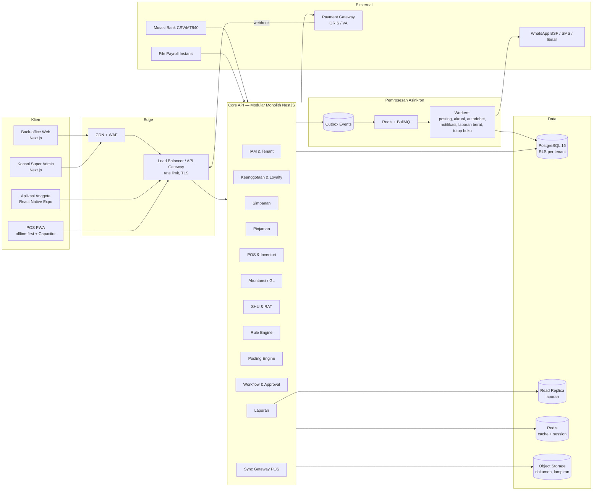

# 01 — Ringkasan Analisa Kebutuhan & Tech Stack

[← Kembali ke daftar isi](./README.md)

---

## 1. Latar Belakang

1. **Skala pasar besar dan sedang tumbuh.** Kementerian Koperasi mencatat ±224 ribu koperasi per Juli 2026,
   dengan Koperasi Desa/Kelurahan Merah Putih (KDKMP) sebagai jenis terbanyak. Puluhan ribu KDKMP telah terbentuk
   dan sekitar 10 ribu unit sudah beroperasi per Oktober 2026, dengan target pemerintah jauh lebih besar.
   Sebagian besar koperasi baru ini belum punya sistem pembukuan yang memadai.
2. **Kewajiban standar akuntansi.** Permenkop UKM No. 2 Tahun 2024 tentang Kebijakan Akuntansi Koperasi
   mewajibkan KSP/USP dan KSPPS/USPPS menerapkan kebijakan akuntansi berbasis **SAK EP** paling lambat tahun buku 2025.
   Koperasi sektor riil memakai SAK yang ditetapkan pembina sektornya, atau SAK Indonesia/SAK EP/SAK EMKM.
3. **Aturan tiap koperasi berbeda dan berubah.** Besaran simpanan pokok/wajib, plafon pinjaman, metode bunga, denda,
   pembagian SHU, harga anggota, dan program poin ditentukan AD/ART dan keputusan RAT masing-masing koperasi.
   Selain itu, revisi UU No. 25/1992 masih dibahas di DPR per pertengahan 2026. Sistem harus bisa mengikuti
   perubahan aturan **tanpa perubahan kode**.
4. **Fragmentasi aplikasi.** Koperasi multi-usaha (toko + simpan pinjam + jasa) umumnya memakai aplikasi kasir
   terpisah dari aplikasi simpan pinjam, dan pembukuan dikerjakan ulang di Excel. Data belanja anggota tidak
   tersambung ke perhitungan SHU jasa usaha.

## 2. Pernyataan Masalah

| # | Masalah | Dampak | Jawaban platform |
|---|---|---|---|
| P1 | Transaksi kasir, teller, dan pembukuan dicatat terpisah | Input ganda, selisih saldo, laporan terlambat | Posting Engine: setiap transaksi otomatis menjadi jurnal |
| P2 | Saldo simpanan per anggota tidak cocok dengan buku besar | Kepercayaan anggota turun, temuan audit | Buku pembantu terikat akun kontrol + rekonsiliasi otomatis |
| P3 | Penyusunan laporan untuk RAT dan SHU manual | Berminggu-minggu, rawan salah | Laporan SAK EP real-time, kalkulator SHU dari data transaksi |
| P4 | Aturan koperasi berbeda-beda, vendor harus mengubah kode | Mahal, lambat, tidak fleksibel | Rule Engine no-code, terversi, dapat disimulasikan |
| P5 | Internet di desa tidak stabil | Kasir berhenti saat koneksi putus | POS offline-first dengan sinkronisasi aman |
| P6 | Belanja anggota tidak tercatat per anggota | Jasa usaha SHU tidak adil/tidak bisa dihitung | Identifikasi anggota di POS (QR), transaksi tersimpan per anggota |
| P7 | Pinjaman macet tidak terpantau | NPL tinggi, cadangan tidak cukup | Kolektibilitas harian, CKPN otomatis, pengingat angsuran |
| P8 | Data pribadi anggota (NIK, KK) tersebar di Excel | Risiko pelanggaran UU PDP | Enkripsi field, RBAC, audit trail, consent |
| P9 | Biaya sistem per koperasi mahal (server sendiri) | Koperasi kecil tidak mampu | SaaS multi-tenant, biaya berbagi infrastruktur |

## 3. Visi, Tujuan & Metrik Keberhasilan

**Visi produk:** *Satu platform tempat koperasi menjalankan seluruh usaha dan menghasilkan laporan keuangan
standar secara otomatis, dengan aturan yang dikendalikan koperasi sendiri.*

| Tujuan | Metrik (KPI) | Target 12 bulan setelah go-live |
|---|---|---|
| G1. Laporan keuangan cepat dan akurat | Waktu dari akhir bulan sampai laporan bulanan final | ≤ 1 hari kerja (sebelumnya umumnya 7–30 hari) |
| G2. Semua transaksi terjurnal | % transaksi operasional yang terjurnal otomatis | ≥ 99% (sisanya antrean posting gagal yang diselesaikan ≤ 1 hari) |
| G3. Integritas buku pembantu | Selisih buku pembantu vs akun kontrol | Rp 0 pada setiap tutup buku |
| G4. Kustomisasi tanpa vendor | % perubahan aturan koperasi yang dikerjakan sendiri via Rule Engine | ≥ 90% |
| G5. Operasional kasir lancar | Waktu checkout rata-rata (scan 5 item + bayar tunai) | ≤ 30 detik; tetap berjalan saat offline |
| G6. Onboarding cepat | Waktu dari daftar sampai transaksi pertama | ≤ 1 hari (dengan template COA & rule pack) |
| G7. Kualitas pinjaman terpantau | Pinjaman dengan kolektibilitas & CKPN terbarui harian | 100% |
| G8. Adopsi anggota | % anggota aktif yang memakai aplikasi anggota / kartu QR | ≥ 40% |
| G9. Keandalan | Ketersediaan layanan bulanan | ≥ 99,5% (MVP), ≥ 99,9% (tahun ke-2) |

## 4. Stakeholder & Persona

### 4.1 Peran Pengguna

| Peran | Lingkup tenant | Kebutuhan utama |
|---|---|---|
| Super Admin Platform | Lintas tenant | Onboarding tenant, paket langganan, template COA & rule pack, monitoring |
| Admin Tenant / Manajer | Satu koperasi | Konfigurasi, pengguna, operasional harian, persetujuan |
| Ketua / Sekretaris | Satu koperasi | Persetujuan anggota & pinjaman besar, persetujuan rule AD/ART, laporan RAT |
| Bendahara | Satu koperasi | Kas & bank, persetujuan pengeluaran, posisi keuangan |
| Pengawas | Read-only + catatan | Memeriksa laporan, audit trail, temuan |
| Akuntan / Staf Keuangan | Satu koperasi | Jurnal, template posting, rekonsiliasi, tutup buku, laporan |
| Teller Simpan Pinjam | Kantor/cabang | Setoran, penarikan, angsuran, pencairan |
| Analis/Komite Kredit | Satu koperasi | Menilai & menyetujui pinjaman |
| Kasir Toko | Gerai | Transaksi POS, shift kasir |
| Staf Gudang/Pembelian | Gudang/gerai | PO, penerimaan barang, stok opname |
| Petugas Lapangan/Kolektor | Wilayah | Penagihan angsuran & simpanan wajib di lapangan |
| Anggota | Data diri sendiri | Cek saldo, ajukan pinjaman, kartu QR, poin, SHU |
| Pelanggan non-anggota | Data diri sendiri | Poin belanja (opsional) |
| Auditor eksternal | Read-only, terbatas waktu | Akses laporan & bukti untuk audit |

### 4.2 Persona Kunci

| Persona | Konteks | Tujuan | Frustrasi saat ini |
|---|---|---|---|
| **Bu Sri, 45** — Bendahara Kopdes | Desa di Jawa Tengah, 400 anggota, gerai sembako + simpan pinjam, sinyal sering hilang | Laporan rapi untuk RAT dan dinas, kas tidak selisih | Mencatat di buku dan Excel, tidak paham debit-kredit secara mendalam |
| **Pak Andi, 38** — Manajer Koperasi Karyawan | Pabrik 2.500 karyawan; toko + pinjaman potong gaji | Potong gaji otomatis tiap bulan, plafon pinjaman sesuai aturan pengurus | Tiap pengurus baru mengubah aturan, vendor minta biaya ubah aplikasi |
| **Rina, 24** — Kasir Toko | Minimarket koperasi, 300 transaksi/hari | Kasir cepat, struk tercetak, tutup shift tanpa selisih | Harus menulis manual nama anggota untuk belanja kredit |
| **Pak Budi, 52** — Anggota Petani | HP Android entry-level | Tahu saldo simpanan, sisa pinjaman, perkiraan SHU | Harus datang ke kantor untuk cek saldo |
| **Dewi, 30** — Akuntan Freelance | Memegang pembukuan 6 koperasi | Satu login untuk banyak koperasi, laporan SAK EP siap | Format tiap koperasi berbeda, rekonsiliasi lama |

> Persona Dewi menunjukkan kebutuhan **satu pengguna dapat mengakses beberapa tenant** (dengan peran berbeda di tiap tenant).

## 5. Segmentasi Tenant Sasaran

| Segmen | Unit usaha khas | Kebutuhan spesifik |
|---|---|---|
| Koperasi Konsumen / Karyawan | Toko/minimarket, simpan pinjam, kredit barang | Potong gaji per instansi/departemen, kredit belanja anggota |
| KSP / USP (konvensional) | Simpanan, pinjaman | SAK EP wajib, kolektibilitas, CKPN, simpanan berjangka |
| Koperasi Serba Usaha (KSU) | Toko, simpan pinjam, jasa, penjualan hasil produksi anggota | Multi unit usaha, laporan per unit, konsinyasi |
| Koperasi Desa/Kelurahan Merah Putih | Gerai sembako, simpan pinjam, apotek/klinik desa, logistik, cold storage | Offline-first, perangkat murah, operator awam akuntansi, pelaporan ke pembina |
| Koperasi Produsen (tani, nelayan, susu) | Pembelian hasil anggota, penjualan, saprodi | Pembelian dari anggota sebagai jasa usaha SHU (fase lanjut) |
| KSPPS (syariah) | Akad murabahah, mudharabah, dsb. | **Fase lanjut** (lihat Ruang Lingkup) |

## 6. Ruang Lingkup

### 6.1 Dalam Lingkup (versi 1)

- Platform SaaS multi-tenant: onboarding, paket, isolasi data, template COA & rule pack.
- IAM: pengguna, RBAC + lingkup cabang/unit, 2FA, maker-checker, audit trail.
- Keanggotaan: registrasi, persetujuan, kartu QR, siklus status, keluar anggota, kelompok, tier.
- Loyalty: poin, penukaran, kedaluwarsa, tier.
- Simpanan: pokok, wajib, sukarela, berjangka, khusus; teller; potong gaji; jasa simpanan.
- Pinjaman konvensional: produk, pengajuan, kelayakan, persetujuan berjenjang, akad, pencairan, angsuran, denda,
  kolektibilitas, CKPN, restrukturisasi, hapus buku.
- POS & inventori: kasir offline-first, multi pembayaran, shift, retur, pembelian, stok, opname, konsinyasi.
- Akuntansi: COA standar, jurnal umum & otomatis, buku besar, buku pembantu, kas & bank, rekonsiliasi bank,
  aset tetap, laporan SAK EP, tutup buku bulanan & tahunan, anggaran, pajak (konfigurasi & rekap).
- SHU & RAT: alokasi SHU, perhitungan per anggota, distribusi, paket laporan RAT.
- Rule Engine: parameter, formula, tabel keputusan, ECA, workflow persetujuan, template posting; versi & simulasi.
- Aplikasi anggota (Android/iOS), notifikasi WhatsApp/email, payment gateway (QRIS/VA).

### 6.2 Di Luar Lingkup (versi 1) — kandidat fase berikutnya

| Item | Alasan / Rencana |
|---|---|
| Akad syariah lengkap (KSPPS) | Butuh fatwa DSN-MUI & kebijakan akuntansi syariah (PSAK syariah); arsitektur & COA disiapkan agar dapat ditambahkan |
| Payroll/HR lengkap untuk karyawan koperasi | Cukup jurnal gaji & integrasi file; payroll penuh di luar fokus |
| e-RAT (voting digital) | P2, setelah adopsi aplikasi anggota tinggi |
| Marketplace antar koperasi / B2B | Fase lanjut |
| Produksi/manufaktur (BOM) | Fase lanjut untuk koperasi produsen |
| Integrasi langsung ke sistem pemerintah (mis. Simkopdes, ODS) | Dijajaki bila API resmi tersedia; v1 menyediakan ekspor data terstruktur |
| Multi mata uang | Seluruh transaksi dalam IDR |
| Koperasi *open loop* (melayani non-anggota, di bawah pengawasan OJK sesuai UU P2SK) | Butuh kepatuhan sektor jasa keuangan tambahan; v1 fokus koperasi *closed loop* |

## 7. Analisa Kebutuhan

### 7.1 Kebutuhan Fungsional Inti (ringkas)

Rincian lengkap ada di [02 — Daftar Fitur](./02-daftar-fitur.md). Kebutuhan yang paling menentukan arsitektur:

1. **Integrasi penuh antar modul** — satu identitas anggota dipakai di POS, simpanan, pinjaman, loyalty, SHU.
2. **Jurnal otomatis** — setiap event bisnis yang berdampak keuangan membentuk jurnal seimbang, terlacak ke dokumen sumber.
3. **Pemisahan partisipasi anggota vs non-anggota** — pendapatan & HPP dari anggota dicatat terpisah dari non-anggota
   karena penyajian Laporan Hasil Usaha koperasi dan dasar SHU jasa usaha.
4. **Aturan dapat dikustom per tenant** — dengan versi, tanggal berlaku, persetujuan, simulasi, dan jejak keputusan.
5. **Offline-first di kasir** — transaksi tetap berjalan tanpa internet, lalu tersinkron tanpa duplikasi.
6. **Laporan berstandar** — susunan laporan mengikuti SAK EP dan lampiran Permenkop 2/2024, tetap konsisten meskipun
   tenant menambah sub-akun sendiri.

### 7.2 Matriks Integrasi Antar Modul

| Dari → Ke | Keanggotaan | Simpanan | Pinjaman | POS | Loyalty | Akuntansi | SHU |
|---|---|---|---|---|---|---|---|
| **Keanggotaan** | — | Buka rekening pokok/wajib saat aktif | Data kelayakan (masa anggota, status) | Harga anggota, limit kredit | Akun poin, tier | Buku pembantu per anggota | Daftar penerima SHU |
| **Simpanan** | Profil 360° | — | Plafon = f(simpanan); autodebet angsuran | Bayar pakai saldo sukarela | Poin untuk setoran tepat waktu (opsional) | Jurnal setor/tarik/jasa | Dasar jasa modal |
| **Pinjaman** | Status tunggakan | Pencairan ke rekening sukarela | — | Kredit barang (cicilan) | — | Jurnal pencairan/angsuran/CKPN | Jasa pinjaman = dasar jasa usaha |
| **POS** | Riwayat belanja | Debet saldo | Piutang kredit barang | — | Earn & redeem poin | Jurnal penjualan, HPP, kas, piutang | Belanja anggota = dasar jasa usaha |
| **Loyalty** | Tier | — | — | Diskon tier, bayar poin | — | Liabilitas program poin | — |
| **Akuntansi** | — | — | — | — | — | — | SHU tahun berjalan |
| **SHU** | Riwayat SHU | Pembayaran SHU ke sukarela | — | — | — | Jurnal pembagian SHU & dana-dana | — |

### 7.3 Analisa Regulasi & Standar

| Regulasi / Standar | Implikasi pada produk |
|---|---|
| UU No. 25/1992 tentang Perkoperasian (masih berlaku; revisi sedang dibahas DPR per 2026) | Modal sendiri = simpanan pokok, simpanan wajib, dana cadangan, hibah → simpanan pokok & wajib dicatat sebagai **ekuitas**. SHU dibagi sesuai jasa anggota dan keputusan rapat anggota. Struktur organ: rapat anggota, pengurus, pengawas. Karena revisi UU belum final, aturan dan template laporan harus **berversi dan dapat diganti** |
| Permenkop UKM No. 2/2024 — Kebijakan Akuntansi Koperasi | Template COA & laporan default mengacu lampiran peraturan; KSP/USP & KSPPS wajib SAK EP (paling lambat tahun buku 2025); sektor riil dapat memilih kerangka (pengaturan per tenant) |
| SAK EP (IAI, efektif 1 Jan 2025) | Basis akrual, laporan: posisi keuangan, laba rugi (hasil usaha), perubahan ekuitas, arus kas, catatan atas laporan keuangan; penurunan nilai piutang; pengakuan pendapatan |
| UU No. 4/2023 (P2SK) | Koperasi simpan pinjam *open loop* masuk pengawasan OJK; v1 menandai tenant sebagai *closed loop* dan membatasi pinjaman hanya untuk anggota/calon anggota |
| UU No. 27/2022 (Pelindungan Data Pribadi) | Consent, tujuan pemrosesan, hak subjek data (akses, koreksi, hapus, portabilitas), notifikasi kegagalan pelindungan data maks. 3×24 jam, enkripsi, minimisasi data, pencatatan aktivitas pemrosesan |
| PP No. 71/2019 (PSTE) | Pendaftaran sebagai Penyelenggara Sistem Elektronik lingkup privat; keandalan & keamanan sistem |
| UU No. 8/1997 (Dokumen Perusahaan) & ketentuan perpajakan | Retensi catatan keuangan & dokumen pendukung **10 tahun** → arsip jurnal & lampiran tidak boleh dihapus |
| Perpajakan (PPh Final UMKM, PPh final bunga simpanan, PPN bila PKP, PPh 21/23, Coretax DJP) | Kode pajak, tarif, dan ambang dikonfigurasi lewat rule (berversi); rekap pajak & ekspor; **tarif tidak di-hardcode** |
| Standar QRIS (Bank Indonesia) | Pembayaran QRIS melalui Penyedia Jasa Pembayaran (payment gateway) berizin; rekonsiliasi settlement & MDR |

> **Catatan:** Tidak ada satu penomoran COA yang diwajibkan secara hukum untuk semua koperasi. Platform menetapkan
> **Bagan Akun Standar Platform** yang mengikuti konvensi umum di Indonesia (1 Aset, 2 Liabilitas, 3 Ekuitas, dst.)
> dan memetakan setiap akun ke **pos laporan** standar. Detail di [04 — Bagan Akun & Posting](./04-bagan-akun-dan-posting.md).

### 7.4 Analisa Multi-Tenant

**Karakteristik beban:** sangat banyak tenant kecil (ratusan anggota) dan sedikit tenant besar (puluhan ribu anggota).
Anggaran koperasi kecil terbatas sehingga biaya per tenant harus rendah. Data keuangan bersifat sensitif sehingga
kebocoran lintas tenant tidak dapat ditoleransi.

| Model | Deskripsi | Kelebihan | Kekurangan | Keputusan |
|---|---|---|---|---|
| **Pool** — shared DB, shared schema, kolom `tenant_id` + RLS | Semua tenant di tabel yang sama | Biaya terendah, migrasi sekali, mudah skala ke puluhan ribu tenant | Butuh disiplin isolasi; *noisy neighbor* | **Default** |
| **Bridge** — shared DB, schema per tenant | Satu schema PostgreSQL per tenant | Isolasi lebih kuat | Migrasi ribuan schema lambat; katalog DB membengkak | Tidak dipakai |
| **Silo** — DB per tenant | Database terpisah | Isolasi & kinerja penuh, cocok tenant besar/regulasi khusus | Mahal, operasional rumit | **Opsi paket Enterprise** melalui *tenant routing* |

**Kontrol isolasi wajib:**

1. Setiap tabel milik tenant memiliki `tenant_id NOT NULL`; indeks komposit diawali `tenant_id`.
2. PostgreSQL **Row Level Security** aktif di semua tabel tenant. Aplikasi memakai role DB tanpa `BYPASSRLS`.
   Tenant di-set per transaksi: `SET LOCAL app.tenant_id = '<uuid>'`.
3. Tenant context diturunkan dari token/subdomain di middleware, **tidak pernah** dari parameter body.
4. *Test suite* negatif otomatis: setiap endpoint diuji tidak dapat membaca/menulis data tenant lain.
5. Cache, antrean job, file storage, dan log selalu diberi prefix `tenant_id`.
6. *Fair scheduling* job per tenant (batas konkurensi per tenant) untuk mencegah *noisy neighbor* saat akhir bulan.
7. Akses Super Admin ke data tenant hanya via impersonasi yang disetujui tenant, terbatas waktu, dan diaudit.

**Asumsi skala (untuk desain kapasitas):** 1.000 tenant di tahun pertama, 10.000 tenant di tahun ke-3; median
300 anggota per tenant, tenant terbesar 50.000 anggota; 1–10 terminal POS per tenant; puncak global
±50 transaksi POS/detik dan ±500 event sinkronisasi/detik saat jam buka gerai.

### 7.5 Kebutuhan Non-Fungsional

| Kategori | Kebutuhan | Target / Kriteria |
|---|---|---|
| Keamanan | Enkripsi transport & penyimpanan | TLS 1.2+; AES-256 at rest; enkripsi level field untuk NIK, No. KK, no. rekening bank; pencarian NIK via HMAC hash |
| Keamanan | Autentikasi & otorisasi | Argon2id; 2FA wajib untuk peran keuangan & admin; RBAC + lingkup data; lockout setelah 5 gagal; standar OWASP ASVS Level 2 |
| Audit | Jejak perubahan | Semua aksi tulis tercatat (siapa, apa, kapan, IP, sebelum/sesudah); log *append-only* dengan rantai hash |
| Integritas akuntansi | Invarian | Debit = kredit per jurnal; jurnal POSTED tidak bisa diubah/dihapus (koreksi via jurnal pembalik); periode tertutup terkunci |
| Privasi | UU PDP | Consent tercatat; masking data di UI & log; ekspor & penghapusan data subjek; retensi sesuai kebijakan |
| Kinerja | API transaksional | p95 < 300 ms; p99 < 800 ms |
| Kinerja | POS lokal | Tambah item < 100 ms; cetak struk < 2 detik setelah bayar |
| Kinerja | Laporan | Neraca saldo 1 tahun untuk tenant dengan 1 juta baris jurnal < 5 detik |
| Ketersediaan | Uptime | 99,5% (MVP), 99,9% (tahun ke-2); POS tetap jalan offline hingga 72 jam |
| Backup & DR | Pemulihan | PITR; RPO ≤ 15 menit; RTO ≤ 4 jam; uji restore tiap kuartal; retensi backup 35 hari + arsip tahunan 10 tahun |
| Skalabilitas | Pertumbuhan | Horizontal scaling stateless API & worker; partisi tabel jurnal per tahun; read replica untuk laporan |
| Lokalisasi | Bahasa & format | Bahasa Indonesia (default), format Rupiah, tanggal `dd/mm/yyyy`, zona waktu per tenant (WIB/WITA/WIT) |
| Perangkat | Kompatibilitas | Android 8+ (RAM 2 GB) untuk POS & aplikasi anggota; Chrome/Edge terbaru untuk back-office; printer thermal 58/80 mm ESC/POS; barcode scanner HID |
| Aksesibilitas | UI | Kontras WCAG 2.1 AA, navigasi keyboard penuh di POS & back-office, ukuran target sentuh ≥ 44 px |
| Observability | Pemantauan | Tracing terdistribusi, metrik bisnis (posting gagal, sinkron tertunda), alert on-call |
| Maintainability | Kualitas kode | Batas modul tegas, coverage unit ≥ 80% pada modul akuntansi & rule engine, ADR terdokumentasi |
| Data residency | Lokasi data | Seluruh data produksi & backup di region Indonesia (Jakarta) |

### 7.6 Invarian Akuntansi yang Dijaga Sistem

1. **Double-entry:** setiap jurnal minimal 2 baris, total debit = total kredit (validasi aplikasi + *constraint trigger* DB).
2. **Imutabilitas:** jurnal berstatus `POSTED` tidak dapat diubah. Koreksi = jurnal pembalik + jurnal baru.
3. **Penguncian periode:** tidak ada posting ke periode `CLOSED`; periode `SOFT_CLOSED` hanya untuk jurnal penyesuaian oleh akuntan.
4. **Ketertelusuran:** setiap baris jurnal otomatis menyimpan `source_type`/`source_id` ke dokumen asal; tiap jurnal manual wajib keterangan & lampiran (opsional per rule).
5. **Rekonsiliasi buku pembantu:** total saldo buku pembantu (simpanan per anggota, piutang pinjaman, piutang usaha, utang supplier, persediaan) = saldo akun kontrol. Tutup buku diblokir bila ada selisih.
6. **Pemisahan anggota/non-anggota:** penjualan dan HPP dicatat ke akun anggota/non-anggota sesuai status pembeli **pada saat transaksi**.
7. **Presisi uang:** tipe `NUMERIC(20,2)` di DB dan pustaka desimal di aplikasi; dilarang memakai *floating point*; kebijakan pembulatan per tenant (ke Rp1/Rp100) dengan akun selisih pembulatan.
8. **Akrual:** jasa simpanan, bunga pinjaman, penyusutan, dan CKPN diakui pada periodenya melalui job terjadwal.

### 7.7 Asumsi & Batasan

- Tahun buku tenant = tahun kalender (1 Januari–31 Desember); dapat dikonfigurasi bila AD/ART berbeda.
- Mata uang tunggal IDR.
- Koperasi pilot bersedia menjalankan *parallel run* 1 bulan bersama sistem lama.
- Payment gateway, penyedia WhatsApp Business (BSP), dan cloud provider region Jakarta tersedia secara komersial.
- Akuntan/KAP mitra tersedia untuk memvalidasi COA, template laporan, dan matriks posting di Fase 0.

### 7.8 Risiko & Mitigasi

| # | Risiko | Kemungkinan | Dampak | Mitigasi |
|---|---|---|---|---|
| R1 | Kebocoran data lintas tenant | Rendah | Sangat tinggi | RLS + tes negatif otomatis + review keamanan + pentest |
| R2 | Kesalahan logika akuntansi (jurnal salah) | Sedang | Tinggi | Validasi template posting, *property-based test*, UAT dengan akuntan, rekonsiliasi otomatis |
| R3 | Rule kustom yang salah merugikan koperasi | Sedang | Tinggi | Simulasi wajib sebelum publish, persetujuan maker-checker, *replay* data historis, rollback versi |
| R4 | Konflik data POS offline (stok, saldo, poin) | Sedang | Sedang | Batas transaksi offline per anggota, server otoritatif, antrean pengecualian |
| R5 | Perubahan regulasi (UU Perkoperasian baru, aturan pajak) | Tinggi | Sedang | Rule & template laporan berversi; *regulatory watch* per kuartal |
| R6 | Adopsi rendah oleh operator awam | Sedang | Tinggi | UX sederhana, mode "panduan", pelatihan video, rule pack siap pakai, dukungan WhatsApp |
| R7 | Lingkup terlalu besar untuk jadwal | Tinggi | Tinggi | Fase bertahap, MVP ketat, prioritas P0/P1/P2, *feature flag* |
| R8 | Migrasi data saldo awal tidak akurat | Sedang | Tinggi | Wizard saldo awal dengan validasi, *dry run*, rekonsiliasi dengan neraca lama sebelum go-live |
| R9 | Kinerja job akhir bulan (ribuan tenant bersamaan) | Sedang | Sedang | Penjadwalan bertahap, *fair queue* per tenant, read replica |
| R10 | Ketergantungan vendor pihak ketiga (PG, WA) | Rendah | Sedang | Abstraksi *provider adapter*, minimal 2 vendor teruji |

---

## 8. Arsitektur & Tech Stack

### 8.1 Gaya Arsitektur

**Modular monolith** dengan batas domain yang tegas dan komunikasi antar modul via *domain events* (transactional
outbox). Alasan:

- Akuntansi membutuhkan **konsistensi transaksional (ACID)**: transaksi teller dan jurnalnya ideal tersimpan dalam
  satu transaksi database.
- Tim awal kecil (±10 orang); microservices menambah beban operasional tanpa manfaat sepadan di awal.
- Batas modul yang tegas memungkinkan ekstraksi menjadi layanan terpisah nanti (kandidat: sinkronisasi POS,
  pelaporan/analitik, notifikasi).



### 8.2 Tech Stack Terpilih

| Lapisan | Teknologi | Alasan |
|---|---|---|
| Bahasa | **TypeScript** (end-to-end) | Satu bahasa untuk backend, web, POS, mobile; **paket Rule Engine & kalkulasi harga dipakai bersama di server dan di POS offline** sehingga hasilnya identik |
| Monorepo | Turborepo + pnpm workspaces | Berbagi paket (`money`, `rule-engine`, `contracts`, `ui`), build terinkremental |
| Backend API | **NestJS** (Node.js 22 LTS) | Struktur modul, DI, guard untuk RBAC, cocok untuk modular monolith |
| Kontrak API | REST + OpenAPI 3.1, validasi **Zod** | Dokumentasi otomatis, SDK klien ter-generate, mudah untuk integrasi pihak ketiga |
| Akses data | **Drizzle ORM** + SQL murni untuk laporan | Type-safe, ringan, mudah mengatur `SET LOCAL` untuk RLS per transaksi |
| Database | **PostgreSQL 16** (managed) | ACID, RLS, JSONB untuk definisi rule, partisi tabel, `NUMERIC` presisi tinggi |
| Cache & antrean | **Redis 7 + BullMQ** | Job terjadwal (akrual harian, denda, tutup buku), retry, prioritas, batas konkurensi per tenant |
| Event | Transactional **Outbox** + worker BullMQ | Tidak ada event yang hilang; idempotensi via `event_id`; dapat diganti Kafka/Redpanda bila skala menuntut |
| Pencarian | PostgreSQL full-text + `pg_trgm` | Cari anggota/produk cepat tanpa infrastruktur tambahan |
| Rule Engine | **AST JSON** (kompatibel JSON Logic) + operator & fungsi kustom; evaluator sandbox milik sendiri | Aman (tanpa eksekusi kode bebas), dapat diserialisasi, berjalan di server dan di POS |
| Uang & desimal | `decimal.js` (dibungkus paket `@kop/money`) | Hindari kesalahan *floating point* |
| Web back-office | **Next.js 15** (App Router), React 19, Tailwind CSS, shadcn/ui, TanStack Query & Table, React Hook Form + Zod | Produktif, komponen tabel/form kuat untuk aplikasi data-heavy |
| POS | **PWA** (Vite + React) + Service Worker (Workbox) + IndexedDB (Dexie) + **Capacitor** (Android) | Offline-first; Capacitor untuk printer Bluetooth/USB, scanner, cash drawer di Android murah |
| Aplikasi anggota | **React Native (Expo)** | Satu kode Android/iOS, berbagi tipe & validasi dengan backend |
| Autentikasi | Modul Auth internal: Argon2id, JWT akses 15 menit + refresh token rotasi, TOTP 2FA, OTP WhatsApp/SMS untuk anggota; siap SSO OIDC (Enterprise) | Kendali penuh atas multi-tenant (satu pengguna banyak tenant) |
| Otorisasi | RBAC + lingkup data + kebijakan ABAC (CASL) | Izin per modul/aksi + pembatasan cabang/unit |
| Penyimpanan file | Object storage S3-compatible (signed URL) | Foto KTP, akad, lampiran jurnal; terenkripsi |
| Dokumen & laporan | HTML → PDF (Chromium headless/Gotenberg), ExcelJS | Struk, akad, laporan keuangan, paket RAT |
| Notifikasi | WhatsApp Business Platform (via BSP), SMS gateway, email transaksional, FCM push | Kanal yang dipakai anggota di Indonesia |
| Pembayaran | Payment gateway berizin BI (QRIS dinamis, Virtual Account) — adapter multi-vendor | Rekonsiliasi otomatis via webhook |
| Infrastruktur | Docker; container terkelola (mulai Cloud Run/ECS, naik ke Kubernetes bila perlu); region **Jakarta** | Data residency, biaya awal rendah |
| IaC & CI/CD | Terraform; GitHub Actions (lint, test, SAST, dependency scan, deploy bertahap) | Reproducible, aman |
| Observability | OpenTelemetry → Grafana (Prometheus, Loki, Tempo) + Sentry | Tracing lintas modul & job, error tracking |
| Pengujian | Vitest (unit), Testcontainers (integrasi PostgreSQL nyata), Playwright (E2E), fast-check (*property-based* untuk invarian akuntansi), k6 (beban) | Akuntansi & rule engine wajib teruji ketat |
| Analitik platform (fase lanjut) | ClickHouse / BigQuery (data anonim teragregasi) | Dashboard super admin tanpa membebani OLTP |

### 8.3 Keputusan Arsitektur (ADR Ringkas)

| ADR | Keputusan | Konsekuensi |
|---|---|---|
| ADR-01 | Modular monolith + outbox events | Konsistensi kuat; perlu disiplin batas modul (dicek otomatis dengan *dependency-cruiser*) |
| ADR-02 | Multi-tenancy model *pool* + RLS; *silo* opsional untuk Enterprise | Biaya rendah; wajib tes isolasi; *tenant routing* disiapkan sejak awal |
| ADR-03 | Uang `NUMERIC(20,2)`, tarif `NUMERIC(9,6)`, pustaka desimal | Tidak ada pembulatan liar; akun selisih pembulatan eksplisit |
| ADR-04 | Jurnal imutabel; koreksi via pembalik | Audit trail kuat; UI harus memudahkan "koreksi jurnal" |
| ADR-05 | Posting Engine berbasis **template posting** (rule) + **account role** | Akuntan tenant dapat menyesuaikan jurnal otomatis tanpa koding; validasi template wajib seimbang |
| ADR-06 | POS offline-first, ID transaksi UUIDv7 dari perangkat, upload idempoten | Tidak ada duplikasi; server otoritatif untuk stok/saldo; ada antrean pengecualian |
| ADR-07 | Rule Engine AST JSON sandbox, berversi, *effective-dated*, dieksekusi identik di server & POS | Aman & dapat dijelaskan; tidak mendukung skrip bebas (sengaja) |
| ADR-08 | COA standar terkunci (level 1–4) + sub-akun tenant (level 5); setiap akun dipetakan ke pos laporan | Laporan selalu standar walau tenant menambah akun |
| ADR-09 | Satu pengguna dapat menjadi anggota tim di banyak tenant (*membership* pengguna–tenant) | Mendukung akuntan freelance & pengurus koperasi sekunder |
| ADR-10 | Snapshot versi rule disimpan pada transaksi (mis. pinjaman menyimpan versi rule plafon) | Keputusan dapat direproduksi & diaudit |

### 8.4 Alternatif yang Dipertimbangkan

| Alternatif | Kelebihan | Alasan tidak dipilih sebagai default |
|---|---|---|
| Laravel + Filament (PHP) | Talenta melimpah di Indonesia, CRUD sangat cepat | Rule engine & kalkulasi tidak dapat dipakai bersama di POS offline (berbeda bahasa); tetap **alternatif layak** bila tim lebih kuat di PHP |
| Go (backend) | Kinerja tinggi, biner tunggal | Produktivitas CRUD & ekosistem form/validasi lebih rendah untuk tim kecil |
| Kustomisasi Odoo/ERPNext | Fitur akuntansi & POS sudah ada | Multi-tenant ribuan tenant mahal (DB per tenant), kustomisasi koperasi (SHU, simpanan, rule kustom) berat, lisensi/upgrade |
| Microservices sejak awal | Skala independen | Kompleksitas operasional & konsistensi data terdistribusi tidak sepadan di tahap awal |
| Schema-per-tenant | Isolasi lebih kuat | Migrasi ribuan schema lambat; dipenuhi oleh opsi *silo* untuk tenant yang membutuhkan |

### 8.5 Struktur Monorepo (usulan)

```text
koperasios/
├── apps/
│   ├── api/                 # NestJS modular monolith
│   │   └── src/modules/
│   │       ├── iam/ tenant/ org/
│   │       ├── membership/ loyalty/
│   │       ├── savings/ loans/
│   │       ├── pos/ inventory/ purchasing/
│   │       ├── accounting/ posting/ shu/
│   │       ├── rules/ workflow/
│   │       ├── reporting/ notification/ integration/
│   │       └── sync/
│   ├── worker/              # proses BullMQ (berbagi modul dengan api)
│   ├── web/                 # Next.js back-office + konsol super admin
│   ├── pos/                 # Vite React PWA + Capacitor Android
│   └── member-app/          # React Native Expo
├── packages/
│   ├── money/               # aritmetika desimal & pembulatan
│   ├── rule-engine/         # evaluator AST, operator, validator (dipakai api + pos)
│   ├── pricing/             # resolusi harga/diskon/poin (dipakai api + pos)
│   ├── contracts/           # skema Zod + tipe OpenAPI
│   ├── coa-templates/       # bagan akun standar & template laporan (seed)
│   ├── rule-packs/          # rule pack default per jenis koperasi
│   └── ui/                  # komponen UI bersama
└── infra/                   # Terraform, Dockerfile, k6, runbook
```

[Lanjut ke 02 — Daftar Fitur →](./02-daftar-fitur.md)
