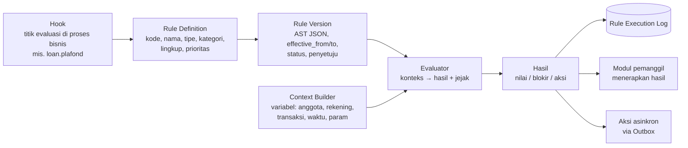
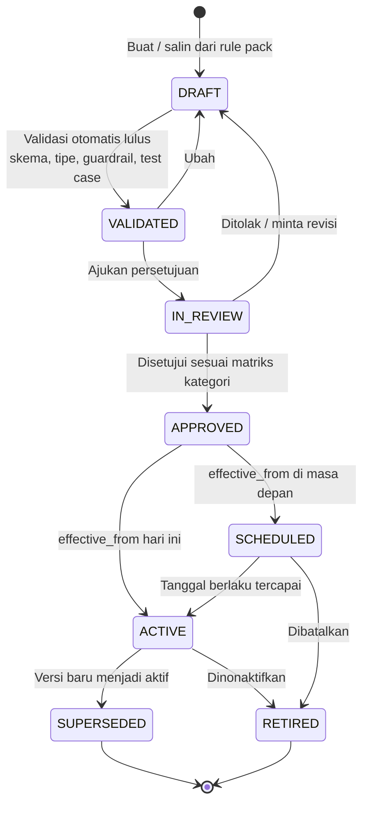
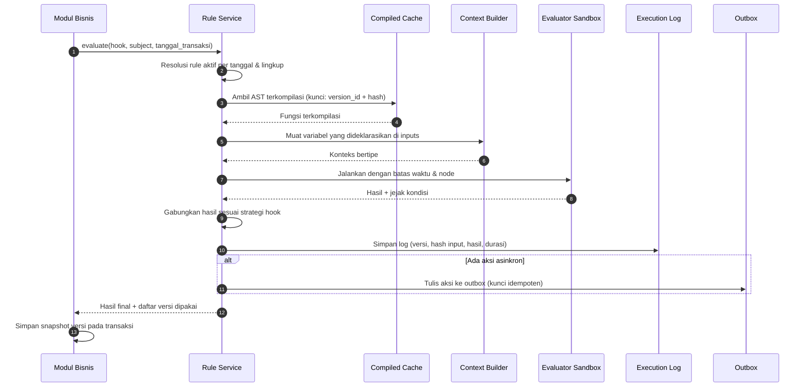

# 03 — Spesifikasi Rule Engine (Custom Rule Koperasi)

[← Kembali ke daftar isi](./README.md)

---

## 1. Tujuan & Prinsip

Rule Engine memungkinkan setiap koperasi **membuat dan mengubah aturan bisnisnya sendiri** (sesuai AD/ART,
keputusan RAT, dan kebijakan pengurus) tanpa perubahan kode oleh vendor.

| Prinsip | Penjelasan |
|---|---|
| **No-code untuk pengurus, low-code untuk akuntan** | Mode *Sederhana* berbentuk kalimat & formulir; mode *Lanjutan* berupa editor formula dengan autocomplete |
| **Aman** | Rule adalah data (AST JSON), bukan kode. Tidak ada akses jaringan, file, atau database langsung; dievaluasi dalam sandbox dengan batas waktu & kompleksitas |
| **Berversi & bertanggal berlaku** | Setiap perubahan menghasilkan versi baru dengan `effective_from`/`effective_to`; versi lama tetap tersimpan |
| **Dapat diuji sebelum berlaku** | Test case, *replay* data historis, *shadow mode*, dan laporan dampak |
| **Dapat dijelaskan** | Setiap keputusan menyimpan jejak: rule & versi mana, nilai input, kondisi mana yang lulus/gagal |
| **Dapat diaudit & reproducible** | Transaksi menyimpan snapshot versi rule yang dipakai; hasil dapat dihitung ulang persis |
| **Deterministik & identik di semua tempat** | Paket evaluator TypeScript yang sama dipakai di server dan di POS offline |
| **Tidak dapat melanggar invarian akuntansi** | Rule hanya menghasilkan nilai/aksi; jurnal tetap divalidasi Posting Engine (wajib seimbang, periode terbuka) |

## 2. Konsep Inti



| Konsep | Definisi |
|---|---|
| **Hook** | Titik di proses bisnis tempat rule dievaluasi. Didefinisikan oleh platform (bukan tenant), lengkap dengan variabel konteks, tipe keluaran, aksi yang diizinkan, mode, dan strategi penggabungan |
| **Rule Definition** | Identitas rule milik tenant: kode, nama, hook, tipe, kategori persetujuan, lingkup (cabang/unit/gerai/produk/kelompok), prioritas |
| **Rule Version** | Isi rule (AST JSON) + periode berlaku + status siklus hidup. Hanya satu versi `ACTIVE` per definisi pada satu waktu |
| **Rule Pack** | Kumpulan definisi + versi default yang disediakan platform per jenis koperasi |
| **Parameter** | Nilai bernama (mis. `simpanan.wajib.nominal`) yang dapat dirujuk rule lain dengan `param` |
| **Tabel Referensi** | Tabel lookup milik tenant (mis. golongan pegawai → nominal simpanan wajib) yang dirujuk dengan `lookup` |
| **Context** | Kumpulan variabel bertipe yang disediakan hook (lihat §5) |
| **Execution Log** | Catatan setiap evaluasi: versi, ringkasan input (hash + snapshot terbatas), hasil, jejak, durasi |

## 3. Tipe Rule

| Tipe | Kegunaan | Bentuk UI | Contoh |
|---|---|---|---|
| **PARAMETER** | Nilai konfigurasi bertipe | Formulir | Simpanan pokok = Rp100.000; masa tenggang denda = 10 hari |
| **FORMULA** | Menghitung satu nilai dari variabel | Editor formula + autocomplete | Plafon = `min(3 × total_simpanan, (40% × penghasilan − angsuran_aktif) × tenor)` |
| **DECISION_TABLE** | Keputusan bertingkat berbasis tabel | Grid seperti spreadsheet | Tarif jasa simpanan per rentang saldo; kolektibilitas per DPD |
| **ECA** (Event–Condition–Action) | Reaksi terhadap kejadian | Builder WHEN–IF–THEN | Jika anggota Gold belanja sembako hari Jumat → poin ganda |
| **WORKFLOW** | Alur persetujuan | Builder langkah | Pinjaman > Rp25 juta → komite kredit 2 dari 3 |
| **POSTING_TEMPLATE** | Pemetaan event → jurnal | Editor baris debit/kredit | Penjualan POS → Kas / Penjualan Anggota / HPP / Persediaan |

### 3.1 Mode Eksekusi

| Mode | Perilaku | Contoh hook |
|---|---|---|
| `SYNC_VALUE` | Dievaluasi di jalur transaksi, mengembalikan nilai yang dipakai modul | `loan.plafond`, `pos.price.resolve` |
| `SYNC_GUARD` | Dievaluasi sebelum transaksi; dapat `block`, `warn`, atau `require_approval` | `saving.before_withdraw`, `pos.before_checkout` |
| `ASYNC` | Dievaluasi setelah transaksi tersimpan; aksi dijalankan via outbox (idempoten) | `pos.after_checkout`, `member.after_activated` |
| `SCHEDULED` | Dipicu jadwal (harian, akhir bulan, tanggal tertentu) | `loan.penalty.daily`, `member.status.evaluate` |

### 3.2 Strategi Penggabungan (bila >1 rule aktif di hook yang sama)

| Strategi | Arti | Dipakai pada |
|---|---|---|
| `MOST_SPECIFIC` | Rule dengan lingkup paling spesifik menang (produk > kategori > gerai > unit > cabang > tenant), lalu prioritas | Harga, tarif, parameter |
| `FIRST_BY_PRIORITY` | Rule pertama (prioritas tertinggi) yang kondisinya terpenuhi | Rute workflow |
| `MIN` / `MAX` | Ambil nilai terkecil/terbesar dari semua rule yang cocok | Plafon (MIN), batas kredit (MIN) |
| `SUM` | Jumlahkan semua hasil | Poin (dasar + promo), biaya-biaya |
| `ALL_MUST_PASS` | Semua guard dievaluasi; satu `block` → ditolak; semua alasan dikumpulkan | Kelayakan pinjaman, validasi penarikan |
| `BEST_FOR_CUSTOMER` | Pilih diskon terbesar bagi pembeli | Promo POS (default) |
| `STACK_WITH_CAP` | Diskon ditumpuk dengan batas maksimum (mis. 20% atau Rp50.000) | Promo POS (opsional) |

## 4. Katalog Hook

Daftar hook v1. Hook baru ditambahkan platform melalui rilis; tenant tidak membuat hook.

| Domain | Hook | Mode | Tipe rule | Strategi | Keluaran / aksi yang diizinkan |
|---|---|---|---|---|---|
| Keanggotaan | `member.before_register` | SYNC_GUARD | ECA | ALL_MUST_PASS | `block`, `warn`, `require_approval` |
| Keanggotaan | `member.activation_requirements` | SYNC_VALUE | ECA | ALL_MUST_PASS | daftar syarat terpenuhi/belum |
| Keanggotaan | `member.number_format` | SYNC_VALUE | PARAMETER | MOST_SPECIFIC | pola nomor |
| Keanggotaan | `member.after_activated` | ASYNC | ECA | — | `notify`, `award_points`, `tag`, `create_task` |
| Keanggotaan | `member.status.evaluate` | SCHEDULED | DECISION_TABLE / ECA | FIRST_BY_PRIORITY | `set_member_status`, `notify` |
| Keanggotaan | `member.tier.evaluate` | SCHEDULED | DECISION_TABLE | FIRST_BY_PRIORITY | tier |
| Simpanan | `saving.required_amount` | SYNC_VALUE | PARAMETER / DECISION_TABLE / FORMULA | MOST_SPECIFIC | nominal simpanan pokok/wajib (dapat per kelompok/golongan) |
| Simpanan | `saving.before_deposit` / `saving.before_withdraw` | SYNC_GUARD | ECA | ALL_MUST_PASS | `block`, `warn`, `require_approval`, `add_fee` |
| Simpanan | `saving.interest.rate` | SYNC_VALUE | DECISION_TABLE | MOST_SPECIFIC | tarif tahunan |
| Simpanan | `saving.interest.base` | SYNC_VALUE | PARAMETER | MOST_SPECIFIC | `SALDO_HARIAN` / `SALDO_TERENDAH` / `SALDO_RATA_RATA` |
| Simpanan | `saving.tax.calculate` | SYNC_VALUE | FORMULA | MOST_SPECIFIC | nominal pajak |
| Simpanan | `saving.mandatory.penalty` | SCHEDULED | FORMULA | SUM | nominal denda |
| Simpanan | `saving.after_deposit` | ASYNC | ECA | — | `notify`, `award_points` |
| Pinjaman | `loan.eligibility` | SYNC_GUARD | ECA | ALL_MUST_PASS | layak/tidak + alasan |
| Pinjaman | `loan.plafond` | SYNC_VALUE | FORMULA | MIN | nominal plafon |
| Pinjaman | `loan.rate` | SYNC_VALUE | DECISION_TABLE | MOST_SPECIFIC | tarif & metode |
| Pinjaman | `loan.fees` | SYNC_VALUE | FORMULA | SUM | daftar biaya + account role |
| Pinjaman | `loan.approval_route` | SYNC_VALUE | WORKFLOW | FIRST_BY_PRIORITY | definisi langkah persetujuan |
| Pinjaman | `loan.penalty.daily` | SCHEDULED | FORMULA | SUM | nominal denda |
| Pinjaman | `loan.collectibility.classify` | SCHEDULED | DECISION_TABLE | FIRST_BY_PRIORITY | kategori kolektibilitas |
| Pinjaman | `loan.impairment.rate` | SCHEDULED | DECISION_TABLE | MOST_SPECIFIC | % CKPN |
| Pinjaman | `loan.prepayment.discount` | SYNC_VALUE | FORMULA | MAX | diskon bunga pelunasan |
| Pinjaman | `loan.payment.allocation_order` | SYNC_VALUE | PARAMETER | MOST_SPECIFIC | urutan: denda, bunga, pokok |
| POS | `pos.price.resolve` | SYNC_VALUE | DECISION_TABLE / FORMULA | MOST_SPECIFIC | harga satuan per item |
| POS | `pos.discount.apply` | SYNC_VALUE | ECA | BEST_FOR_CUSTOMER / STACK_WITH_CAP | `add_discount` |
| POS | `pos.before_checkout` | SYNC_GUARD | ECA | ALL_MUST_PASS | `block`, `warn`, `require_approval` (PIN supervisor) |
| POS | `pos.credit_limit` | SYNC_VALUE | FORMULA | MIN | sisa limit kredit anggota |
| POS | `pos.offline_limit` | SYNC_VALUE | FORMULA | MIN | batas nilai transaksi non-tunai offline per anggota |
| POS | `pos.after_checkout` | ASYNC | ECA | — | `award_points`, `notify`, `tag` |
| POS | `pos.cash_difference.policy` | SYNC_VALUE | DECISION_TABLE | FIRST_BY_PRIORITY | perlakuan selisih kas (beban / piutang kasir / perlu persetujuan) |
| POS | `pos.posting_granularity` | SYNC_VALUE | PARAMETER | MOST_SPECIFIC | `PER_TRANSAKSI` / `RINGKAS_PER_SHIFT` |
| Loyalty | `loyalty.points.earn` | SYNC_VALUE | FORMULA / DECISION_TABLE | SUM | jumlah poin |
| Loyalty | `loyalty.points.redeem_value` | SYNC_VALUE | PARAMETER | MOST_SPECIFIC | nilai Rp per poin, minimum tukar |
| Loyalty | `loyalty.points.expiry` | SYNC_VALUE | PARAMETER | MOST_SPECIFIC | masa berlaku (bulan) |
| SHU | `shu.allocation` | SYNC_VALUE | PARAMETER | MOST_SPECIFIC | persentase per komponen (total 100%) |
| SHU | `shu.capital_basis` | SYNC_VALUE | PARAMETER | MOST_SPECIFIC | jenis simpanan & metode (saldo akhir / rata-rata bulanan) |
| SHU | `shu.business_basis` | SYNC_VALUE | FORMULA | MOST_SPECIFIC | bobot sumber transaksi (belanja, jasa pinjaman, penjualan ke koperasi) |
| SHU | `shu.tax` | SYNC_VALUE | FORMULA | MOST_SPECIFIC | potongan pajak atas SHU anggota |
| Akuntansi | `posting.<event>` | SYNC_VALUE | POSTING_TEMPLATE | MOST_SPECIFIC | baris jurnal |
| Akuntansi | `journal.manual.approval` | SYNC_VALUE | WORKFLOW | FIRST_BY_PRIORITY | langkah persetujuan |
| Akuntansi | `period.before_close` | SYNC_GUARD | ECA | ALL_MUST_PASS | `block` dengan pesan (cek tambahan buatan tenant) |
| Akuntansi | `period.late_transaction.policy` | SYNC_VALUE | PARAMETER | MOST_SPECIFIC | transaksi offline yang terlambat masuk ke periode tertutup: `POST_KE_PERIODE_BERJALAN` / `TAHAN_UNTUK_REVIEW` |
| Inventori | `inventory.adjustment.approval` / `purchase.approval` | SYNC_VALUE | WORKFLOW | FIRST_BY_PRIORITY | langkah persetujuan |
| Umum | `schedule.custom` | SCHEDULED | ECA | — | `notify`, `create_task`, `tag` |

## 5. Variabel Konteks (Fact Model)

Variabel bersifat **read-only** dan bertipe. Setiap hook hanya mengekspos namespace yang relevan.

| Namespace | Contoh variabel | Tipe |
|---|---|---|
| `anggota` | `status`, `tier`, `umur`, `masa_keanggotaan_bulan`, `kelompok`, `penghasilan_bulanan`, `total_simpanan_pokok`, `total_simpanan_wajib`, `saldo_sukarela`, `total_simpanan`, `tunggakan_wajib_bulan`, `jumlah_pinjaman_aktif`, `outstanding_pinjaman`, `angsuran_aktif_bulanan`, `dpd_maks`, `belanja_12_bulan`, `poin`, `custom.*` | enum, angka, rupiah |
| `rekening` | `produk`, `jenis`, `saldo`, `saldo_terendah_bulan`, `saldo_rata_rata_bulan`, `status`, `umur_rekening_hari` | enum, rupiah |
| `pinjaman` | `produk`, `nominal`, `tenor_bulan`, `tujuan`, `nilai_agunan`, `metode_bunga`, `tarif`, `dpd`, `sisa_pokok`, `kolektibilitas` | rupiah, angka, enum |
| `transaksi` | `jenis`, `kanal`, `nominal`, `subtotal`, `total`, `items[]` (`produk`, `kategori`, `qty`, `harga`, `subtotal`, `konsinyasi`), `pembayaran[]` (`metode`, `nominal`) | daftar objek |
| `produk` | `sku`, `kategori`, `merek`, `harga_umum`, `harga_anggota`, `custom.*` | — |
| `waktu` | `tanggal`, `hari` (`SENIN`…`MINGGU`), `jam`, `tanggal_dalam_bulan`, `akhir_bulan`, `hari_libur` | tanggal, enum, boolean |
| `koperasi` | `jenis`, `cabang`, `unit_usaha`, `gerai`, `tahun_buku`, `pkp` | enum |
| `periode` | `shu_bersih`, `total_jasa_modal_basis`, `total_jasa_usaha_basis` (hook SHU) | rupiah |
| `event` | Payload event bisnis (hook `posting.*`) | objek |
| `param.<kode>` | Nilai rule PARAMETER aktif | sesuai parameter |

**Custom field** (RUL-14): tenant dapat mendefinisikan atribut tambahan pada anggota, produk, atau pinjaman
(mis. `anggota.custom.golongan_pegawai`) yang otomatis tersedia sebagai variabel.

## 6. Operator & Fungsi

| Kelompok | Operator / fungsi |
|---|---|
| Aritmetika | `+`, `-`, `*`, `/`, `%` (desimal presisi tinggi, bukan float) |
| Perbandingan | `==`, `!=`, `<`, `<=`, `>`, `>=`, `between(x, a, b)`, `in(x, daftar)` |
| Logika | `and`, `or`, `not`, `if(kondisi, a, b)` |
| Numerik | `min`, `max`, `abs`, `round(x, digit)`, `round_to(x, kelipatan)`, `floor`, `ceil`, `floor_to(x, kelipatan)` |
| Daftar | `sum_by(daftar, field, filter?)`, `count_where(daftar, filter)`, `any`, `all`, `none` (maks 1.000 elemen) |
| Tanggal | `date_diff(a, b, satuan)`, `add_days`, `add_months`, `day_of_week`, `month`, `year`, `end_of_month` |
| Referensi | `param(kode)`, `lookup(kode_tabel, kunci, kolom)` |
| Teks (pesan saja) | `concat`, `rupiah(x)`, `persen(x)` |

**Tidak tersedia (sengaja):** perulangan bebas, rekursi, definisi fungsi, akses I/O/jaringan, waktu sistem
selain variabel `waktu`, angka acak. Hal ini menjamin rule selalu berhenti dan deterministik.

## 7. Katalog Aksi

| Aksi | Parameter | Mode | Catatan |
|---|---|---|---|
| `block` | `kode`, `pesan` | SYNC_GUARD | Transaksi ditolak; pesan ditampilkan ke pengguna |
| `warn` | `pesan` | SYNC_GUARD | Pengguna dapat melanjutkan dengan konfirmasi (tercatat) |
| `require_approval` | `workflow`, `alasan` | SYNC_GUARD | Transaksi ditahan menunggu persetujuan / PIN supervisor |
| `add_fee` | `kode`, `nominal`, `account_role` | SYNC_GUARD / SYNC_VALUE | Biaya tambahan yang ikut dijurnal |
| `add_discount` | `nominal` atau `persen`, `lingkup` (item/transaksi), `label` | SYNC_VALUE | Hanya di `pos.discount.apply` |
| `award_points` | `poin`, `alasan`, `masa_berlaku_bulan` | ASYNC / SYNC_VALUE | Membentuk entri ledger poin & jurnal liabilitas |
| `notify` | `template`, `kanal` (wa/push/email/sms), `penerima` | ASYNC / SCHEDULED | Template dengan variabel |
| `set_member_status` | `status`, `alasan` | SCHEDULED | Hanya hook `member.status.evaluate` |
| `tag` | `entitas`, `label` | ASYNC | Untuk segmentasi |
| `create_task` | `peran_penerima`, `judul`, `jatuh_tempo` | ASYNC / SCHEDULED | Tugas tindak lanjut di back-office |
| `emit_webhook` | `event` | ASYNC | P2, paket Enterprise |

Aksi yang **mengubah nilai uang** (`add_fee`, `add_discount`, `award_points`) hanya boleh dipakai pada rule
kategori **FINANSIAL** yang wajib melalui persetujuan (lihat §10).

## 8. Format Penyimpanan (AST JSON) & Contoh

Semua versi rule disimpan sebagai JSON dengan *envelope* yang sama. Ekspresi memakai notasi kompatibel JSON Logic
(`{"operator": [argumen...]}`) dengan operator tambahan koperasi.

```json
{
  "schema": "kop.rule/v1",
  "type": "FORMULA",
  "hook": "loan.plafond",
  "scope": { "loan_product": ["PINJ-REG"] },
  "inputs": ["anggota.total_simpanan", "anggota.penghasilan_bulanan", "anggota.angsuran_aktif_bulanan", "pinjaman.tenor_bulan"],
  "output": { "name": "plafon", "type": "money" },
  "body": { "...": "lihat contoh di bawah" },
  "tests": [
    { "name": "Anggota gaji 5 jt, simpanan 4 jt, tenor 12", "input": { "...": "..." }, "expect": { "plafon": 12000000 } }
  ]
}
```

### 8.1 FORMULA — Plafon pinjaman

Kalimat (mode Sederhana): *"Plafon adalah nilai terkecil dari 3 kali total simpanan dan (40% penghasilan dikurangi
angsuran berjalan) dikali tenor, dibulatkan ke bawah ke kelipatan Rp100.000, maksimum plafon produk."*

Formula (mode Lanjutan):

```text
floor_to(
  min(
    3 * anggota.total_simpanan,
    (0.40 * anggota.penghasilan_bulanan - anggota.angsuran_aktif_bulanan) * pinjaman.tenor_bulan,
    param("pinjaman.reguler.plafon_maks")
  ),
  100000
)
```

AST yang tersimpan:

```json
{
  "floor_to": [
    { "min": [
      { "*": [3, { "var": "anggota.total_simpanan" }] },
      { "*": [
        { "-": [
          { "*": [0.40, { "var": "anggota.penghasilan_bulanan" }] },
          { "var": "anggota.angsuran_aktif_bulanan" }
        ] },
        { "var": "pinjaman.tenor_bulan" }
      ] },
      { "param": "pinjaman.reguler.plafon_maks" }
    ] },
    100000
  ]
}
```

### 8.2 DECISION_TABLE — Tarif jasa simpanan sukarela

| # | Saldo rata-rata bulanan | Tarif per tahun |
|---|---|---|
| 1 | < Rp1.000.000 | 0% |
| 2 | Rp1.000.000 – < Rp10.000.000 | 2,0% |
| 3 | Rp10.000.000 – < Rp50.000.000 | 3,0% |
| 4 | ≥ Rp50.000.000 | 3,5% |

```json
{
  "schema": "kop.rule/v1",
  "type": "DECISION_TABLE",
  "hook": "saving.interest.rate",
  "hit_policy": "FIRST",
  "inputs": [{ "name": "saldo", "expr": { "var": "rekening.saldo_rata_rata_bulan" } }],
  "outputs": [{ "name": "tarif_tahunan", "type": "percent" }],
  "rows": [
    { "when": [{ "<": 1000000 }],                 "then": [0.000] },
    { "when": [{ "between": [1000000, 10000000] }], "then": [0.020] },
    { "when": [{ "between": [10000000, 50000000] }], "then": [0.030] },
    { "when": [{ ">=": 50000000 }],               "then": [0.035] }
  ],
  "between_semantics": "[a, b)"
}
```

Validator tabel keputusan memeriksa **celah** (rentang yang tidak tercakup) dan **tumpang tindih** (untuk `UNIQUE`).

### 8.3 ECA (SYNC_GUARD) — Saldo minimal penarikan

Kalimat: *"Saat penarikan simpanan sukarela, jika saldo setelah penarikan kurang dari saldo minimal, tolak dengan pesan."*

```json
{
  "schema": "kop.rule/v1",
  "type": "ECA",
  "hook": "saving.before_withdraw",
  "mode": "SYNC_GUARD",
  "scope": { "saving_product": ["SUKARELA"] },
  "condition": {
    "<": [
      { "-": [{ "var": "rekening.saldo" }, { "var": "transaksi.nominal" }] },
      { "param": "simpanan.sukarela.saldo_minimal" }
    ]
  },
  "actions": [
    { "action": "block", "params": {
      "kode": "SALDO_MINIMAL",
      "pesan": { "concat": ["Saldo setelah penarikan minimal ", { "rupiah": { "param": "simpanan.sukarela.saldo_minimal" } }] }
    } }
  ]
}
```

### 8.4 ECA (SYNC_GUARD) — Kuota beras program per anggota (contoh Kopdes)

Kalimat: *"Saat checkout, jika anggota membeli produk kategori BERAS_PROGRAM melebihi 2 karung dalam bulan berjalan, tolak."*

```json
{
  "type": "ECA",
  "hook": "pos.before_checkout",
  "mode": "SYNC_GUARD",
  "condition": {
    ">": [
      { "+": [
        { "sum_by": [{ "var": "transaksi.items" }, "qty", { "==": [{ "var": "kategori" }, "BERAS_PROGRAM"] }] },
        { "var": "anggota.custom.beras_program_bulan_ini" }
      ] },
      2
    ]
  },
  "actions": [{ "action": "block", "params": { "kode": "KUOTA_BERAS", "pesan": "Kuota beras program bulan ini sudah habis (maks. 2 karung)" } }]
}
```

> Catatan offline: variabel agregat (mis. `beras_program_bulan_ini`) di POS offline memakai nilai cache terakhir
> + transaksi lokal yang belum tersinkron; rule pack POS menandai rule ini `offline_policy: "ENFORCE_WITH_CACHE"`.

### 8.5 ECA (ASYNC) — Poin ganda sembako hari Jumat untuk anggota Gold

```json
{
  "type": "ECA",
  "hook": "pos.after_checkout",
  "mode": "ASYNC",
  "priority": 50,
  "condition": {
    "and": [
      { "==": [{ "var": "anggota.tier" }, "GOLD"] },
      { "==": [{ "var": "waktu.hari" }, "JUMAT"] },
      { "any": [{ "var": "transaksi.items" }, { "in": [{ "var": "kategori" }, ["SEMBAKO", "BERAS"]] }] }
    ]
  },
  "actions": [
    { "action": "award_points", "params": {
      "poin": { "floor": [{ "/": [
        { "sum_by": [{ "var": "transaksi.items" }, "subtotal", { "in": [{ "var": "kategori" }, ["SEMBAKO", "BERAS"]] }] },
        10000
      ] }] },
      "alasan": "Promo Jumat Sembako (poin tambahan)",
      "masa_berlaku_bulan": 12
    } },
    { "action": "notify", "params": { "template": "POIN_GANDA", "kanal": "wa", "penerima": "anggota" } }
  ]
}
```

### 8.6 WORKFLOW — Persetujuan pinjaman berjenjang

```json
{
  "type": "WORKFLOW",
  "hook": "loan.approval_route",
  "routes": [
    {
      "when": { "<=": [{ "var": "pinjaman.nominal" }, 5000000] },
      "steps": [{ "nama": "Persetujuan Manajer", "penyetuju": { "peran": "MANAJER" }, "minimal": 1, "sla_jam": 24 }]
    },
    {
      "when": { "<=": [{ "var": "pinjaman.nominal" }, 25000000] },
      "steps": [
        { "nama": "Manajer", "penyetuju": { "peran": "MANAJER" }, "minimal": 1, "sla_jam": 24 },
        { "nama": "Bendahara", "penyetuju": { "jabatan": "BENDAHARA" }, "minimal": 1, "sla_jam": 48 }
      ]
    },
    {
      "when": true,
      "steps": [{ "nama": "Komite Kredit", "penyetuju": { "jabatan": ["KETUA", "BENDAHARA", "SEKRETARIS"] },
                  "minimal": 2, "mode": "PARALEL", "sla_jam": 72 }],
      "beritahu": [{ "jabatan": "PENGAWAS" }]
    }
  ],
  "on_sla_breach": { "eskalasi_ke": { "jabatan": "KETUA" } },
  "constraints": { "pembuat_tidak_boleh_menyetujui": true, "penyetuju_bukan_pemohon": true }
}
```

### 8.7 PARAMETER — Alokasi SHU (sesuai AD/ART)

```json
{
  "type": "PARAMETER",
  "hook": "shu.allocation",
  "category": "AD_ART",
  "values": {
    "cadangan": 0.40,
    "jasa_modal": 0.20,
    "jasa_usaha": 0.25,
    "pengurus_pengawas": 0.05,
    "karyawan": 0.05,
    "pendidikan": 0.025,
    "sosial": 0.025,
    "pembangunan_daerah_kerja": 0.00
  },
  "constraints": [{ "==": [{ "sum_values": [] }, 1] }],
  "reference": { "dokumen": "ART Pasal 32", "keputusan_rat": "RAT 2026 No. 05" }
}
```

> Angka di atas adalah **contoh**. Persentase sebenarnya mengikuti AD/ART dan keputusan RAT masing-masing koperasi.

### 8.8 POSTING_TEMPLATE — Penjualan POS

```json
{
  "type": "POSTING_TEMPLATE",
  "hook": "posting.pos.sale_completed",
  "category": "AKUNTANSI",
  "journal": {
    "tanggal": { "var": "event.sold_at" },
    "keterangan": { "concat": ["Penjualan ", { "var": "event.sale_no" }] },
    "dimensi": {
      "branch_id": { "var": "event.branch_id" },
      "business_unit_id": { "var": "event.business_unit_id" },
      "participant_type": { "if": [{ "var": "event.is_member" }, "ANGGOTA", "NON_ANGGOTA"] },
      "member_id": { "var": "event.member_id" }
    }
  },
  "lines": [
    { "foreach": { "var": "event.payments" },
      "side": "D", "role": { "concat": ["BAYAR_", { "var": "item.method" }] }, "amount": { "var": "item.amount" },
      "subledger": { "var": "item.subledger_ref" } },
    { "side": "C", "role": { "if": [{ "var": "event.is_member" }, "PENJUALAN_ANGGOTA", "PENJUALAN_NON_ANGGOTA"] },
      "amount": { "-": [{ "var": "event.grand_total" }, { "var": "event.tax_total" }, { "var": "event.consignment_payable" }, { "var": "event.consignment_commission" }] } },
    { "side": "C", "role": "UTANG_KONSINYASI", "amount": { "var": "event.consignment_payable" }, "skip_if_zero": true },
    { "side": "C", "role": "PENDAPATAN_KOMISI_KONSINYASI", "amount": { "var": "event.consignment_commission" }, "skip_if_zero": true },
    { "side": "C", "role": "PPN_KELUARAN", "amount": { "var": "event.tax_total" }, "skip_if_zero": true },
    { "side": "D", "role": { "if": [{ "var": "event.is_member" }, "HPP_ANGGOTA", "HPP_NON_ANGGOTA"] }, "amount": { "var": "event.cost_total" } },
    { "side": "C", "role": "PERSEDIAAN_BARANG_DAGANG", "amount": { "var": "event.cost_total" } }
  ],
  "tests": [{ "name": "Tunai anggota tanpa pajak", "input": { "...": "..." }, "expect": { "balanced": true } }]
}
```

`role` adalah **account role** yang dipetakan ke akun nyata per tenant (lihat [04 — COA & Posting](./04-bagan-akun-dan-posting.md) §4).
Validator menolak template bila ada test case yang tidak seimbang, role yang belum dipetakan, atau akun yang bukan akun posting.

## 9. Siklus Hidup Rule



Aturan siklus hidup:

1. Versi `APPROVED` ke atas **tidak dapat diubah**. Perubahan = versi baru.
2. `effective_from` tidak boleh di masa lalu kecuali **retroaktif** dicentang, disertai alasan dan persetujuan
   tambahan (Ketua). Rule retroaktif tidak mengubah transaksi lama secara otomatis; sistem membuat daftar
   transaksi terdampak untuk ditindaklanjuti (mis. jurnal koreksi).
3. *Rollback* = mengaktifkan kembali versi lama sebagai versi baru (riwayat tetap utuh).
4. *Shadow mode* (opsional): versi `APPROVED` dapat dijalankan paralel dengan versi aktif selama N hari tanpa
   memengaruhi transaksi; perbedaan hasil dicatat untuk ditinjau sebelum diaktifkan.

## 10. Kategori & Matriks Persetujuan

| Kategori | Contoh rule | Pembuat | Penyetuju wajib |
|---|---|---|---|
| `OPERASIONAL` | Notifikasi, tag segmen, jadwal pengingat | Admin / Manajer | 1 orang berperan Manajer atau Ketua (≠ pembuat) |
| `FINANSIAL` | Tarif jasa, denda, plafon, limit kredit, diskon, poin, biaya | Manajer / Akuntan | Bendahara **dan** Ketua |
| `AD_ART` | Simpanan pokok/wajib, syarat anggota, alokasi SHU, status pasif | Sekretaris / Admin | Ketua **dan** 1 pengurus lain; lampiran keputusan RAT disarankan |
| `AKUNTANSI` | Template posting, pemetaan account role, kebijakan CKPN, pembulatan | Akuntan | Bendahara (+ Ketua untuk perubahan kebijakan) |

Tenant dapat **memperketat** matriks ini, tetapi tidak dapat melonggarkan di bawah batas minimum platform
(selalu ≥ 1 penyetuju selain pembuat untuk kategori FINANSIAL, AD_ART, AKUNTANSI).

## 11. Arsitektur Eksekusi



- **Kompilasi:** AST divalidasi (skema, tipe variabel, aksi diizinkan) lalu dikompilasi menjadi fungsi murni
  dan di-cache per `version_id` (in-memory + Redis).
- **Context Builder:** hanya memuat variabel yang dideklarasikan pada `inputs` (menghindari query berlebihan);
  variabel agregat (mis. `belanja_12_bulan`) dibaca dari tabel ringkasan yang diperbarui inkremental.
- **POS offline:** rule untuk hook `pos.*` dan `loyalty.*` beserta parameter yang dirujuk dikemas sebagai
  **rule bundle** bertanda tangan (Ed25519, kunci per tenant) dan disinkronkan ke perangkat. Perangkat
  memverifikasi tanda tangan sebelum memakai bundle. Setiap transaksi menyimpan `bundle_version`.
- **Kinerja:** p95 evaluasi hook sinkron ≤ 20 ms di server, ≤ 10 ms di perangkat POS untuk keranjang 50 item.

## 12. Guardrail & Keamanan

| Guardrail | Batas default |
|---|---|
| Jumlah node AST per rule | ≤ 500 |
| Kedalaman AST | ≤ 20 |
| Waktu evaluasi | ≤ 20 ms (sinkron), ≤ 1 detik (asinkron/terjadwal) — lewat batas = gagal aman |
| Panjang daftar yang diproses fungsi daftar | ≤ 1.000 elemen |
| Rantai ECA (aksi memicu event yang memicu rule) | Kedalaman ≤ 3; siklus terdeteksi & diblokir saat validasi |
| Jumlah rule aktif per hook per tenant | ≤ 50 (dapat dinaikkan untuk Enterprise) |
| Aksi | Hanya aksi yang di-*whitelist* untuk hook terkait |

**Perilaku gagal aman (fail-safe):**

| Mode | Jika evaluasi error/timeout |
|---|---|
| SYNC_GUARD | Transaksi **ditahan** dengan pesan "perlu persetujuan supervisor" (tidak diloloskan diam-diam) |
| SYNC_VALUE | Memakai nilai *fallback* yang wajib diisi pada definisi hook (mis. harga umum, plafon 0) + peringatan |
| ASYNC / SCHEDULED | Dicoba ulang dengan *backoff*; setelah gagal 5× masuk antrean error + notifikasi admin |

## 13. Uji, Simulasi & Analisis Dampak

| Fitur | Penjelasan |
|---|---|
| **Test case** | Pasangan input → harapan per rule; dijalankan otomatis saat validasi; wajib ≥ 1 untuk kategori FINANSIAL & AKUNTANSI |
| **Uji cepat** | Pilih anggota/transaksi nyata, lihat hasil versi aktif vs draft berdampingan |
| **Replay historis** | Jalankan versi draft terhadap data N hari terakhir (read-only, di read replica); hasil tidak memengaruhi data |
| **Laporan dampak** | Metrik per hook: mis. `pos.discount.apply` → total diskon, rata-rata per transaksi; `loan.plafond` → jumlah pengajuan yang plafonnya berubah & total selisih; `loyalty.points.earn` → tambahan poin & estimasi liabilitas |
| **Perbandingan versi** | Diff visual AST/kalimat antara dua versi |
| **Shadow mode** | Lihat §9 butir 4 |

## 14. Jejak Keputusan (Explainability)

Setiap evaluasi menyimpan jejak per kondisi tingkat atas sehingga UI dapat menampilkan, misalnya pada
pengajuan pinjaman yang ditolak:

```text
Kelayakan Pinjaman — PJ-2027-000184 — dievaluasi 12/03/2027 10:21 — rule pack v7
  [LULUS]  Masa keanggotaan 14 bulan >= 6 bulan                      (LON-ELIG-01 v2)
  [LULUS]  Status anggota = AKTIF                                     (LON-ELIG-02 v1)
  [GAGAL]  Tunggakan simpanan wajib 3 bulan > 0 bulan                 (LON-ELIG-03 v1)
  [LULUS]  Rasio angsuran 31% <= 40%                                  (LON-ELIG-04 v3)
  Hasil: TIDAK LAYAK — "Mohon lunasi tunggakan simpanan wajib (3 bulan) sebelum mengajukan pinjaman."
```

Log eksekusi disimpan minimal 13 bulan (dipartisi per bulan); log yang terkait transaksi keuangan diarsipkan
mengikuti retensi dokumen keuangan.

## 15. Rule Pack Default per Jenis Koperasi

Nilai berikut adalah **nilai awal contoh** agar tenant dapat langsung beroperasi; wajib ditinjau dan disesuaikan
dengan AD/ART saat onboarding (wizard menandai rule yang belum dikonfirmasi).

| Rule | Hook | Konsumen / Karyawan | KSP / USP | Serba Usaha | Kopdes Merah Putih |
|---|---|---|---|---|---|
| Nominal simpanan pokok | `saving.required_amount` | Ya (per golongan via tabel referensi) | Ya | Ya | Ya |
| Nominal & jadwal simpanan wajib | `saving.required_amount` | Bulanan, potong gaji | Bulanan | Bulanan | Bulanan, kolektor/teller |
| Syarat aktivasi (pokok lunas + persetujuan) | `member.activation_requirements` | Ya | Ya | Ya | Ya |
| Status pasif (tunggak wajib ≥ N bulan) | `member.status.evaluate` | N = 3 | N = 6 | N = 6 | N = 6 |
| Jasa simpanan sukarela bertingkat | `saving.interest.rate` | Opsional | Ya | Ya | Opsional |
| Pajak final jasa simpanan | `saving.tax.calculate` | Ya | Ya | Ya | Ya |
| Kelayakan pinjaman | `loan.eligibility` | Ya + rasio potong gaji | Ya | Ya | Ya |
| Plafon pinjaman | `loan.plafond` | Kelipatan simpanan & rasio gaji | Kelipatan simpanan & kapasitas bayar | Kelipatan simpanan | Kelipatan simpanan |
| Persetujuan pinjaman berjenjang | `loan.approval_route` | Ya | Ya | Ya | Ya |
| Kolektibilitas & CKPN | `loan.collectibility.classify`, `loan.impairment.rate` | Ya | Ya (wajib) | Ya | Ya |
| Harga anggota | `pos.price.resolve` | Ya | — | Ya | Ya |
| Limit kredit belanja | `pos.credit_limit` | Ya (potong gaji) | — | Opsional | Opsional |
| Batas transaksi offline | `pos.offline_limit` | Ya | — | Ya | Ya (lebih longgar) |
| Poin belanja | `loyalty.points.earn` | Ya | — | Ya | Opsional |
| Alokasi SHU | `shu.allocation` | Ya | Ya | Ya | Ya |
| Dasar jasa usaha SHU | `shu.business_basis` | Belanja + jasa pinjaman | Jasa pinjaman | Belanja + jasa pinjaman + penjualan ke koperasi | Belanja + jasa pinjaman + penjualan hasil anggota |
| Template posting semua event | `posting.*` | Ya | Ya | Ya | Ya |

**Contoh tabel kolektibilitas & CKPN (nilai awal, dapat diubah sesuai kebijakan akuntansi koperasi):**

| Kategori | DPD | % CKPN (contoh) |
|---|---|---|
| Lancar | 0–30 | 0,5% |
| Kurang Lancar | 31–90 | 10% |
| Diragukan | 91–180 | 50% |
| Macet | > 180 | 100% |

> Kategori "Dalam Perhatian Khusus" dapat diaktifkan bila kebijakan koperasi memakai 5 kategori.
> Persentase CKPN di atas hanyalah nilai awal dan harus ditetapkan berdasarkan kebijakan akuntansi koperasi
> (SAK EP: bukti objektif penurunan nilai) bersama akuntan.

[← 02 Daftar Fitur](./02-daftar-fitur.md) · [Lanjut ke 04 — Bagan Akun & Posting →](./04-bagan-akun-dan-posting.md)
