# 05 — Flowchart

[← Kembali ke daftar isi](./README.md)

---

Diagram arsitektur tingkat tinggi ada di [01 §8.1](./01-ringkasan-analisa-dan-tech-stack.md#81-gaya-arsitektur);
siklus hidup rule (state diagram) dan urutan evaluasi rule ada di [03 §9 & §11](./03-rule-engine.md#9-siklus-hidup-rule).

| No | Alur | Modul |
|---|---|---|
| 5.1 | Onboarding tenant | PLT |
| 5.2 | Pendaftaran & aktivasi anggota | MBR, SAV, RUL |
| 5.3 | Setoran & penarikan simpanan | SAV, RUL, ACC |
| 5.4 | Siklus hidup pinjaman | LON, RUL, ACC |
| 5.5 | Transaksi POS end-to-end | POS, MBR, LOY, SAV, ACC |
| 5.6 | Shift kasir | POS, ACC |
| 5.7 | Sinkronisasi POS offline | POS, SYNC |
| 5.8 | Posting Engine (event → jurnal) | ACC, RUL |
| 5.9 | Potong gaji bulanan | SAV, LON, POS, INT |
| 5.10 | Pembelian sampai pembayaran supplier | INV, ACC |
| 5.11 | Tutup buku bulanan | ACC |
| 5.12 | Tutup buku tahunan, SHU & RAT | ACC, SHU |
| 5.13 | Pembuatan & publikasi rule | RUL |
| 5.14 | Anggota keluar | MBR, SAV, LON, ACC |

---

## 5.1 Onboarding Tenant

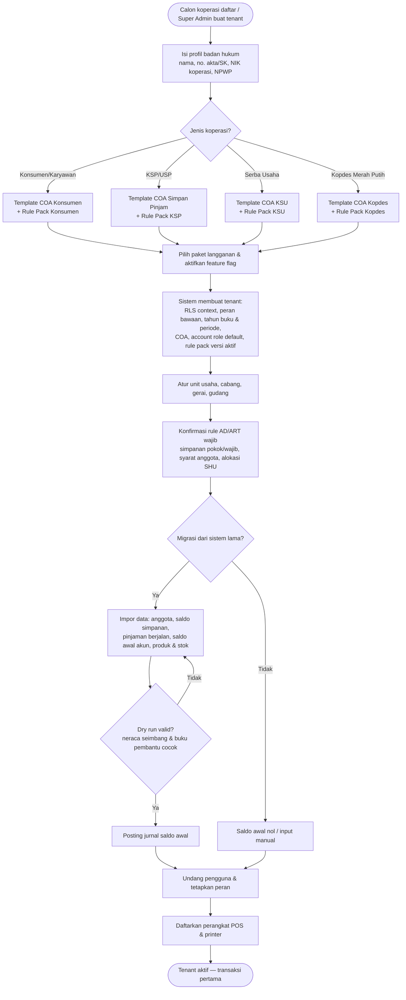

## 5.2 Pendaftaran & Aktivasi Anggota

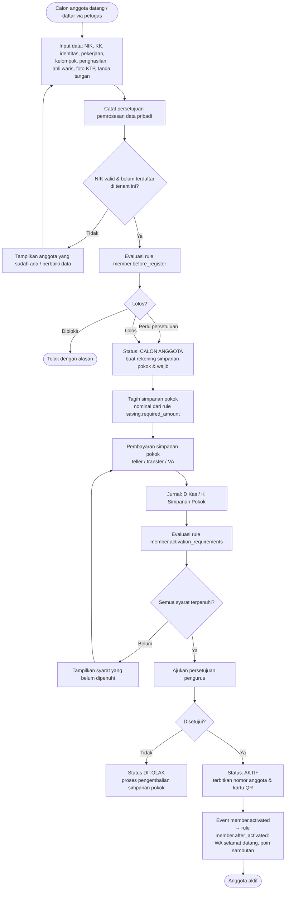

## 5.3 Setoran & Penarikan Simpanan

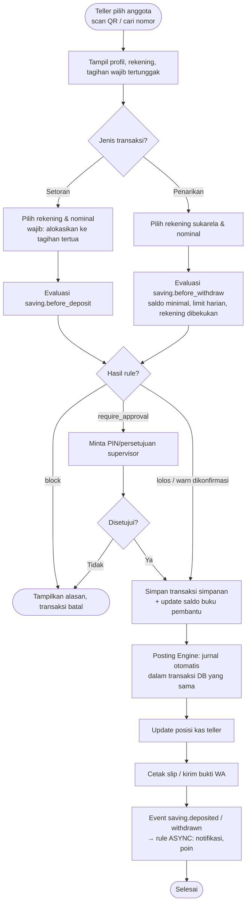

## 5.4 Siklus Hidup Pinjaman

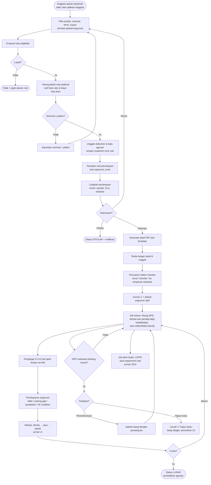

## 5.5 Transaksi POS End-to-End

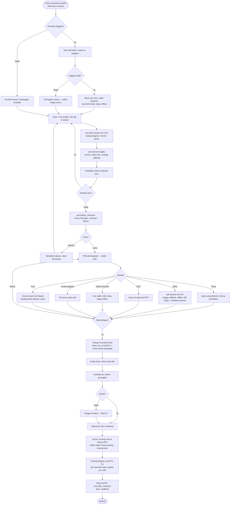

## 5.6 Shift Kasir

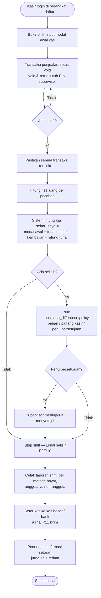

## 5.7 Sinkronisasi POS Offline

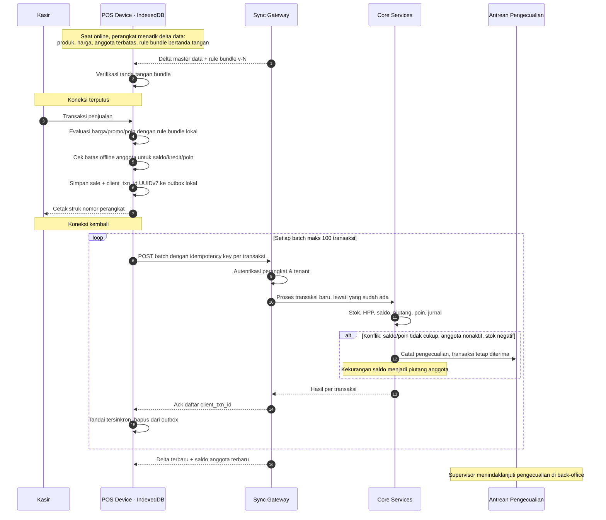

## 5.8 Posting Engine (Event → Jurnal)

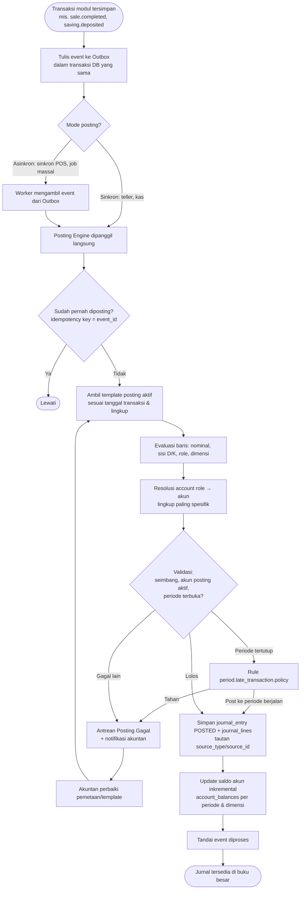

## 5.9 Potong Gaji Bulanan (Koperasi Karyawan)

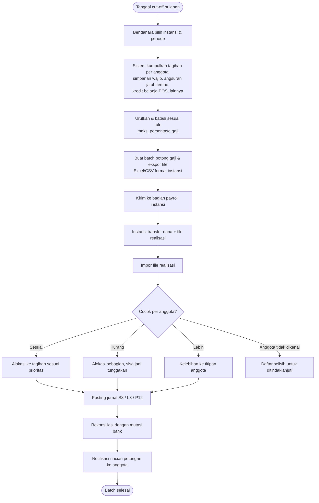

## 5.10 Pembelian sampai Pembayaran Supplier

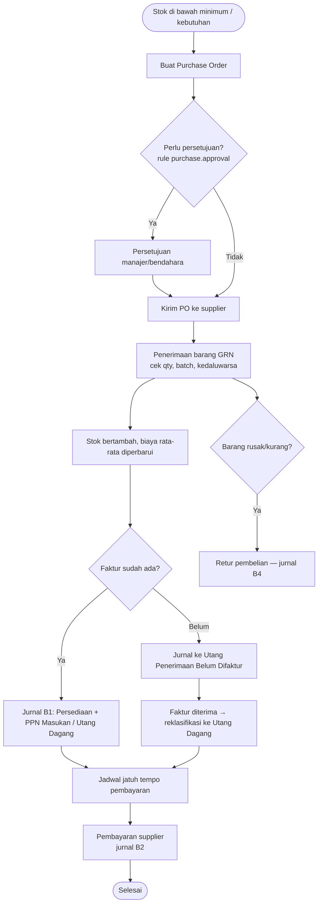

## 5.11 Tutup Buku Bulanan

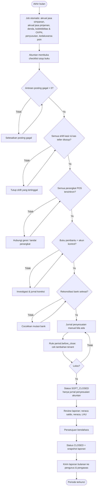

## 5.12 Tutup Buku Tahunan, SHU & RAT

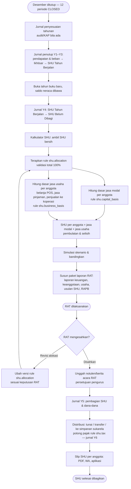

## 5.13 Pembuatan & Publikasi Rule

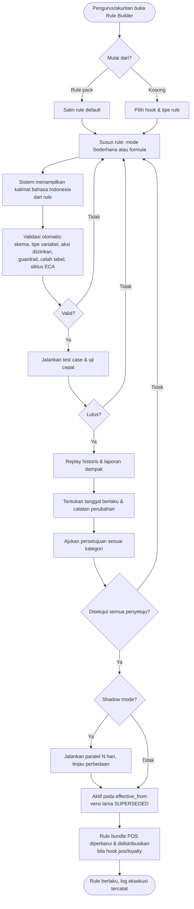

## 5.14 Anggota Keluar

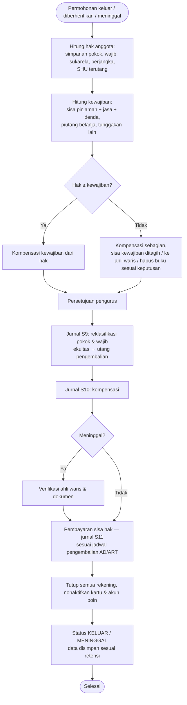

[← 04 Bagan Akun](./04-bagan-akun-dan-posting.md) · [Lanjut ke 06 — ERD →](./06-erd.md)
