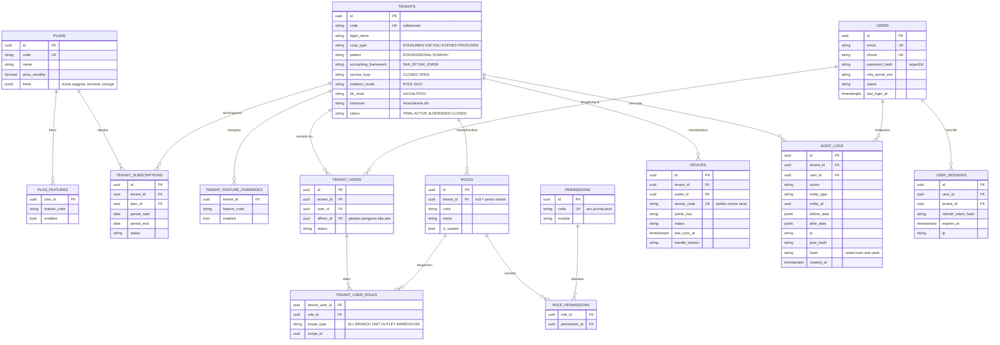
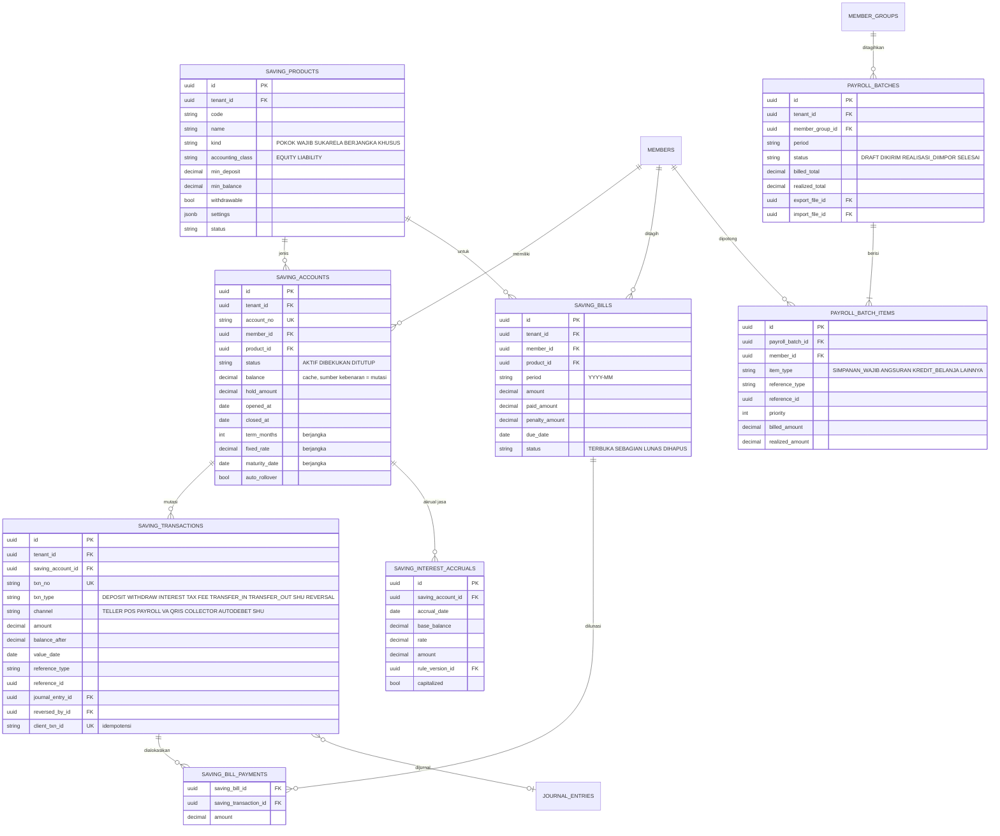
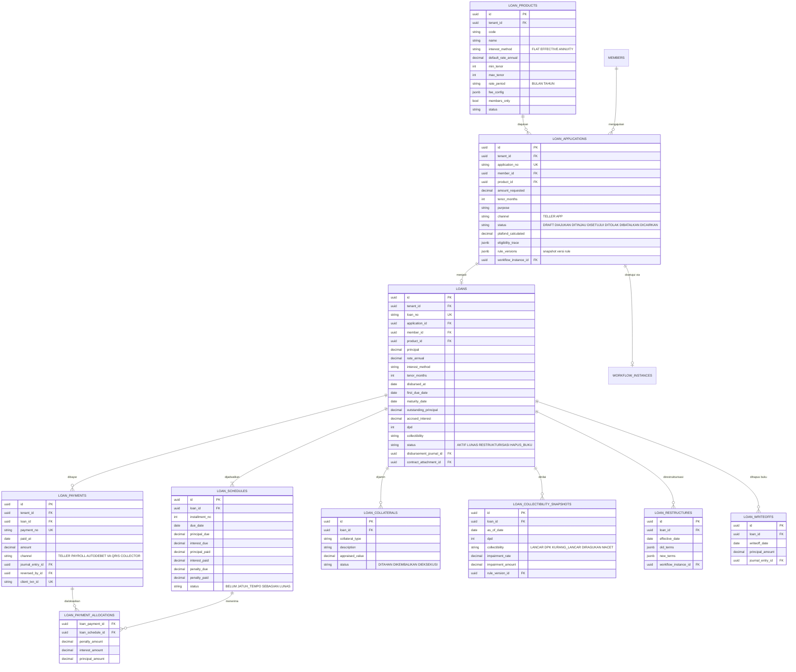
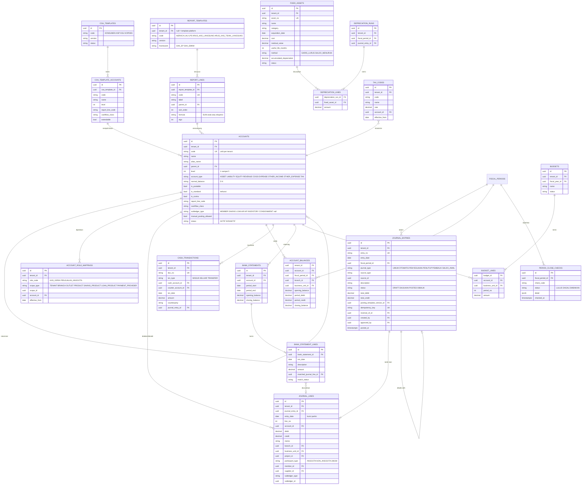
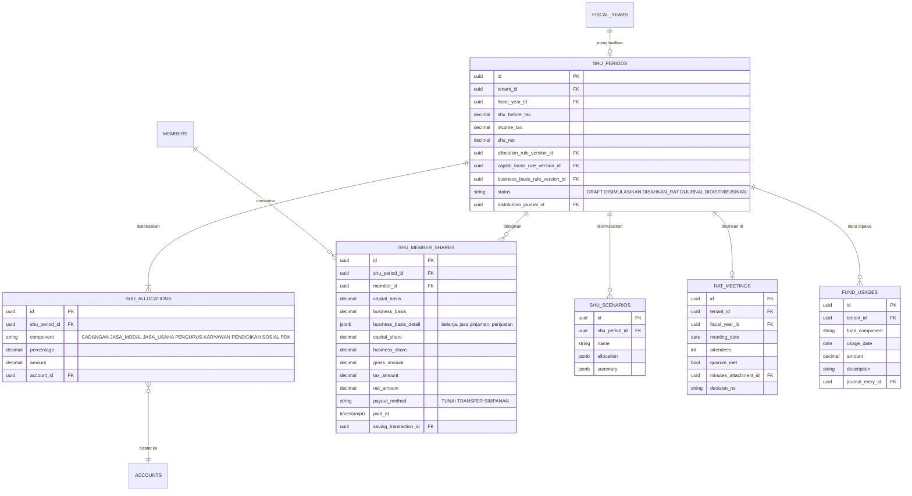
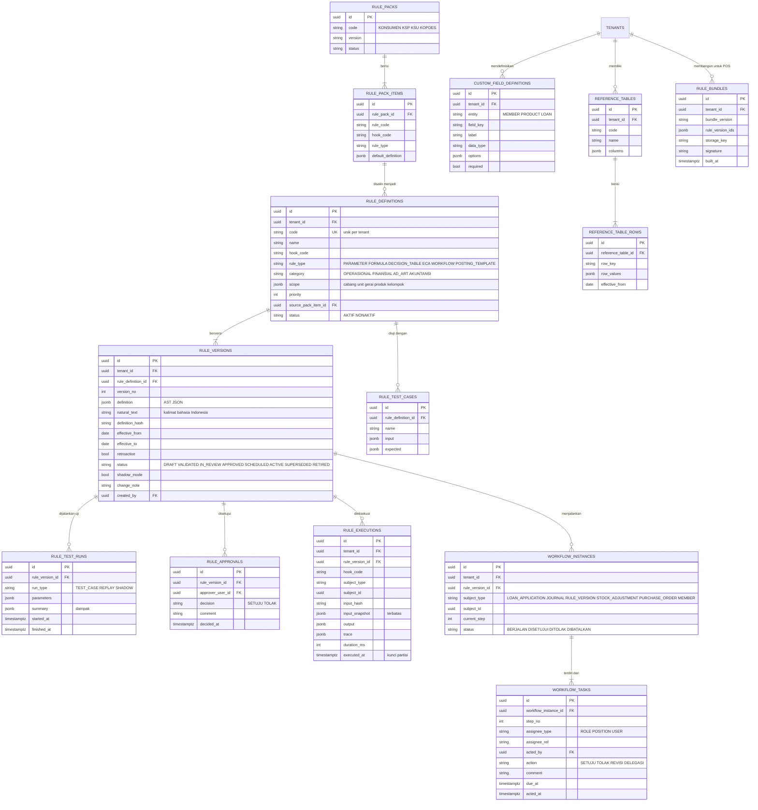

# 06 — Entity Relationship Diagram (ERD)

[← Kembali ke daftar isi](./README.md)

---

## 1. Konvensi Database

| Konvensi | Aturan |
|---|---|
| Primary key | `id UUID` (UUIDv7, terurut waktu); dibuat aplikasi/perangkat agar aman untuk offline |
| Tenant | Semua tabel milik tenant memiliki `tenant_id UUID NOT NULL` + **RLS policy** `tenant_id = current_setting('app.tenant_id')::uuid`; indeks diawali `tenant_id` |
| Tabel global | `plans`, `permissions`, `users`, `member_logins`, `coa_templates`, `rule_packs`, `report_templates` (versi platform) — tanpa RLS tenant, akses dibatasi peran platform |
| Uang | `NUMERIC(20,2)`; tarif/persen `NUMERIC(9,6)`; qty `NUMERIC(18,4)` |
| Waktu | `TIMESTAMPTZ` (UTC) untuk waktu kejadian; `DATE` untuk tanggal akuntansi (`entry_date`, `value_date`) |
| Audit kolom | `created_at`, `created_by`, `updated_at`, `updated_by`, `version` (optimistic locking) |
| Hapus | *Soft delete* (`deleted_at`) hanya untuk data master. **Transaksi keuangan tidak pernah dihapus**; dibatalkan dengan pembalik (`reversed_by_id`) |
| Penomoran dokumen | Tabel `document_sequences` per tenant, jenis dokumen, dan periode; nomor perangkat POS memakai prefiks perangkat |
| Enum | Disimpan sebagai `TEXT` + `CHECK` constraint (mudah migrasi) |
| JSONB | Hanya untuk data semi-terstruktur: definisi rule, snapshot, custom field, payload event |
| Partisi | `journal_lines` & `rule_executions` per rentang tanggal (tahunan/bulanan); `audit_logs` per bulan |
| Data sensitif | `nik_enc`, `kk_no_enc`, `bank_account_enc` terenkripsi di aplikasi (AES-256-GCM, kunci KMS per tenant) + `nik_hash` (HMAC) untuk pencarian & keunikan |

Diagram di bawah menampilkan **kolom kunci** saja; kolom lengkap untuk tabel inti ada di §11 Kamus Data.

---

## 2. Platform, Tenant & IAM

## 3. Organisasi, Keanggotaan & Loyalty

```mermaid
erDiagram
    TENANTS ||--o{ BRANCHES : "memiliki"
    TENANTS ||--o{ BUSINESS_UNITS : "memiliki"
    TENANTS ||--o{ FISCAL_YEARS : "memiliki"
    FISCAL_YEARS ||--|{ FISCAL_PERIODS : "terdiri dari"
    TENANTS ||--o{ OFFICERS : "dipimpin"
    MEMBERS ||--o{ OFFICERS : "menjabat"
    BRANCHES ||--o{ MEMBERS : "terdaftar di"
    MEMBER_GROUPS ||--o{ MEMBERS : "mengelompokkan"
    MEMBERS ||--o{ MEMBER_BENEFICIARIES : "menunjuk"
    MEMBERS ||--o{ MEMBER_DOCUMENTS : "melampirkan"
    MEMBERS ||--o{ MEMBER_STATUS_HISTORIES : "berubah status"
    MEMBERS ||--o{ MEMBER_CARDS : "memegang"
    MEMBERS ||--o{ MEMBER_CONSENTS : "memberi"
    MEMBERSHIP_TIERS ||--o{ LOYALTY_ACCOUNTS : "mengklasifikasi"
    MEMBERS ||--o| LOYALTY_ACCOUNTS : "memiliki"
    CUSTOMERS ||--o| LOYALTY_ACCOUNTS : "memiliki"
    CUSTOMERS }o--o| MEMBERS : "dikonversi menjadi"
    LOYALTY_ACCOUNTS ||--o{ POINT_LEDGER : "mencatat"
    LOYALTY_ACCOUNTS ||--o{ POINT_BUCKETS : "menyimpan"
    MEMBER_LOGINS ||--o{ MEMBER_LOGIN_LINKS : "tertaut"
    MEMBERS ||--o{ MEMBER_LOGIN_LINKS : "diakses via"

    BRANCHES {
        uuid id PK
        uuid tenant_id FK
        string code
        string name
        string address
    }
    BUSINESS_UNITS {
        uuid id PK
        uuid tenant_id FK
        string code
        string name
        string unit_type "SIMPAN_PINJAM TOKO APOTEK JASA LOGISTIK"
    }
    FISCAL_YEARS {
        uuid id PK
        uuid tenant_id FK
        int year
        date start_date
        date end_date
        string status "OPEN CLOSED"
    }
    FISCAL_PERIODS {
        uuid id PK
        uuid tenant_id FK
        uuid fiscal_year_id FK
        int period_no
        date start_date
        date end_date
        string status "OPEN SOFT_CLOSED CLOSED"
        timestamptz closed_at
    }
    OFFICERS {
        uuid id PK
        uuid tenant_id FK
        uuid member_id FK
        string position "KETUA SEKRETARIS BENDAHARA PENGAWAS MANAJER"
        date term_start
        date term_end
        string decree_no
    }
    MEMBERS {
        uuid id PK
        uuid tenant_id FK
        string member_no UK "unik per tenant"
        string status "CALON AKTIF PASIF DIBERHENTIKAN KELUAR MENINGGAL DITOLAK"
        string full_name
        string nik_enc
        string nik_hash "unik per tenant"
        string kk_no_enc
        date birth_date
        string phone
        uuid branch_id FK
        uuid member_group_id FK
        decimal monthly_income
        date joined_at
        date exited_at
        jsonb custom_fields
    }
    MEMBER_GROUPS {
        uuid id PK
        uuid tenant_id FK
        string name
        string group_type "INSTANSI DUSUN KELOMPOK_TANI LAINNYA"
        string payroll_contact
    }
    MEMBER_BENEFICIARIES {
        uuid id PK
        uuid member_id FK
        string name
        string relation
        decimal share_pct
    }
    MEMBER_DOCUMENTS {
        uuid id PK
        uuid member_id FK
        string doc_type "KTP KK FOTO TTD LAINNYA"
        uuid attachment_id FK
    }
    MEMBER_STATUS_HISTORIES {
        uuid id PK
        uuid member_id FK
        string from_status
        string to_status
        string reason
        uuid rule_version_id FK
        timestamptz changed_at
    }
    MEMBER_CARDS {
        uuid id PK
        uuid member_id FK
        string card_no UK
        string qr_token_hash
        string status "AKTIF HILANG DIGANTI"
    }
    MEMBER_CONSENTS {
        uuid id PK
        uuid member_id FK
        string consent_type
        string policy_version
        timestamptz granted_at
        timestamptz revoked_at
    }
    CUSTOMERS {
        uuid id PK
        uuid tenant_id FK
        string name
        string phone
        uuid converted_member_id FK
    }
    MEMBERSHIP_TIERS {
        uuid id PK
        uuid tenant_id FK
        string code
        string name
        int rank
    }
    LOYALTY_ACCOUNTS {
        uuid id PK
        uuid tenant_id FK
        uuid member_id FK "salah satu terisi"
        uuid customer_id FK "salah satu terisi"
        uuid tier_id FK
        decimal points_balance
    }
    POINT_LEDGER {
        uuid id PK
        uuid tenant_id FK
        uuid loyalty_account_id FK
        string entry_type "EARN REDEEM EXPIRE ADJUST REVERSE"
        decimal points
        decimal value_amount
        string source_type
        uuid source_id
        uuid rule_version_id FK
        uuid journal_entry_id FK
    }
    POINT_BUCKETS {
        uuid id PK
        uuid loyalty_account_id FK
        decimal earned_points
        decimal remaining_points
        date expires_at
    }
    MEMBER_LOGINS {
        uuid id PK
        string phone UK "global lintas tenant"
        string pin_hash
        string status
    }
    MEMBER_LOGIN_LINKS {
        uuid member_login_id FK
        uuid tenant_id FK
        uuid member_id FK
    }
```

## 4. Simpanan

## 5. Pinjaman

## 6. POS, Inventori & Pembelian

```mermaid
erDiagram
    OUTLETS ||--o{ CASHIER_SHIFTS : "membuka"
    DEVICES ||--o{ CASHIER_SHIFTS : "dipakai"
    CASHIER_SHIFTS ||--o{ SALES : "mencatat"
    OUTLETS ||--o{ SALES : "terjadi di"
    MEMBERS ||--o{ SALES : "membeli"
    CUSTOMERS ||--o{ SALES : "membeli"
    SALES ||--|{ SALE_ITEMS : "berisi"
    SALES ||--|{ SALE_PAYMENTS : "dibayar"
    SALES ||--o{ SALE_RETURNS : "diretur"
    SALE_RETURNS ||--|{ SALE_RETURN_ITEMS : "berisi"
    PRODUCTS ||--o{ SALE_ITEMS : "terjual"
    PRODUCT_CATEGORIES ||--o{ PRODUCTS : "mengelompokkan"
    PRODUCTS ||--o{ PRODUCT_BARCODES : "memiliki"
    PRODUCTS ||--o{ PRODUCT_UOMS : "dikonversi"
    PRICE_LISTS ||--o{ PRICE_LIST_ITEMS : "berisi"
    PRODUCTS ||--o{ PRICE_LIST_ITEMS : "dihargai"
    WAREHOUSES ||--o{ STOCK_BALANCES : "menyimpan"
    PRODUCTS ||--o{ STOCK_BALANCES : "tersedia"
    WAREHOUSES ||--o{ STOCK_MOVEMENTS : "mutasi"
    PRODUCTS ||--o{ STOCK_MOVEMENTS : "bergerak"
    OUTLETS }o--|| WAREHOUSES : "mengambil stok dari"
    SUPPLIERS ||--o{ PURCHASE_ORDERS : "menerima"
    PURCHASE_ORDERS ||--|{ PURCHASE_ORDER_ITEMS : "berisi"
    PURCHASE_ORDERS ||--o{ GOODS_RECEIPTS : "diterima"
    GOODS_RECEIPTS ||--|{ GOODS_RECEIPT_ITEMS : "berisi"
    SUPPLIERS ||--o{ SUPPLIER_INVOICES : "menagih"
    SUPPLIER_INVOICES ||--o{ SUPPLIER_PAYMENT_LINES : "dibayar"
    SUPPLIERS ||--o{ PRODUCTS : "menitipkan konsinyasi"
    MEMBERS ||--o| SUPPLIERS : "dapat menjadi pemasok"
    MEMBERS ||--o{ RECEIVABLES : "berutang belanja"
    SALES ||--o{ RECEIVABLES : "menimbulkan"
    WAREHOUSES ||--o{ STOCK_OPNAMES : "dihitung"
    STOCK_OPNAMES ||--|{ STOCK_OPNAME_ITEMS : "berisi"

    OUTLETS {
        uuid id PK
        uuid tenant_id FK
        uuid branch_id FK
        uuid business_unit_id FK
        uuid warehouse_id FK
        string code
        string name
        jsonb receipt_settings
    }
    CASHIER_SHIFTS {
        uuid id PK
        uuid tenant_id FK
        uuid outlet_id FK
        uuid device_id FK
        uuid cashier_user_id FK
        timestamptz opened_at
        decimal opening_cash
        timestamptz closed_at
        decimal expected_cash
        decimal counted_cash
        decimal difference
        jsonb denomination_count
        string status "OPEN CLOSED APPROVED"
        uuid journal_entry_id FK
    }
    SALES {
        uuid id PK
        uuid tenant_id FK
        uuid outlet_id FK
        uuid shift_id FK
        uuid device_id FK
        string receipt_no UK "prefiks perangkat"
        string client_txn_id UK "UUIDv7 idempotensi"
        uuid member_id FK
        uuid customer_id FK
        string buyer_type "ANGGOTA NON_ANGGOTA"
        timestamptz sold_at
        decimal subtotal
        decimal discount_total
        decimal tax_total
        decimal grand_total
        decimal cost_total
        string status "SELESAI VOID RETUR_SEBAGIAN RETUR_PENUH"
        bool created_offline
        timestamptz synced_at
        string rule_bundle_version
        uuid journal_entry_id FK
    }
    SALE_ITEMS {
        uuid id PK
        uuid sale_id FK
        uuid product_id FK
        uuid uom_id FK
        decimal qty
        decimal unit_price
        uuid price_list_id FK
        decimal discount_amount
        decimal tax_amount
        decimal line_total
        decimal unit_cost
        bool is_consignment
        jsonb applied_rules
    }
    SALE_PAYMENTS {
        uuid id PK
        uuid sale_id FK
        string method "CASH QRIS EDC TRANSFER SAVING_BALANCE MEMBER_CREDIT POINTS VOUCHER"
        decimal amount
        string external_ref
        uuid saving_account_id FK
        decimal points_used
        string status "BERHASIL PENDING GAGAL"
    }
    SALE_RETURNS {
        uuid id PK
        uuid sale_id FK
        string return_no UK
        decimal amount
        string refund_method
        uuid approved_by FK
        uuid journal_entry_id FK
    }
    SALE_RETURN_ITEMS {
        uuid sale_return_id FK
        uuid sale_item_id FK
        decimal qty
    }
    RECEIVABLES {
        uuid id PK
        uuid tenant_id FK
        uuid member_id FK
        string source_type "SALE PAYROLL_SHORTFALL OFFLINE_CONFLICT"
        uuid source_id
        decimal amount
        decimal paid_amount
        date due_date
        string status
    }
    PRODUCTS {
        uuid id PK
        uuid tenant_id FK
        string sku UK
        string name
        uuid category_id FK
        uuid base_uom_id FK
        bool is_stock_item
        bool is_consignment
        uuid consignor_supplier_id FK
        decimal consignment_commission_pct
        string tax_code
        decimal min_stock
        bool track_batch
        jsonb custom_fields
    }
    PRODUCT_CATEGORIES {
        uuid id PK
        uuid tenant_id FK
        uuid parent_id FK
        string code
        string name
    }
    PRODUCT_BARCODES {
        uuid id PK
        uuid product_id FK
        string barcode UK
        uuid uom_id FK
    }
    PRODUCT_UOMS {
        uuid product_id FK
        uuid uom_id FK
        decimal factor_to_base
    }
    PRICE_LISTS {
        uuid id PK
        uuid tenant_id FK
        string code "ANGGOTA UMUM GROSIR"
        int priority
        date valid_from
        date valid_to
    }
    PRICE_LIST_ITEMS {
        uuid price_list_id FK
        uuid product_id FK
        uuid uom_id FK
        decimal min_qty
        decimal price
    }
    WAREHOUSES {
        uuid id PK
        uuid tenant_id FK
        uuid branch_id FK
        string code
        string name
    }
    STOCK_BALANCES {
        uuid warehouse_id FK
        uuid product_id FK
        decimal qty_on_hand
        decimal avg_cost
        timestamptz updated_at
    }
    STOCK_MOVEMENTS {
        uuid id PK
        uuid tenant_id FK
        uuid warehouse_id FK
        uuid product_id FK
        string movement_type "SALE SALE_RETURN PURCHASE PURCHASE_RETURN TRANSFER_IN TRANSFER_OUT ADJUSTMENT"
        decimal qty
        decimal unit_cost
        decimal total_cost
        string batch_no
        date expiry_date
        string reference_type
        uuid reference_id
        timestamptz moved_at
    }
    SUPPLIERS {
        uuid id PK
        uuid tenant_id FK
        string code
        string name
        uuid member_id FK "bila pemasok adalah anggota"
        int payment_terms_days
        string npwp
    }
    PURCHASE_ORDERS {
        uuid id PK
        uuid tenant_id FK
        string po_no UK
        uuid supplier_id FK
        date order_date
        string status
        decimal total
    }
    PURCHASE_ORDER_ITEMS {
        uuid id PK
        uuid purchase_order_id FK
        uuid product_id FK
        decimal qty
        decimal unit_price
    }
    GOODS_RECEIPTS {
        uuid id PK
        uuid tenant_id FK
        string grn_no UK
        uuid purchase_order_id FK
        uuid warehouse_id FK
        date received_at
        uuid journal_entry_id FK
    }
    GOODS_RECEIPT_ITEMS {
        uuid id PK
        uuid goods_receipt_id FK
        uuid product_id FK
        decimal qty
        decimal unit_cost
        string batch_no
        date expiry_date
    }
    SUPPLIER_INVOICES {
        uuid id PK
        uuid tenant_id FK
        uuid supplier_id FK
        string invoice_no
        date invoice_date
        date due_date
        decimal amount
        decimal tax_amount
        decimal paid_amount
        uuid journal_entry_id FK
    }
    SUPPLIER_PAYMENT_LINES {
        uuid id PK
        uuid supplier_invoice_id FK
        decimal amount
        uuid journal_entry_id FK
    }
    STOCK_OPNAMES {
        uuid id PK
        uuid tenant_id FK
        uuid warehouse_id FK
        date count_date
        string status "DRAFT DIHITUNG DISETUJUI"
        uuid journal_entry_id FK
    }
    STOCK_OPNAME_ITEMS {
        uuid stock_opname_id FK
        uuid product_id FK
        decimal system_qty
        decimal counted_qty
        decimal difference_value
    }
```

## 7. Akuntansi

## 8. SHU & RAT

## 9. Rule Engine & Workflow

## 10. Infrastruktur Aplikasi (Outbox, Sinkron, Notifikasi, Integrasi)

```mermaid
erDiagram
    TENANTS ||--o{ OUTBOX_EVENTS : "menghasilkan"
    OUTBOX_EVENTS ||--o{ PROCESSED_EVENTS : "dikonsumsi"
    DEVICES ||--o{ SYNC_BATCHES : "mengunggah"
    SYNC_BATCHES ||--o{ SYNC_EXCEPTIONS : "menghasilkan"
    TENANTS ||--o{ NOTIFICATION_TEMPLATES : "memiliki"
    NOTIFICATION_TEMPLATES ||--o{ NOTIFICATIONS : "dipakai"
    TENANTS ||--o{ PAYMENT_GATEWAY_TXNS : "menerima"
    TENANTS ||--o{ ATTACHMENTS : "menyimpan"
    TENANTS ||--o{ DOCUMENT_SEQUENCES : "menomori"
    TENANTS ||--o{ IMPORT_JOBS : "mengimpor"

    OUTBOX_EVENTS {
        uuid id PK
        uuid tenant_id FK
        string aggregate_type
        uuid aggregate_id
        string event_type "sale.completed saving.deposited loan.disbursed"
        jsonb payload
        timestamptz occurred_at
        timestamptz published_at
        int attempts
        string last_error
    }
    PROCESSED_EVENTS {
        string consumer
        uuid event_id FK
        timestamptz processed_at
    }
    SYNC_BATCHES {
        uuid id PK
        uuid tenant_id FK
        uuid device_id FK
        string client_batch_id UK
        int txn_count
        int accepted_count
        int duplicate_count
        string status
        timestamptz received_at
    }
    SYNC_EXCEPTIONS {
        uuid id PK
        uuid tenant_id FK
        uuid sync_batch_id FK
        string client_txn_id
        string exception_type "SALDO_KURANG POIN_KURANG ANGGOTA_NONAKTIF STOK_NEGATIF BUNDLE_KADALUARSA PERIODE_TERTUTUP"
        jsonb detail
        string status "TERBUKA DITANGANI"
        uuid resolved_by FK
    }
    NOTIFICATION_TEMPLATES {
        uuid id PK
        uuid tenant_id FK
        string code
        string channel "WA PUSH EMAIL SMS"
        string body
        string provider_template_id
    }
    NOTIFICATIONS {
        uuid id PK
        uuid tenant_id FK
        uuid template_id FK
        string recipient_type
        uuid recipient_id
        string channel
        string status "ANTRE TERKIRIM GAGAL DIBACA"
        timestamptz sent_at
    }
    PAYMENT_GATEWAY_TXNS {
        uuid id PK
        uuid tenant_id FK
        string provider
        string external_id UK
        string txn_type "QRIS VA"
        decimal amount
        decimal fee_amount
        string status "PENDING PAID EXPIRED SETTLED"
        string reference_type
        uuid reference_id
        jsonb raw_payload
        timestamptz settled_at
    }
    ATTACHMENTS {
        uuid id PK
        uuid tenant_id FK
        string owner_type
        uuid owner_id
        string storage_key
        string mime_type
        int size_bytes
        string sha256
    }
    DOCUMENT_SEQUENCES {
        uuid tenant_id FK
        string doc_type
        string period_key
        string prefix
        bigint last_no
    }
    IMPORT_JOBS {
        uuid id PK
        uuid tenant_id FK
        string import_type "ANGGOTA SALDO_SIMPANAN PINJAMAN SALDO_AWAL PRODUK STOK"
        string status "VALIDASI DRY_RUN SIAP DIPROSES GAGAL SELESAI"
        jsonb error_report
        uuid file_id FK
    }
```

## 11. Kamus Data — Tabel Inti

### 11.1 `journal_entries`

| Kolom | Tipe | Null | Keterangan |
|---|---|---|---|
| id | uuid | N | PK (UUIDv7) |
| tenant_id | uuid | N | RLS |
| entry_no | text | N | Unik per tenant; format `JU-2027-03-000123` |
| entry_date | date | N | Tanggal akuntansi |
| fiscal_period_id | uuid | N | FK; harus berstatus OPEN (atau SOFT_CLOSED untuk PENYESUAIAN) |
| journal_type | text | N | `UMUM`, `OTOMATIS`, `PENYESUAIAN`, `PENUTUP`, `PEMBALIK`, `SALDO_AWAL` |
| source_type / source_id | text / uuid | Y | Dokumen sumber (mis. `SALE`, `SAVING_TXN`, `LOAN_PAYMENT`) |
| description | text | N | |
| status | text | N | `DRAFT`, `DIAJUKAN`, `POSTED`, `DIBALIK` |
| total_debit / total_credit | numeric(20,2) | N | `CHECK (total_debit = total_credit)` saat POSTED |
| posting_template_version_id | uuid | Y | Versi rule template posting (jurnal otomatis) |
| idempotency_key | text | Y | Unik per tenant; = `event_id` untuk jurnal otomatis |
| reversal_of_id | uuid | Y | Jurnal yang dibalik |
| created_by / approved_by | uuid | N / Y | Maker-checker: `approved_by <> created_by` |
| posted_at | timestamptz | Y | |

**Constraint & trigger:** jurnal `POSTED` tidak dapat di-`UPDATE` kecuali kolom `status` menjadi `DIBALIK`;
`DELETE` ditolak untuk semua status selain `DRAFT`.

### 11.2 `journal_lines` (partisi per tahun `entry_date`)

| Kolom | Tipe | Null | Keterangan |
|---|---|---|---|
| id | uuid | N | PK |
| tenant_id | uuid | N | RLS |
| journal_entry_id | uuid | N | FK |
| entry_date | date | N | Salinan dari header untuk partisi & indeks |
| line_no | int | N | |
| account_id | uuid | N | Harus `is_postable = true` dan `status = AKTIF` |
| debit / credit | numeric(20,2) | N | `CHECK (debit >= 0 AND credit >= 0 AND (debit = 0 OR credit = 0))` |
| memo | text | Y | |
| branch_id / business_unit_id / project_id | uuid | Y | Dimensi |
| participant_type | text | Y | `ANGGOTA`, `NON_ANGGOTA`, `UMUM` |
| member_id / supplier_id | uuid | Y | Pihak terkait |
| subledger_type / subledger_id | text / uuid | Y | Referensi buku pembantu (rekening simpanan, pinjaman, piutang) |

Indeks: `(tenant_id, account_id, entry_date)`, `(tenant_id, subledger_type, subledger_id)`, `(tenant_id, member_id, entry_date)`.

### 11.3 `accounts`

| Kolom | Tipe | Keterangan |
|---|---|---|
| code | text | 1/2/4/6 digit standar atau `NNNNNN.NNN` sub-akun tenant; unik per tenant |
| level | int | 1–5 |
| is_standard | bool | `true` untuk akun dari template (tidak dapat dihapus/diubah kodenya) |
| is_postable | bool | Hanya level 4 tanpa anak, atau level 5 |
| report_line_code | text | Pos laporan (diwarisi sub-akun) |
| cashflow_class | text | `OPERASI_*`, `INVESTASI_*`, `PENDANAAN_*`, `KAS` |
| subledger_type | text | Bila akun kontrol buku pembantu |
| manual_posting_allowed | bool | `false` untuk akun kontrol buku pembantu |

### 11.4 `sales`

| Kolom | Tipe | Keterangan |
|---|---|---|
| client_txn_id | text | UUIDv7 dari perangkat; **unik per tenant** → idempotensi sinkronisasi |
| receipt_no | text | `{device_code}-{yyMMdd}-{seq}`; dicetak di struk saat offline |
| buyer_type | text | Snapshot status pembeli saat transaksi (menentukan akun penjualan & dasar SHU) |
| rule_bundle_version | text | Versi bundle rule yang dipakai menghitung harga/promo/poin |
| created_offline | bool | Ditandai untuk analisis & audit |
| cost_total | numeric(20,2) | Total HPP (barang milik sendiri; konsinyasi tidak termasuk) |

### 11.5 `saving_transactions`

| Kolom | Tipe | Keterangan |
|---|---|---|
| txn_type | text | Lihat diagram §4 |
| amount | numeric(20,2) | Selalu positif; arah ditentukan `txn_type` |
| balance_after | numeric(20,2) | Saldo berjalan; diperbarui dalam transaksi dengan `SELECT … FOR UPDATE` pada rekening |
| value_date | date | Tanggal efektif untuk perhitungan jasa |
| journal_entry_id | uuid | Wajib terisi untuk transaksi selesai (kecuali mode ringkas → diisi saat jurnal ringkas dibuat) |
| reversed_by_id | uuid | Koreksi melalui transaksi pembalik |

### 11.6 `rule_versions`

| Kolom | Tipe | Keterangan |
|---|---|---|
| definition | jsonb | AST JSON sesuai skema `kop.rule/v1` (lihat dokumen 03 §8) |
| definition_hash | text | SHA-256 definisi kanonik; kunci cache kompilasi |
| effective_from / effective_to | date | Tidak boleh tumpang tindih antar versi ACTIVE/SCHEDULED pada definisi yang sama |
| status | text | Siklus hidup (dokumen 03 §9) |
| natural_text | text | Kalimat yang ditinjau penyetuju |

**Exclusion constraint:** `EXCLUDE USING gist (rule_definition_id WITH =, daterange(effective_from, effective_to) WITH &&) WHERE status IN ('SCHEDULED','ACTIVE')`.

## 12. Relasi Lintas Domain (Ringkas)

| Entitas sumber | Entitas tujuan | Makna |
|---|---|---|
| `members` | `saving_accounts`, `loans`, `sales`, `loyalty_accounts`, `shu_member_shares`, `receivables`, `journal_lines.member_id` | Satu identitas anggota di semua modul |
| `sales`, `saving_transactions`, `loan_payments`, `goods_receipts`, `cashier_shifts`, … | `journal_entries` (`source_type`/`source_id` & `journal_entry_id`) | Ketertelusuran dua arah dokumen ↔ jurnal |
| Semua transaksi yang dievaluasi rule | `rule_versions` (snapshot ID/versi) | Reproduksibilitas keputusan |
| `outbox_events` | Posting Engine, notifikasi, loyalty | Integrasi antar modul tanpa kehilangan event |
| `sales.buyer_type = ANGGOTA` + `loan_payments` (jasa) + pembelian dari anggota | `shu_member_shares.business_basis` | Dasar jasa usaha SHU |
| `saving_accounts` (pokok, wajib, opsional sukarela) | `shu_member_shares.capital_basis` | Dasar jasa modal SHU |

[← 05 Flowchart](./05-flowchart.md) · [Lanjut ke 07 — Wireframe →](./07-wireframe.md)
