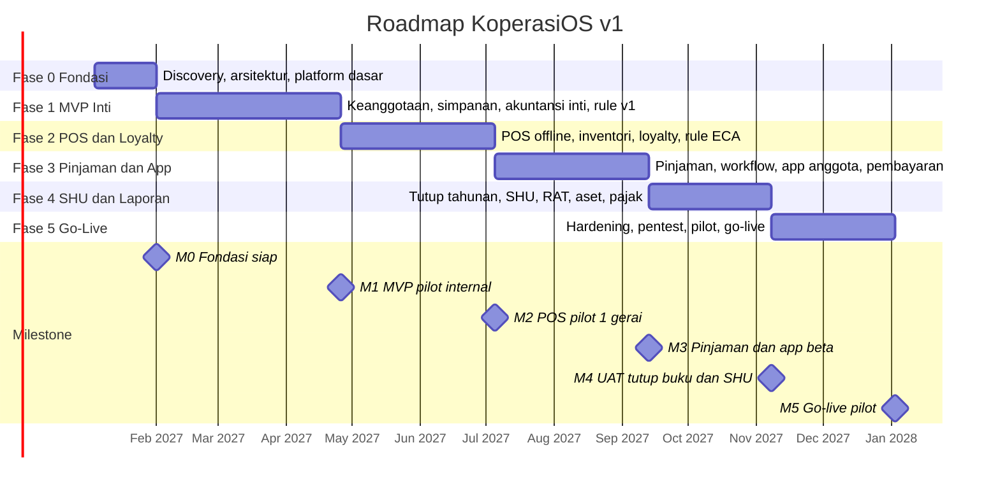

# 08 — Task Todo & Roadmap

[← Kembali ke daftar isi](./README.md)

---

## 1. Asumsi Perencanaan

| Asumsi | Nilai |
|---|---|
| Mulai proyek | Senin, 4 Januari 2027 (dapat digeser; durasi relatif tetap) |
| Durasi total v1 | ±52 minggu (6 fase) |
| Sprint | 2 minggu; demo & retrospektif tiap akhir sprint |
| Estimasi | **hari-orang (HO)**, sudah termasuk unit test; belum termasuk buffer risiko 15% |
| Komposisi tim inti | 1 Product Owner, 1 Tech Lead/Arsitek, 3 Backend, 2 Frontend (web + POS), 1 Mobile, 1 QA Automation, 1 UI/UX Designer, 1 DevOps/SRE (50%), 1 Akuntan konsultan (domain expert, 50%) |
| Kode peran (PIC) | PO, TL, BE, FE, MOB, QA, UX, OPS, AKT |

**Format tugas:** `- [ ] ID — tugas · PIC · estimasi HO · dependensi`

## 2. Roadmap & Milestone

| Milestone | Minggu | Kriteria keluar (exit criteria) |
|---|---|---|
| **M0 — Fondasi siap** | 4 | Monorepo, CI/CD, staging, auth + RBAC, tenant + RLS dengan tes isolasi lulus, COA & rule pack tervalidasi akuntan, desain UX inti disetujui |
| **M1 — MVP pilot internal** | 16 | Satu koperasi contoh dapat: daftar anggota, setor/tarik simpanan, potong gaji via file, jurnal umum & otomatis, buku besar, neraca saldo, neraca, LHU, tutup buku bulanan; rule parameter/formula/tabel dapat dibuat, diuji, disetujui |
| **M2 — POS pilot 1 gerai** | 26 | POS berjalan di 1 gerai nyata ≥ 2 minggu termasuk skenario offline; stok, pembelian, opname, poin, jurnal POS cocok dengan kas |
| **M3 — Pinjaman & app beta** | 36 | Siklus pinjaman penuh (pengajuan → lunas), kolektibilitas & CKPN, workflow persetujuan, app anggota beta di Play Store (internal testing), QRIS/VA & WA aktif |
| **M4 — UAT tutup buku & SHU** | 44 | Simulasi tutup buku tahunan & pembagian SHU dengan data pilot disetujui akuntan; laporan SAK EP lengkap; paket RAT |
| **M5 — Go-live pilot** | 52 | Pentest tanpa temuan kritis/tinggi terbuka, uji beban lulus, 3–5 koperasi pilot live setelah parallel run 1 bulan, runbook & support siap |

### Ringkasan Effort per Fase

| Fase | Fokus | Jumlah tugas | Estimasi tugas langsung (HO) | Termasuk overhead ×1,6 (HO) |
|---|---|---|---|---|
| F0 | Fondasi | 29 | 148 | ±237 |
| F1 | MVP Inti | 58 | 303 | ±485 |
| F2 | POS, Inventori, Loyalty | 44 | 224 | ±358 |
| F3 | Pinjaman, Workflow, App, Pembayaran | 36 | 167 | ±267 |
| F4 | Tutup Tahunan, SHU, Laporan Lanjut | 24 | 111 | ±178 |
| F5 | Hardening, Pilot, Go-Live | 19 | 104 | ±166 |
| **Total** | | **210** | **1.057** | **±1.691** (+15% buffer ≈ 1.945 HO) |

> **Overhead ×1,6** mencakup code review, integrasi antar modul, perbaikan bug, rapat sprint, dokumentasi, dan
> dukungan pilot yang tidak dirinci per tugas. Kapasitas tim inti ±11 FTE × ±220 hari kerja efektif ≈ 2.400 HO,
> tetapi **beban terberat ada di Backend** (3 orang) — pantau velocity BE per sprint. Bila melebihi kapasitas,
> tambah 1 Backend atau tunda fitur P1/P2 (konsolidasi, anggaran, rasio, voucher, report builder).

---

## 3. Fase 0 — Fondasi (Minggu 1–4)

### Epic F0-DISC — Discovery & Validasi Domain
- [ ] `F0-DISC-01` — Wawancara 5–8 koperasi (konsumen/karyawan, KSP, KSU, Kopdes); validasi persona & pain point · PO, UX · 8 HO
- [ ] `F0-DISC-02` — Validasi Bagan Akun Standar, template laporan, matriks posting terhadap Permenkop UKM 2/2024 & SAK EP bersama akuntan/KAP mitra; verifikasi tarif & ketentuan pajak terkini · AKT, PO · 8 HO
- [ ] `F0-DISC-03` — Finalisasi katalog hook & rule pack default per jenis koperasi (nilai awal, kategori persetujuan) · PO, AKT, TL · 5 HO
- [ ] `F0-DISC-04` — Kajian hukum: UU PDP (DPIA awal), pendaftaran PSE, status RUU Perkoperasian, batas *closed loop* (UU P2SK) · PO · 3 HO
- [ ] `F0-DISC-05` — Sitemap, user flow, design system (komponen dasar), prototipe Figma POS, teller, rule builder; uji usabilitas 5 pengguna · UX · 15 HO
- [ ] `F0-DISC-06` — Tetapkan KPI produk & rencana instrumentasi analitik · PO · 2 HO

### Epic F0-ARCH — Fondasi Teknis
- [ ] `F0-ARCH-01` — Setup monorepo Turborepo + pnpm, lint, format, konvensi commit, struktur `apps/` & `packages/` · TL · 3 HO
- [ ] `F0-ARCH-02` — CI GitHub Actions: lint, typecheck, unit test, build, SAST, dependency & secret scan · OPS · 3 HO
- [ ] `F0-ARCH-03` — Terraform: VPC, PostgreSQL terkelola (PITR), Redis, object storage, container runtime, secret manager — staging di region Jakarta · OPS · 8 HO
- [ ] `F0-ARCH-04` — Skeleton NestJS modular monolith + aturan batas modul (dependency-cruiser) · TL · 4 HO
- [ ] `F0-ARCH-05` — Tooling migrasi DB, konvensi (UUIDv7, kolom audit, NUMERIC uang), seed · BE · 3 HO
- [ ] `F0-ARCH-06` — Tenant context middleware + RLS policy generator + **tes negatif lintas tenant** otomatis · BE, TL · 6 HO · dep: F0-ARCH-05
- [ ] `F0-ARCH-07` — Outbox table + worker BullMQ + consumer idempoten + *fair queue* per tenant · BE · 5 HO
- [ ] `F0-ARCH-08` — Paket `@kop/money` (decimal, pembulatan, format Rupiah) + tes properti · BE · 2 HO
- [ ] `F0-ARCH-09` — Paket `@kop/contracts` (Zod → OpenAPI) + generator SDK klien · BE · 3 HO
- [ ] `F0-ARCH-10` — Observability: OpenTelemetry, log terstruktur (masking PII), Sentry, dashboard dasar · OPS · 4 HO
- [ ] `F0-ARCH-11` — Shell Next.js back-office: layout, navigasi, tabel/form dasar, format id-ID · FE · 6 HO
- [ ] `F0-ARCH-12` — Paket `@kop/ui` dari design system · FE · 5 HO · dep: F0-DISC-05
- [ ] `F0-ARCH-13` — Kerangka error: format RFC 9457, registry kode error (dok. 09 §4), exception filter NestJS, idempotency-key middleware, error boundary & komponen status (memuat/kosong/error) di web · BE, FE · 5 HO
- [ ] `F0-ARCH-14` — Paket `@kop/motion`: token gerak, preset, `useReducedMotion`, Storybook (dok. 11) · FE · 3 HO

### Epic F0-PLT/IAM — Platform & Akses
- [ ] `F0-IAM-01` — Auth: login, Argon2id, JWT + refresh rotasi, lockout, TOTP 2FA · BE · 6 HO
- [ ] `F0-IAM-02` — Pengguna lintas tenant (`tenant_users`), pemilihan tenant saat login · BE, FE · 4 HO
- [ ] `F0-IAM-03` — RBAC: permission registry, peran bawaan, peran kustom, lingkup data, guard + UI matriks izin · BE, FE · 8 HO
- [ ] `F0-IAM-04` — Audit log append-only dengan rantai hash + viewer · BE, FE · 5 HO
- [ ] `F0-PLT-01` — Konsol super admin: CRUD tenant, paket, feature flag · BE, FE · 6 HO
- [ ] `F0-PLT-02` — Wizard onboarding tenant (profil, jenis, unit, cabang, tahun buku) + provisioning otomatis · BE, FE · 8 HO · dep: F0-PLT-01
- [ ] `F0-PLT-03` — Pustaka template global berversi (COA, rule pack, laporan) + mekanisme salin ke tenant · BE · 5 HO
- [ ] `F0-PLT-04` — Layanan penomoran dokumen per tenant & periode · BE · 2 HO
- [ ] `F0-PLT-05` — Registrasi & pairing perangkat POS (kode sekali pakai, kunci perangkat) · BE · 3 HO

---

## 4. Fase 1 — MVP Inti (Minggu 5–16)

### Epic F1-ACC — Akuntansi Inti
- [ ] `F1-ACC-01` — Seed COA standar per jenis koperasi (level 1–4 terkunci) + sub-akun tenant + validasi kode · BE, AKT · 5 HO
- [ ] `F1-ACC-02` — UI Bagan Akun: pohon akun, alias, tambah sub-akun, nonaktifkan, pemetaan pos laporan · FE · 5 HO
- [ ] `F1-ACC-03` — Account role registry + pemetaan per lingkup + resolver (paling spesifik) + UI · BE, FE · 6 HO
- [ ] `F1-ACC-04` — Tahun buku & periode (OPEN/SOFT_CLOSED/CLOSED) · BE · 3 HO
- [ ] `F1-ACC-05` — Layanan jurnal: draft, validasi seimbang, posting, pembalik; trigger DB imutabilitas & constraint debit/kredit · BE · 8 HO · dep: F1-ACC-01
- [ ] `F1-ACC-06` — UI jurnal umum (multi baris, dimensi, lampiran, jurnal berulang) + maker-checker · FE, BE · 8 HO
- [ ] `F1-ACC-07` — **Posting Engine**: konsumsi event, evaluasi template posting, resolusi role, idempotensi, antrean posting gagal + UI · BE · 10 HO · dep: F1-RUL-05
- [ ] `F1-ACC-08` — Saldo akun inkremental (`account_balances`) + job rebuild & verifikasi · BE · 5 HO
- [ ] `F1-ACC-09` — Buku besar dengan drill-down ke jurnal & dokumen sumber · BE, FE · 6 HO
- [ ] `F1-ACC-10` — Buku pembantu (simpanan per anggota, piutang, utang) + rekonsiliasi vs akun kontrol · BE, FE · 6 HO
- [ ] `F1-ACC-11` — Kas & bank: kas masuk/keluar, kas kecil, transfer antar kas/bank, buku kas harian · BE, FE · 6 HO
- [ ] `F1-ACC-12` — Wizard saldo awal + rincian buku pembantu + validasi seimbang · BE, FE · 6 HO
- [ ] `F1-ACC-13` — Mesin template laporan (`report_lines`, rumus, tanda) + Neraca Saldo, Neraca, LHU, komparatif, filter dimensi · BE, FE · 10 HO
- [ ] `F1-ACC-14` — Tutup buku bulanan: checklist otomatis, soft close, close, snapshot laporan · BE, FE · 6 HO
- [ ] `F1-ACC-15` — Ekspor PDF/Excel laporan & buku besar · BE · 4 HO
- [ ] `F1-ACC-16` — Tes properti (fast-check): jurnal selalu seimbang, neraca saldo seimbang, buku pembantu = kontrol setelah urutan transaksi acak · QA, BE · 5 HO
- [ ] `F1-ACC-17` — UAT akuntansi bersama akuntan: 50 skenario jurnal dari matriks posting · AKT, QA · 5 HO

### Epic F1-MBR — Keanggotaan
- [ ] `F1-MBR-01` — Model anggota + enkripsi field NIK/KK + HMAC hash + cek duplikat · BE · 5 HO
- [ ] `F1-MBR-02` — Form pendaftaran (data diri, ahli waris, unggah KTP/foto/tanda tangan) · FE · 6 HO
- [ ] `F1-MBR-03` — Alur calon → aktif (hook `member.before_register`, `member.activation_requirements`) + persetujuan · BE · 5 HO
- [ ] `F1-MBR-04` — Nomor anggota otomatis (format dari rule) · BE · 1 HO
- [ ] `F1-MBR-05` — Kartu anggota: token QR, rotasi, PDF kartu · BE, FE · 4 HO
- [ ] `F1-MBR-06` — Siklus status + job `member.status.evaluate` + riwayat · BE · 4 HO
- [ ] `F1-MBR-07` — Proses keluar anggota: hitung hak & kewajiban, kompensasi, jurnal S9–S11 · BE, FE · 6 HO
- [ ] `F1-MBR-08` — Profil 360° (versi F1: data diri, simpanan, riwayat) · FE · 5 HO
- [ ] `F1-MBR-09` — Kelompok anggota (instansi/dusun) · BE, FE · 2 HO
- [ ] `F1-MBR-10` — Consent & masking data sensitif + izin "lihat data sensitif" teraudit · BE, FE · 3 HO
- [ ] `F1-MBR-11` — Impor anggota massal (template Excel, dry run, laporan error) · BE, FE · 5 HO

### Epic F1-SAV — Simpanan
- [ ] `F1-SAV-01` — Produk simpanan (konfigurasi jenis, klasifikasi, batasan) + UI · BE, FE · 4 HO
- [ ] `F1-SAV-02` — Pembukaan rekening otomatis (pokok, wajib) saat calon disetujui · BE · 2 HO
- [ ] `F1-SAV-03` — Layanan transaksi simpanan (locking saldo, saldo berjalan, pembalik, idempotensi) · BE · 6 HO
- [ ] `F1-SAV-04` — UI teller setor/tarik + hook `saving.before_*` + cetak slip · FE, BE · 6 HO
- [ ] `F1-SAV-05` — Posisi kas teller harian & tutup kas teller · BE, FE · 3 HO
- [ ] `F1-SAV-06` — Tagihan simpanan wajib: generate periodik, alokasi pembayaran, denda via rule · BE · 5 HO
- [ ] `F1-SAV-07` — Batch potong gaji: ekspor tagihan, impor realisasi, alokasi, selisih, jurnal S7/S8 · BE, FE · 8 HO
- [ ] `F1-SAV-08` — Jasa simpanan: akrual harian, kapitalisasi bulanan, pajak final via rule, jurnal S5/S6 · BE · 6 HO
- [ ] `F1-SAV-09` — Mutasi/rekening koran & cetak buku simpanan · BE, FE · 4 HO
- [ ] `F1-SAV-10` — Template posting simpanan (S1–S11) + test case · AKT, BE · 3 HO
- [ ] `F1-SAV-11` — Impor saldo simpanan awal per anggota · BE · 3 HO

### Epic F1-RUL — Rule Engine v1
- [ ] `F1-RUL-01` — Paket `@kop/rule-engine`: skema AST `kop.rule/v1`, parser, validator tipe, evaluator, operator & fungsi (§6 dok. 03), batas node/kedalaman/waktu · BE, TL · 10 HO
- [ ] `F1-RUL-02` — Registry hook (definisi variabel, keluaran, aksi diizinkan, strategi, fallback) · BE · 4 HO
- [ ] `F1-RUL-03` — Penyimpanan rule: definisi, versi, effective dating (exclusion constraint), resolusi tenant > pack > default, cache kompilasi · BE · 6 HO
- [ ] `F1-RUL-04` — Tipe PARAMETER, FORMULA, DECISION_TABLE (+ deteksi celah/tumpang tindih) · BE · 6 HO
- [ ] `F1-RUL-05` — Tipe POSTING_TEMPLATE + validator (seimbang via test case, role terpetakan, akun posting) · BE · 5 HO
- [ ] `F1-RUL-06` — Context builder untuk hook F1 (anggota, rekening, simpanan, waktu, param, lookup tabel referensi) · BE · 5 HO
- [ ] `F1-RUL-07` — Log eksekusi (partisi bulanan) + jejak keputusan + UI viewer · BE, FE · 5 HO
- [ ] `F1-RUL-08` — UI katalog aturan, editor parameter, editor formula (autocomplete variabel), editor tabel keputusan · FE · 10 HO
- [ ] `F1-RUL-09` — Generator kalimat bahasa Indonesia dari AST · BE · 3 HO
- [ ] `F1-RUL-10` — Test case & uji cepat (bandingkan versi aktif vs draft) · BE, FE · 5 HO
- [ ] `F1-RUL-11` — Alur persetujuan publikasi rule sesuai kategori (maker-checker) + siklus hidup lengkap · BE, FE · 5 HO
- [ ] `F1-RUL-12` — Seed rule pack default 4 jenis koperasi + penanda "belum dikonfirmasi" di onboarding · AKT, BE · 4 HO
- [ ] `F1-RUL-13` — Tabel referensi (lookup) & UI · BE, FE · 3 HO

### Epic F1-RPT & Lainnya
- [ ] `F1-RPT-01` — Dashboard v1 (anggota, simpanan, kas & bank, SHU berjalan, tindakan tertunda) · FE, BE · 5 HO
- [ ] `F1-RPT-02` — Laporan simpanan (rekap per produk, per anggota, tunggakan wajib) · BE, FE · 4 HO
- [ ] `F1-ORG-01` — Profil koperasi, cabang, unit usaha, pengurus & pengawas, dokumen AD/ART · BE, FE · 4 HO
- [ ] `F1-QA-01` — E2E Playwright alur F1 (daftar anggota → setor → jurnal → laporan → tutup buku) · QA · 6 HO
- [ ] `F1-QA-02` — Pilot internal dengan data contoh 1 koperasi + perbaikan · semua · 8 HO
- [ ] `F1-QA-03` — Tes otomatis edge case F1 (EC-01..EC-10, EC-28..EC-32, EC-40..EC-42) & tes setiap kode error endpoint F1 · QA, BE · 5 HO

---

## 5. Fase 2 — POS, Inventori & Loyalty (Minggu 17–26)

### Epic F2-INV — Produk, Stok & Pembelian
- [ ] `F2-INV-01` — Master produk, kategori, merek, barcode ganda, satuan & konversi, custom field · BE, FE · 6 HO
- [ ] `F2-INV-02` — Daftar harga (anggota/umum/grosir/qty) + hook `pos.price.resolve` · BE, FE · 5 HO
- [ ] `F2-INV-03` — Gudang & stok per lokasi; mutasi stok & rata-rata bergerak; kartu stok · BE · 6 HO
- [ ] `F2-INV-04` — Supplier (termasuk anggota sebagai pemasok) · BE, FE · 2 HO
- [ ] `F2-INV-05` — PO, GRN (batch & kedaluwarsa), faktur supplier, retur, pembayaran + jurnal B1–B4 · BE, FE · 10 HO
- [ ] `F2-INV-06` — Stok opname (input via HP), penyesuaian dengan persetujuan + jurnal B5/B6 · BE, FE · 5 HO
- [ ] `F2-INV-07` — Transfer stok antar gudang/gerai · BE, FE · 3 HO
- [ ] `F2-INV-08` — Stok minimum & saran pemesanan; peringatan kedaluwarsa · BE, FE · 3 HO
- [ ] `F2-INV-09` — Konsinyasi: produk titipan, utang ke penitip, komisi, settlement & pembayaran (B7) · BE, FE · 5 HO
- [ ] `F2-INV-10` — Impor produk & stok awal · BE · 2 HO

### Epic F2-POS — Point of Sale Offline-First
- [ ] `F2-POS-01` — Shell PWA (Vite React), service worker, IndexedDB (Dexie), login perangkat & kasir · FE · 6 HO
- [ ] `F2-POS-02` — Sinkron turun (delta): produk, harga, anggota terbatas, saldo ringkas, rule bundle · BE, FE · 6 HO
- [ ] `F2-POS-03` — Build & tanda tangan rule bundle (Ed25519) + verifikasi di perangkat · BE, FE · 4 HO
- [ ] `F2-POS-04` — Paket `@kop/pricing` (harga, diskon, poin) memakai `@kop/rule-engine` — identik server & POS + tes kesetaraan · BE · 6 HO
- [ ] `F2-POS-05` — Layar kasir: scan/cari, keranjang, qty/satuan, diskon dengan PIN supervisor, tahan transaksi · FE · 8 HO
- [ ] `F2-POS-06` — Identifikasi anggota (QR/no. anggota/HP), tampilan tier/poin/saldo/limit · FE · 3 HO
- [ ] `F2-POS-07` — Pembayaran split: tunai, QRIS statis (F2), EDC, transfer, saldo sukarela, kredit anggota, poin; batas offline · FE, BE · 8 HO
- [ ] `F2-POS-08` — Shift: buka, tutup, hitung pecahan, selisih (rule), setoran kas (P9–P11) · FE, BE · 5 HO
- [ ] `F2-POS-09` — Cetak struk ESC/POS (USB/Bluetooth/LAN) + struk digital WA (antre) · FE · 6 HO
- [ ] `F2-POS-10` — Retur & void dengan otorisasi; pembalikan stok & jurnal (P7) · FE, BE · 5 HO
- [ ] `F2-POS-11` — Outbox perangkat & sinkron naik: batch, idempotensi `client_txn_id`, ack, retry · FE, BE · 6 HO
- [ ] `F2-POS-12` — Sync Gateway server: proses penjualan (stok, HPP, saldo, piutang, poin), antrean pengecualian + UI tindak lanjut · BE, FE · 10 HO
- [ ] `F2-POS-13` — Posting POS: template P1–P6, mode per transaksi vs ringkas per shift · BE, AKT · 5 HO
- [ ] `F2-POS-14` — Kebijakan transaksi terlambat ke periode tertutup + kunci POS bila tidak sinkron > N jam · BE · 3 HO
- [ ] `F2-POS-15` — Bungkus Capacitor Android + plugin printer/scanner/cash drawer · FE · 6 HO
- [ ] `F2-POS-16` — Laporan kasir & penjualan (shift, kasir, metode bayar, anggota vs non-anggota, produk) · BE, FE · 4 HO
- [ ] `F2-POS-17` — Matriks uji perangkat keras (3 printer, 2 scanner, 3 tablet Android murah) · QA · 4 HO
- [ ] `F2-POS-18` — Uji chaos offline: putus koneksi di tiap langkah, unggah ganda, jam perangkat salah · QA · 4 HO
- [ ] `F2-POS-19` — Umpan balik interaksi POS: animasi CSS POS-A1..A12, suara, getar, mode performa (Penuh/Minimal/Mati) + uji frame di perangkat referensi · FE · 4 HO

### Epic F2-LOY — Loyalty
- [ ] `F2-LOY-01` — Akun poin (anggota & pelanggan non-anggota), ledger imutabel, bucket FIFO · BE · 5 HO
- [ ] `F2-LOY-02` — Earn via hook `loyalty.points.earn` & aksi `award_points`; redeem sebagai metode bayar · BE · 4 HO
- [ ] `F2-LOY-03` — Job kedaluwarsa + notifikasi H-30; jurnal P4–P6 · BE · 3 HO
- [ ] `F2-LOY-04` — Tier & evaluasi bulanan (`member.tier.evaluate`) · BE · 3 HO
- [ ] `F2-LOY-05` — UI program poin, tier, riwayat poin per anggota · FE · 4 HO
- [ ] `F2-MBR-01` — Pelanggan non-anggota terdaftar & konversi ke calon anggota · BE, FE · 3 HO

### Epic F2-RUL — Rule Engine v2
- [ ] `F2-RUL-01` — Tipe ECA: mode SYNC_GUARD & ASYNC, katalog aksi, eksekusi aksi via outbox idempoten · BE · 8 HO
- [ ] `F2-RUL-02` — Strategi penggabungan (BEST_FOR_CUSTOMER, STACK_WITH_CAP, SUM, MIN, ALL_MUST_PASS) · BE · 4 HO
- [ ] `F2-RUL-03` — Deteksi siklus ECA & batas rantai · BE · 3 HO
- [ ] `F2-RUL-04` — UI builder ECA (mode Sederhana: WHEN–IF–THEN, grup kondisi) · FE · 8 HO
- [ ] `F2-RUL-05` — Replay historis di read replica + laporan dampak per hook + diff versi · BE, FE · 8 HO
- [ ] `F2-RUL-06` — Shadow mode · BE · 4 HO
- [ ] `F2-RUL-07` — Rule terjadwal (`SCHEDULED`) + custom field sebagai variabel · BE · 4 HO
- [ ] `F2-PLT-01` — Subdomain & white-label (logo/warna di back-office & struk) · FE, OPS · 3 HO
- [ ] `F2-QA-01` — Pilot POS di 1 gerai nyata 2 minggu + perbaikan · semua · 10 HO

---

## 6. Fase 3 — Pinjaman, Workflow, Aplikasi Anggota & Pembayaran (Minggu 27–36)

### Epic F3-LON — Pinjaman
- [ ] `F3-LON-01` — Produk pinjaman (metode bunga, tenor, biaya, denda, urutan alokasi, rule terkait) + UI · BE, FE · 5 HO
- [ ] `F3-LON-02` — Generator jadwal angsuran flat/efektif/anuitas + pembulatan; diuji terhadap spreadsheet referensi akuntan · BE, AKT · 5 HO
- [ ] `F3-LON-03` — Pengajuan + simulasi + unggah dokumen; hook eligibility/plafond/rate/fees; snapshot versi rule · BE, FE · 8 HO
- [ ] `F3-LON-04` — Akad: template dokumen bervariabel → PDF · BE · 4 HO
- [ ] `F3-LON-05` — Pencairan (tunai/transfer/ke simpanan) maker-checker + jurnal L1 · BE, FE · 4 HO
- [ ] `F3-LON-06` — Pembayaran angsuran (teller, autodebet, potong gaji) + alokasi + kelebihan bayar (L3, L4) · BE, FE · 6 HO
- [ ] `F3-LON-07` — Job harian DPD & denda; job akrual jasa bulanan (L2) · BE · 4 HO
- [ ] `F3-LON-08` — Kolektibilitas harian + CKPN bulanan (L5, L6) + laporan CKPN per kategori · BE · 5 HO
- [ ] `F3-LON-09` — Pelunasan dipercepat, restrukturisasi, hapus buku & pemulihan (L7–L9) · BE, FE · 6 HO
- [ ] `F3-LON-10` — Agunan: registrasi, dokumen, status · BE, FE · 3 HO
- [ ] `F3-LON-11` — Kredit barang dari POS → pinjaman cicilan (P13) · BE · 3 HO
- [ ] `F3-LON-12` — Integrasi angsuran ke batch potong gaji · BE · 2 HO
- [ ] `F3-LON-13` — Laporan portofolio: outstanding, aging, NPL, jatuh tempo, proyeksi arus kas · BE, FE · 5 HO
- [ ] `F3-LON-14` — Impor pinjaman berjalan + sisa jadwal dari sistem lama · BE · 3 HO
- [ ] `F3-SAV-01` — Simpanan berjangka (tenor, ARO, pencairan dini, bilyet) · BE, FE · 5 HO
- [ ] `F3-SAV-02` — Autodebet simpanan wajib & angsuran dari saldo sukarela · BE · 3 HO

### Epic F3-WF — Workflow Persetujuan
- [ ] `F3-WF-01` — Tipe rule WORKFLOW: rute, langkah serial/paralel, minimal penyetuju, constraint (pembuat ≠ penyetuju) · BE · 6 HO
- [ ] `F3-WF-02` — Mesin instance & tugas: SLA, eskalasi, delegasi, pembatalan · BE · 6 HO
- [ ] `F3-WF-03` — Inbox persetujuan (web) + notifikasi · FE · 5 HO
- [ ] `F3-WF-04` — Migrasikan maker-checker F1 (jurnal, opname, rule) ke mesin workflow · BE · 3 HO

### Epic F3-APP — Aplikasi Anggota
- [ ] `F3-APP-01` — Setup Expo, navigasi, tema per tenant, build pipeline (EAS) · MOB · 4 HO
- [ ] `F3-APP-02` — Login OTP WA/SMS, PIN, biometrik, multi koperasi · MOB, BE · 6 HO
- [ ] `F3-APP-03` — Beranda, kartu QR dinamis, mutasi simpanan, riwayat belanja & poin · MOB · 8 HO
- [ ] `F3-APP-04` — Pinjaman: simulasi, pengajuan, status, jadwal; alasan penolakan dari jejak rule · MOB · 6 HO
- [ ] `F3-APP-05` — Pembayaran via VA/QRIS · MOB, BE · 4 HO
- [ ] `F3-APP-06` — Notifikasi push, pengumuman, profil & permintaan ubah data / hak subjek data · MOB, BE · 5 HO
- [ ] `F3-APP-07` — Cache offline & mode hemat data · MOB · 3 HO
- [ ] `F3-APP-08` — Rilis beta (internal testing Play Store & TestFlight) · MOB · 2 HO
- [ ] `F3-APP-09` — Animasi & haptics aplikasi anggota (APP-A1..A11) dengan Reanimated + mode kurangi gerakan · MOB · 4 HO

### Epic F3-INT — Pembayaran & Notifikasi
- [ ] `F3-INT-01` — Adapter payment gateway (QRIS dinamis, VA per anggota), verifikasi signature webhook, idempotensi · BE · 8 HO
- [ ] `F3-INT-02` — Rekonsiliasi settlement & MDR (P8) + laporan selisih · BE · 4 HO
- [ ] `F3-INT-03` — QRIS dinamis di POS (online) · FE, BE · 3 HO
- [ ] `F3-INT-04` — Integrasi WhatsApp BSP: template, opt-in, status kirim; email & SMS fallback · BE · 6 HO
- [ ] `F3-INT-05` — Template notifikasi editable + pemicu ECA/jadwal (pengingat angsuran H-3, tagihan wajib) · BE, FE · 4 HO
- [ ] `F3-PLT-01` — Impersonasi dukungan dengan persetujuan tenant & audit · BE, FE · 3 HO
- [ ] `F3-QA-01` — E2E siklus pinjaman & uji kalkulasi terhadap 30 kasus akuntan · QA, AKT · 6 HO

---

## 7. Fase 4 — Tutup Buku Tahunan, SHU & Pelaporan Lanjut (Minggu 37–44)

### Epic F4-ACC — Akuntansi Lanjut
- [ ] `F4-ACC-01` — Aset tetap: register, kategori, penyusutan bulanan otomatis, pelepasan (K4–K6) · BE, FE · 6 HO
- [ ] `F4-ACC-02` — Laporan Perubahan Ekuitas · BE · 3 HO
- [ ] `F4-ACC-03` — Laporan Arus Kas langsung (klasifikasi akun lawan) & tidak langsung + uji silang · BE, AKT · 6 HO
- [ ] `F4-ACC-04` — CaLK: template naratif + tabel rincian otomatis + editor · BE, FE · 6 HO
- [ ] `F4-ACC-05` — Neraca lajur 10 kolom · BE, FE · 3 HO
- [ ] `F4-ACC-06` — Tutup buku tahunan: jurnal penutup Y1–Y4, buka tahun baru, carry forward, kunci tahun · BE · 6 HO
- [ ] `F4-ACC-07` — Rekonsiliasi bank: impor CSV/MT940, aturan pencocokan otomatis, pencocokan manual · BE, FE · 6 HO
- [ ] `F4-ACC-08` — Konsolidasi multi unit/cabang + eliminasi antar unit · BE · 5 HO
- [ ] `F4-ACC-09` — Anggaran (RAPB) & realisasi vs anggaran · BE, FE · 5 HO
- [ ] `F4-ACC-10` — Pajak: kode pajak berversi, rekap PPN/PPh, ekspor · BE, FE · 5 HO
- [ ] `F4-ACC-11` — Analisis rasio & tren · BE, FE · 4 HO

### Epic F4-SHU — SHU & RAT
- [ ] `F4-SHU-01` — Kalkulator SHU: ambil SHU bersih, terapkan `shu.allocation`, validasi 100% · BE · 4 HO
- [ ] `F4-SHU-02` — Dasar jasa modal (saldo akhir / rata-rata bulanan) & jasa usaha (belanja, jasa pinjaman, penjualan ke koperasi) via rule · BE · 6 HO
- [ ] `F4-SHU-03` — Pembagian per anggota + pembulatan + akun selisih; skenario & perbandingan · BE, FE · 5 HO
- [ ] `F4-SHU-04` — Penetapan setelah RAT (unggah notulen, persetujuan) + jurnal Y5 · BE, FE · 3 HO
- [ ] `F4-SHU-05` — Distribusi: tunai/transfer/ke simpanan, pajak (`shu.tax`), jurnal Y6, slip SHU (PDF/WA/app) · BE, FE · 5 HO
- [ ] `F4-SHU-06` — Dana-dana: saldo & pemakaian (Y7) · BE, FE · 3 HO
- [ ] `F4-SHU-07` — Paket laporan RAT (keuangan, keanggotaan, usaha, SHU, RAPB) → PDF/Word · BE · 5 HO
- [ ] `F4-SHU-08` — Estimasi SHU berjalan & riwayat SHU di aplikasi anggota · MOB, BE · 3 HO
- [ ] `F4-QA-01` — UAT tutup buku tahunan & SHU dengan data pilot bersama akuntan · AKT, QA · 6 HO

### Epic F4-PLT — Komersial Platform
- [ ] `F4-PLT-01` — Billing langganan: tagihan otomatis, tautan bayar, masa tenggang, suspend · BE, FE · 6 HO
- [ ] `F4-PLT-02` — Monitoring penggunaan & kuota per tenant + dashboard platform agregat · BE, FE · 4 HO
- [ ] `F4-PLT-03` — Ekspor data tenant penuh & proses penutupan (retensi 10 tahun terenkripsi) · BE · 4 HO
- [ ] `F4-RPT-01` — Laporan terjadwal via email ke pengurus · BE · 2 HO

---

## 8. Fase 5 — Hardening, Pilot & Go-Live (Minggu 45–52)

### Epic F5-SEC — Keamanan & Kepatuhan
- [ ] `F5-SEC-01` — Threat modeling ulang (STRIDE) & checklist OWASP ASVS L2 · TL · 4 HO
- [ ] `F5-SEC-02` — Penetration test pihak ketiga + remediasi temuan kritis/tinggi · OPS, BE · 10 HO
- [ ] `F5-SEC-03` — Audit isolasi tenant (review RLS, tes negatif menyeluruh, fuzzing ID) · BE, QA · 4 HO
- [ ] `F5-SEC-04` — Rotasi kunci & secret, enkripsi field per tenant (KMS), uji pemulihan kunci · OPS · 3 HO
- [ ] `F5-SEC-05` — UU PDP: ROPA, DPIA final, kebijakan privasi, prosedur insiden 3×24 jam, prosedur hak subjek data · PO · 4 HO
- [ ] `F5-SEC-06` — Pendaftaran PSE & dokumen legal (S&K, SLA, DPA dengan tenant) · PO · 3 HO

### Epic F5-OPS — Keandalan
- [ ] `F5-OPS-01` — Uji beban k6: puncak sinkron POS, akhir bulan ribuan tenant, laporan berat · QA, OPS · 6 HO
- [ ] `F5-OPS-02` — Tuning indeks & partisi `journal_lines`, read replica untuk laporan · BE · 4 HO
- [ ] `F5-OPS-03` — Drill backup/restore & DR (RPO 15 menit, RTO 4 jam) + restore logis per tenant · OPS · 4 HO
- [ ] `F5-OPS-04` — Runbook insiden, on-call, alert (posting gagal, antrean sinkron, error rule), status page · OPS · 4 HO
- [ ] `F5-OPS-05` — Lingkungan produksi via Terraform + deploy bertahap (canary) · OPS · 5 HO

### Epic F5-PILOT — Pilot & Go-Live
- [ ] `F5-PILOT-01` — Pilih 3–5 koperasi pilot berbeda jenis; perjanjian pilot · PO · 2 HO
- [ ] `F5-PILOT-02` — Migrasi data tiap pilot (anggota, saldo, pinjaman, saldo awal, produk) + rekonsiliasi dengan neraca lama · BE, AKT · 12 HO
- [ ] `F5-PILOT-03` — Konfirmasi rule AD/ART tiap pilot & pemetaan account role · AKT, PO · 5 HO
- [ ] `F5-PILOT-04` — Parallel run 1 bulan: bandingkan saldo & laporan dengan sistem lama, log & perbaiki selisih · AKT, QA · 10 HO
- [ ] `F5-PILOT-05` — Pelatihan: video, manual pengguna, SOP kasir/teller/akuntan, pusat bantuan · UX, PO · 8 HO
- [ ] `F5-PILOT-06` — Instalasi perangkat POS di gerai pilot · FE, OPS · 4 HO
- [ ] `F5-PILOT-07` — Go-live + hypercare 2 minggu + rilis aplikasi anggota publik · semua · 10 HO
- [ ] `F5-PILOT-08` — Evaluasi KPI pilot & backlog v1.1 · PO · 2 HO

---

## 9. Backlog Setelah v1 (P2 / Lanjutan)

- [ ] Akad syariah (KSPPS): murabahah, mudharabah, musyarakah, ijarah + COA & laporan syariah
- [ ] e-RAT: undangan, daftar hadir, kuorum, voting digital
- [ ] Report builder kustom
- [ ] Voucher & promo kode; poin dari aktivitas non-belanja
- [ ] Kolektor lapangan (aplikasi, rute, setoran kolektor)
- [ ] PPOB & penjualan jasa
- [ ] API publik & webhook untuk integrasi pihak ketiga
- [ ] e-Sign & e-Meterai untuk akad
- [ ] Ekspor/integrasi laporan ke sistem pembina (Dinas/Kementerian) bila API tersedia
- [ ] SSO OIDC/SAML untuk koperasi karyawan korporasi
- [ ] Marketplace antar koperasi & pembelian bersama (koperasi sekunder)
- [ ] Modul koperasi produsen (pembelian hasil anggota terjadwal, saprodi)

---

## 10. Definition of Done (DoD)

Sebuah tugas dinyatakan selesai bila:

- [ ] Kode di-review minimal 1 engineer lain (2 untuk modul akuntansi, rule engine, auth, RLS)
- [ ] Unit test lulus; coverage modul akuntansi & rule engine ≥ 80%
- [ ] Tes integrasi dengan PostgreSQL nyata (Testcontainers) untuk perubahan skema/akses data
- [ ] Tes negatif lintas tenant untuk endpoint baru
- [ ] Setiap transaksi baru yang berdampak keuangan memiliki template posting + test case seimbang + disetujui akuntan
- [ ] Setiap aksi tulis tercatat di audit log; data sensitif ter-masking di log
- [ ] OpenAPI diperbarui; migrasi DB dapat di-rollback
- [ ] UI memenuhi checklist aksesibilitas dasar & teks Bahasa Indonesia ditinjau
- [ ] Fitur di balik feature flag bila belum siap untuk semua tenant
- [ ] Didemokan ke PO dan diterima sesuai acceptance criteria
- [ ] Kode error & edge case sesuai dok. 09 §12; endpoint uang/stok/poin teruji idempoten
- [ ] Layar punya status memuat/kosong/error/berhasil; animasi memakai token `@kop/motion` dan lulus uji reduced motion (dok. 11 §9)

## 11. Strategi Pengujian

| Lapisan | Alat | Fokus |
|---|---|---|
| Unit | Vitest | Kalkulasi uang, jadwal angsuran, jasa simpanan, evaluator rule, resolusi harga |
| Property-based | fast-check | Invarian akuntansi (seimbang, buku pembantu = kontrol), determinisme rule, kesetaraan hasil server vs POS |
| Integrasi | Testcontainers (PostgreSQL, Redis) | RLS, trigger imutabilitas, outbox, idempotensi sinkron |
| Kontrak | Zod/OpenAPI | Kompatibilitas API untuk POS & aplikasi anggota versi lama |
| E2E | Playwright | Alur kritis back-office & POS (termasuk simulasi offline) |
| Mobile | Detox / Maestro | Login, kartu QR, pengajuan pinjaman |
| Beban | k6 | Sinkron POS, job akhir bulan, laporan |
| Keamanan | SAST, DAST, pentest | OWASP Top 10, isolasi tenant |
| UAT | Akuntan + koperasi pilot | Skenario jurnal, tutup buku, SHU, parallel run |

## 12. Checklist Go-Live per Tenant

- [ ] Profil koperasi, unit, cabang, gerai, gudang lengkap
- [ ] Pengguna & peran ditetapkan; 2FA aktif untuk peran keuangan
- [ ] Rule AD/ART dikonfirmasi pengurus (simpanan pokok/wajib, syarat anggota, alokasi SHU)
- [ ] Pemetaan account role lengkap (tidak ada role kosong)
- [ ] Saldo awal diposting; neraca saldo seimbang; buku pembantu = akun kontrol; cocok dengan neraca lama
- [ ] Data anggota, saldo simpanan, pinjaman berjalan terimpor dan diverifikasi sampel
- [ ] Produk, harga, stok awal terimpor; stok opname awal dilakukan
- [ ] Perangkat POS terdaftar, printer & scanner teruji, uji offline dilakukan
- [ ] Template notifikasi WA disetujui & opt-in anggota dikumpulkan
- [ ] Pelatihan kasir, teller, akuntan, pengurus selesai
- [ ] Kontak dukungan & jalur eskalasi diketahui tenant

## 13. Pertanyaan Terbuka (perlu keputusan stakeholder)

| # | Pertanyaan | Pemilik | Target jawaban |
|---|---|---|---|
| Q1 | Format final Laporan Hasil Usaha & CaLK mengikuti lampiran Permenkop 2/2024 persis, atau dengan penyesuaian? | Akuntan/KAP | Minggu 3 |
| Q2 | Kebijakan default pengakuan jasa pinjaman: akrual atau saat diterima (kas) untuk koperasi kecil? | Akuntan | Minggu 3 |
| Q3 | Kebijakan CKPN default: persentase per kolektibilitas atau penilaian individual untuk pinjaman besar? | Akuntan | Minggu 3 |
| Q4 | Perlakuan akuntansi poin: nilai penuh atau dengan estimasi tingkat penukaran? | Akuntan | Minggu 3 |
| Q5 | Granularitas default posting POS: per transaksi atau ringkas per shift? | Akuntan, PO | Minggu 4 |
| Q6 | Model harga SaaS (per anggota aktif, per unit usaha, atau flat per paket)? | PO, bisnis | Minggu 8 |
| Q7 | Vendor payment gateway & WhatsApp BSP yang dipilih (minimal 2 untuk cadangan)? | TL, PO | Minggu 12 |
| Q8 | Apakah perlu integrasi dengan sistem informasi Kopdes milik pemerintah pada v1, dan apakah API tersedia? | PO | Minggu 4 |
| Q9 | Kapan modul syariah (KSPPS) dibutuhkan pasar? Menentukan prioritas backlog | PO | Minggu 16 |
| Q10 | Batas default transaksi non-tunai offline per anggota & lama maksimum offline sebelum POS terkunci? | PO, pilot | Minggu 18 |

[← 07 Wireframe](./07-wireframe.md) · [Lanjut ke 09 — Error Handling & Edge Case →](./09-error-handling-dan-edge-case.md)
