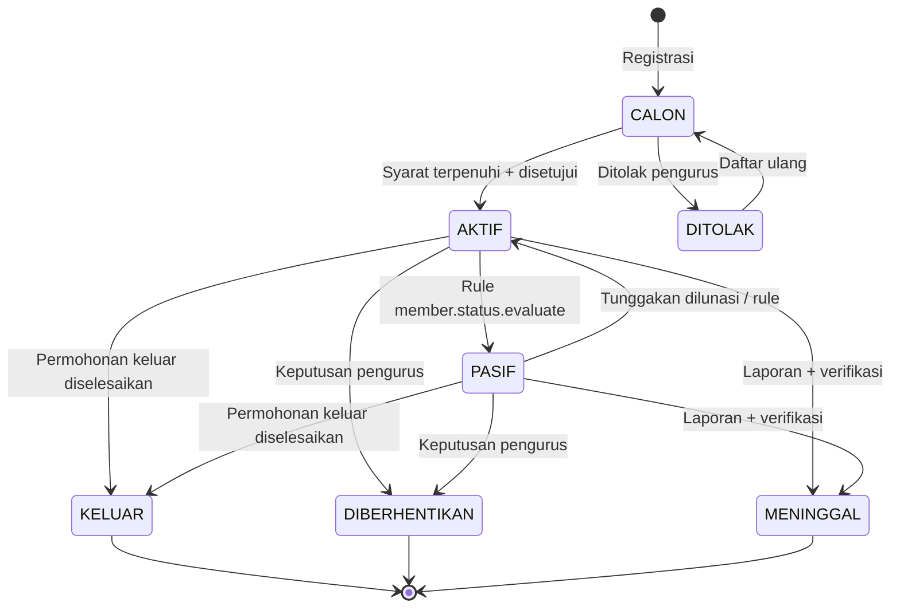
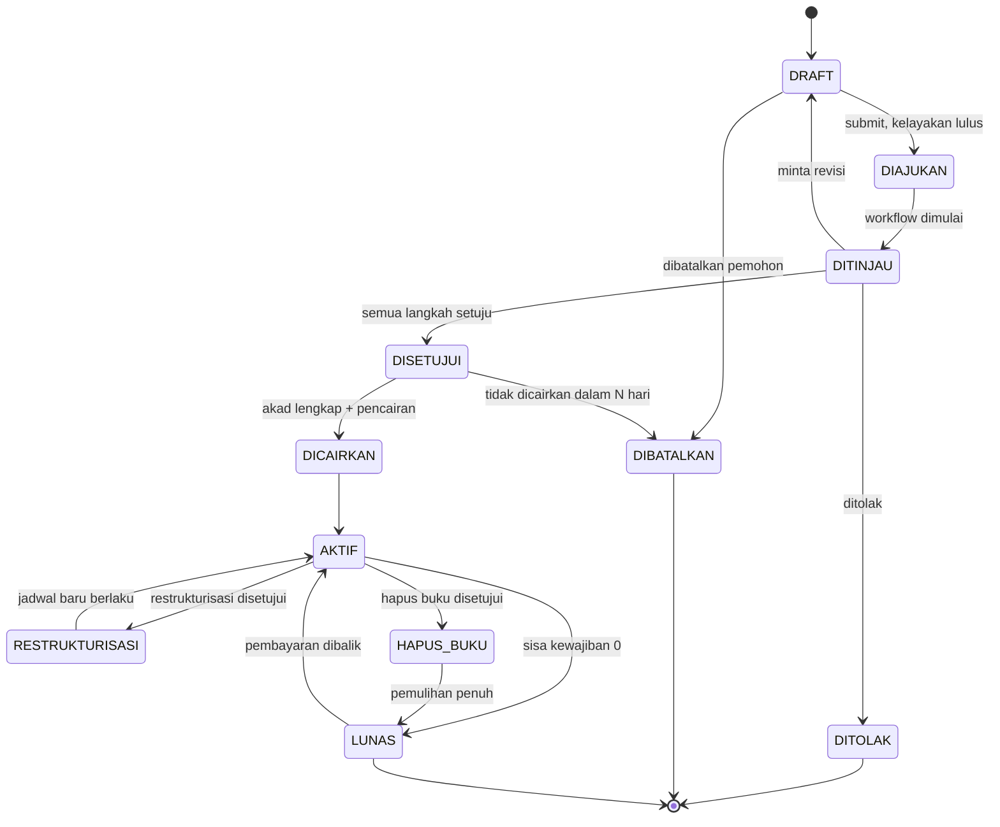
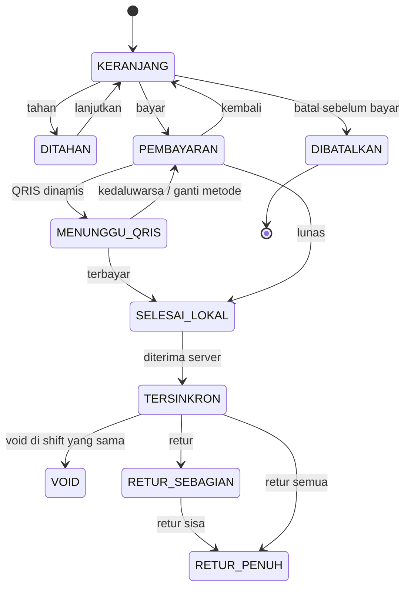
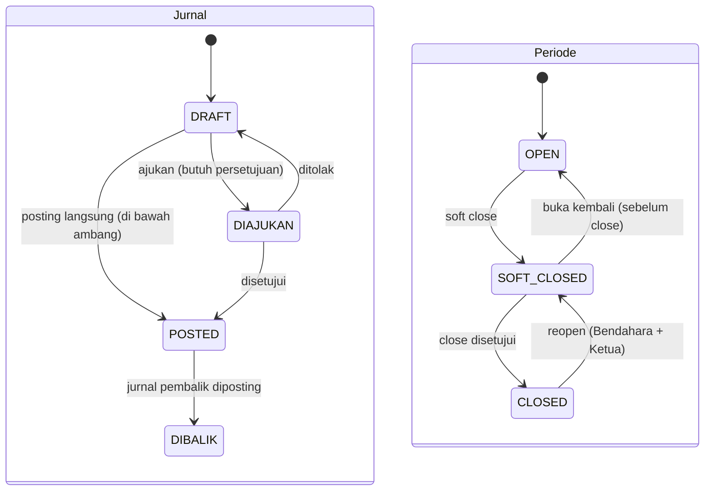

# 10 — Spesifikasi Teknis Detail

[← Kembali ke daftar isi](./README.md)

---

Dokumen ini melengkapi 01–09 dengan detail yang dibutuhkan untuk implementasi tanpa menebak: konvensi API,
katalog endpoint, katalog event, *state machine*, rumus kalkulasi, aturan validasi, matriks izin, penomoran
dokumen, waktu, keamanan, notifikasi, dan format impor.

## 1. Konvensi API

| Aspek | Aturan |
|---|---|
| Base URL | `https://api.<domain>/api/v1` ; POS sinkron: `/api/v1/sync` ; aplikasi anggota: `/api/v1/member` |
| Autentikasi | `Authorization: Bearer <jwt>`; klaim: `sub`, `tid` (tenant aktif), `roles`, `scopes`, `sid`; ganti tenant = token baru via `POST /auth/switch-tenant` |
| Perangkat POS | Token perangkat (`device_token`) + JWT kasir; setiap request sinkron ditandatangani kunci perangkat (header `X-Device-Signature`) |
| Format | JSON, `snake_case` |
| Uang | **String desimal** (`"150000.00"`), tidak pernah number JSON |
| Tanggal | Tanggal akuntansi `YYYY-MM-DD`; waktu ISO 8601 UTC (`2027-03-31T16:30:00Z`) |
| ID | UUIDv7 string |
| Paginasi | Cursor: `?limit=50&cursor=<opaque>`; respons `{ "data": [...], "next_cursor": "...", "has_more": true }`; maks `limit` 200 |
| Filter & urut | `?filter[status]=AKTIF&filter[joined_at][gte]=2026-01-01&sort=-created_at` |
| Konkurensi | Respons GET memuat `ETag`; PATCH/PUT wajib `If-Match` |
| Idempotensi | `Idempotency-Key` wajib untuk endpoint bertanda ⓘ di §2 |
| Error | RFC 9457 (dokumen 09 §2) |
| Versi | Versi mayor di path; perubahan *breaking* hanya di versi baru; POS & app versi lama didukung ≥ 6 bulan |
| Rate limit | Default 600 req/menit per pengguna, 60 req/menit untuk login/OTP per IP, 30 req/menit untuk ekspor laporan per tenant |
| Dokumentasi | OpenAPI 3.1 di-generate dari skema Zod; dipublikasi di `/api/docs` (staging) |

## 2. Katalog Endpoint Utama

ⓘ = wajib `Idempotency-Key`. Izin mengacu ke §8.

### 2.1 Auth, IAM, Platform

| Method | Path | Izin | Catatan |
|---|---|---|---|
| POST | `/auth/login` | publik | Mengembalikan daftar tenant bila > 1 |
| POST | `/auth/mfa/verify` | publik (token sementara) | |
| POST | `/auth/refresh` | refresh token | Rotasi; refresh token lama dicabut |
| POST | `/auth/switch-tenant` | terautentikasi | |
| POST | `/auth/logout` | terautentikasi | |
| GET/POST/PATCH | `/users`, `/users/{id}` | `iam.user.*` | Undang via email/WA |
| GET/POST/PATCH | `/roles`, `/roles/{id}/permissions` | `iam.role.*` | |
| GET | `/audit-logs` | `iam.audit.read` | Filter entitas, pengguna, tanggal |
| POST | `/devices/pairing-codes` · POST `/devices/pair` | `pos.device.manage` · kode | |
| GET/POST/PATCH | `/platform/tenants`, `/platform/plans` | peran platform | Konsol super admin |
| POST | `/platform/tenants/{id}/impersonation-requests` | peran platform | Butuh persetujuan admin tenant |

### 2.2 Organisasi & Keanggotaan

| Method | Path | Izin | Catatan |
|---|---|---|---|
| GET/PATCH | `/organization`, `/branches`, `/business-units`, `/officers` | `org.*` | |
| GET/POST | `/members` | `mbr.member.read/create` | Cari: `?q=` (nama, no. anggota, HP), NIK via `?nik=` (dicocokkan hash) |
| GET/PATCH | `/members/{id}` | `mbr.member.read/update` | Field sensitif hanya dengan `mbr.sensitive.read` |
| POST | `/members/{id}/submit-activation` ⓘ | `mbr.member.create` | Evaluasi syarat |
| POST | `/members/{id}/approve` · `/reject` ⓘ | `mbr.member.approve` | |
| POST | `/members/{id}/exit-requests` ⓘ | `mbr.member.exit` | Menghitung hak & kewajiban |
| POST | `/members/{id}/cards/rotate` ⓘ | `mbr.card.manage` | |
| GET | `/members/{id}/summary` | `mbr.member.read` | Data profil 360° |
| GET | `/members/resolve-card?token=` | `pos.sale.create` | Untuk POS; token QR → ringkasan anggota |
| POST | `/imports/members` ⓘ | `imp.run` | Dry run: `?dry_run=true` |
| GET/POST | `/loyalty/accounts/{id}/ledger` | `loy.*` | |

### 2.3 Simpanan & Pinjaman

| Method | Path | Izin | Catatan |
|---|---|---|---|
| GET/POST/PATCH | `/saving-products` | `sav.product.*` | |
| GET | `/saving-accounts?member_id=` | `sav.account.read` | |
| POST | `/saving-accounts/{id}/deposits` ⓘ | `sav.txn.deposit` | Body: `amount`, `channel`, `value_date`, `allocations?` |
| POST | `/saving-accounts/{id}/withdrawals` ⓘ | `sav.txn.withdraw` | |
| POST | `/saving-transactions/{id}/reverse` ⓘ | `sav.txn.reverse` | Maker-checker |
| GET | `/saving-accounts/{id}/statement?from=&to=` | `sav.account.read` | PDF via `Accept: application/pdf` |
| POST | `/saving-bills/generate` ⓘ | `sav.bill.generate` | Periode |
| POST | `/payroll-batches` ⓘ · GET `/payroll-batches/{id}/export` · POST `/payroll-batches/{id}/realization` ⓘ | `sav.payroll.*` | |
| GET/POST/PATCH | `/loan-products` | `lon.product.*` | |
| POST | `/loan-applications/simulate` | `lon.app.create` | Tanpa simpan; hasil jadwal + plafon + kelayakan |
| POST | `/loan-applications` ⓘ · POST `/loan-applications/{id}/submit` ⓘ | `lon.app.create` | |
| POST | `/loan-applications/{id}/disburse` ⓘ | `lon.disburse` | Maker-checker |
| GET | `/loans/{id}`, `/loans/{id}/schedule` | `lon.loan.read` | |
| POST | `/loans/{id}/payments` ⓘ | `lon.payment.create` | |
| POST | `/loans/{id}/payoff-quote` | `lon.loan.read` | Simulasi pelunasan per tanggal |
| POST | `/loans/{id}/restructure` ⓘ · `/write-off` ⓘ | `lon.restructure` · `lon.writeoff` | Workflow |

### 2.4 POS, Inventori, Pembelian

| Method | Path | Izin | Catatan |
|---|---|---|---|
| GET/POST/PATCH | `/products`, `/product-categories`, `/price-lists`, `/warehouses`, `/suppliers` | `inv.*` | |
| GET | `/stock?warehouse_id=&product_id=` · `/stock-movements` | `inv.stock.read` | Kartu stok |
| POST | `/purchase-orders` ⓘ · `/goods-receipts` ⓘ · `/supplier-invoices` ⓘ · `/supplier-payments` ⓘ · `/purchase-returns` ⓘ | `pur.*` | |
| POST | `/stock-opnames` ⓘ · PATCH `/stock-opnames/{id}/counts` · POST `/stock-opnames/{id}/finalize` ⓘ | `inv.opname.*` | |
| GET | `/sync/pull?since=<cursor>` | perangkat | Delta produk, harga, anggota, rule bundle |
| POST | `/sync/push` ⓘ (per transaksi `client_txn_id`) | perangkat | Batch ≤ 100 |
| POST | `/pos/shifts` ⓘ · POST `/pos/shifts/{id}/close` ⓘ | `pos.shift.*` | Online; offline dikirim via `/sync/push` |
| POST | `/pos/sales` ⓘ | `pos.sale.create` | Jalur online langsung (opsional; default tetap via outbox perangkat) |
| POST | `/pos/sales/{id}/returns` ⓘ · `/void` ⓘ | `pos.return` · `pos.void` | |
| GET/PATCH | `/sync/exceptions` | `pos.exception.resolve` | |

### 2.5 Akuntansi, Laporan, SHU

| Method | Path | Izin | Catatan |
|---|---|---|---|
| GET/POST/PATCH | `/accounts` | `acc.coa.*` | Hanya sub-akun yang dapat dibuat |
| GET/PUT | `/account-role-mappings` | `acc.mapping.*` | Berversi (via rule kategori AKUNTANSI) |
| GET/POST | `/journal-entries` ⓘ | `acc.journal.read/create` | |
| POST | `/journal-entries/{id}/submit` · `/approve` ⓘ · `/reverse` ⓘ | `acc.journal.*` | |
| GET | `/ledger?account_id=&from=&to=` | `acc.ledger.read` | |
| GET | `/subledgers/{type}?…` · `/subledgers/reconciliation` | `acc.ledger.read` | |
| POST | `/cash-transactions` ⓘ | `acc.cash.create` | |
| POST | `/bank-statements/import` ⓘ · POST `/bank-reconciliations/{id}/match` | `acc.bank.*` | |
| GET | `/reports/{code}?period=&compare=&scope=&format=` | `rpt.financial.read` | `code`: `TRIAL_BALANCE`, `BALANCE_SHEET`, `LHU`, `EQUITY`, `CASHFLOW_DIRECT`, `CASHFLOW_INDIRECT`, `WORKSHEET` |
| GET/POST | `/fiscal-periods/{id}/close-checks` · POST `/fiscal-periods/{id}/soft-close` ⓘ · `/close` ⓘ · `/reopen` ⓘ | `acc.period.*` | |
| GET | `/posting-failures` · POST `/posting-failures/{id}/retry` | `acc.posting.manage` | |
| POST | `/shu-periods` ⓘ · `/shu-periods/{id}/calculate` · `/scenarios` · `/ratify` ⓘ · `/distribute` ⓘ | `shu.*` | |

### 2.6 Rule Engine & Workflow

| Method | Path | Izin | Catatan |
|---|---|---|---|
| GET | `/rule-hooks` | `rul.read` | Katalog hook + variabel + aksi (untuk builder) |
| GET/POST | `/rules` · GET `/rules/{id}/versions` | `rul.read/create` | |
| POST | `/rules/{id}/versions` · PATCH `/rule-versions/{id}` (hanya DRAFT) | `rul.create` | |
| POST | `/rule-versions/{id}/validate` · `/test` · `/replay` · `/submit` ⓘ · `/approve` ⓘ · `/retire` ⓘ | `rul.*` | |
| POST | `/rules/evaluate-preview` | `rul.read` | Uji cepat dengan input pilihan |
| GET | `/rule-executions?subject_type=&subject_id=` | `rul.trace.read` | Jejak keputusan |
| GET | `/workflow-tasks?assignee=me` · POST `/workflow-tasks/{id}/decide` ⓘ | `wf.task.*` | |

### 2.7 Aplikasi Anggota (`/member`)

`POST /member/auth/otp`, `POST /member/auth/verify`, `GET /member/me`, `GET /member/savings`,
`GET /member/savings/{id}/transactions`, `GET /member/loans`, `POST /member/loan-applications/simulate`,
`POST /member/loan-applications` ⓘ, `POST /member/payments/va` ⓘ, `GET /member/card-token` (QR dinamis),
`GET /member/points`, `GET /member/shu`, `POST /member/data-requests` ⓘ (hak subjek data).

### 2.8 Webhook Masuk

`POST /webhooks/payments/{provider}` (verifikasi signature, idempoten), `POST /webhooks/whatsapp/{provider}` (status kirim).

## 3. Katalog Domain Event

**Envelope** (disimpan di `outbox_events.payload`):

```json
{
  "event_id": "0193b1c2-...",
  "event_type": "saving.deposited",
  "event_version": 1,
  "tenant_id": "...",
  "occurred_at": "2027-03-31T03:12:00Z",
  "business_date": "2027-03-31",
  "actor": { "type": "USER", "id": "..." },
  "trace_id": "7f3a9c2e1b",
  "data": { }
}
```

| Event | Produsen | Data utama | Konsumen |
|---|---|---|---|
| `member.registered` | MBR | member_id, branch_id | Notifikasi |
| `member.activated` | MBR | member_id, member_no | SAV (buka rekening), LOY (akun poin), Rule ASYNC, Notifikasi |
| `member.status_changed` | MBR | member_id, from, to, reason | POS cache, Notifikasi |
| `member.exit_settled` | MBR | member_id, rights, obligations | Posting (S9–S11) |
| `saving.deposited` / `saving.withdrawn` | SAV | txn_id, account_id, product_kind, amount, channel | Posting (S1–S4), Rule ASYNC, Notifikasi |
| `saving.interest_accrued` / `saving.interest_capitalized` | SAV | account_id, amount, tax | Posting (S5–S6) |
| `saving.bill_generated` | SAV | bill_id, member_id, amount, due_date | Notifikasi |
| `payroll.realization_applied` | SAV | batch_id, allocations[] | Posting (S8, L3, P12) |
| `loan.application_submitted` / `loan.application_decided` | LON | application_id, decision | Workflow, Notifikasi |
| `loan.disbursed` | LON | loan_id, principal, fees[], net, channel | Posting (L1), Notifikasi |
| `loan.payment_received` | LON | payment_id, allocation{penalty, interest, principal}, overpayment | Posting (L3–L4), SHU basis, Notifikasi |
| `loan.interest_accrued` | LON | loan_id, amount | Posting (L2) |
| `loan.collectibility_changed` | LON | loan_id, from, to, dpd | Notifikasi, Dashboard |
| `loan.impairment_adjusted` | LON | product_id, delta | Posting (L5–L6) |
| `loan.written_off` / `loan.recovery_received` | LON | loan_id, amount | Posting (L7–L8) |
| `pos.shift_opened` / `pos.shift_closed` | POS | shift_id, expected, counted, difference | Posting (P9–P10; ringkas per shift) |
| `pos.sale_completed` | POS | sale_id, buyer_type, member_id, items[], payments[], totals, cost_total, consignment | Posting (P1–P3), INV, LOY, SAV (debet saldo), Rule ASYNC, SHU basis |
| `pos.sale_returned` / `pos.sale_voided` | POS | sale_id, return_id, items[], refunds[] | Posting (P7), INV, LOY |
| `pos.cash_deposit_sent` / `pos.cash_deposit_received` | POS | amount, from, to | Posting (P11) |
| `loyalty.points_earned` / `loyalty.points_redeemed` / `loyalty.points_expired` | LOY | account_id, points, value | Posting (P4–P6), Notifikasi |
| `inventory.goods_received` / `inventory.adjusted` / `inventory.transferred` | INV | doc_id, lines[] | Posting (B1, B5–B6) |
| `purchase.invoice_posted` / `purchase.payment_made` / `purchase.returned` | PUR | doc_id, amount | Posting (B1–B4) |
| `consignment.settled` | INV | consignor_id, amount | Posting (B7) |
| `payment.received` | INT | provider, external_id, amount, reference | SAV/LON/POS (sesuai referensi), Posting (P8 settlement) |
| `accounting.period_closed` | ACC | period_id | Laporan (snapshot), Notifikasi |
| `accounting.year_closed` | ACC | fiscal_year_id, shu | SHU |
| `shu.ratified` / `shu.distributed` | SHU | shu_period_id, totals | Posting (Y5–Y6), Notifikasi |
| `rule.version_activated` | RUL | rule_id, version, hooks | Cache invalidation, Rule bundle builder |

Aturan event: nama `domain.past_tense`; perubahan skema data → naikkan `event_version` dan dukung versi lama ≥ 1 rilis;
konsumen wajib idempoten (`processed_events`).

## 4. State Machine Entitas Utama

### 4.1 Anggota



| Status | Transaksi simpanan | Pinjaman baru | Harga anggota POS | Hak SHU |
|---|---|---|---|---|
| CALON | Pokok saja | Tidak | Tidak | Tidak |
| AKTIF | Ya | Ya (sesuai rule) | Ya | Ya |
| PASIF | Setor saja | Tidak | Rule (default: ya) | Ya (default) |
| KELUAR / DIBERHENTIKAN / MENINGGAL | Hanya penyelesaian | Tidak | Tidak | Sesuai rule (EC-34) |

### 4.2 Pengajuan & Pinjaman



### 4.3 Penjualan POS & Shift



Shift: `OPEN → CLOSING (hitung uang) → CLOSED → APPROVED` (APPROVED oleh supervisor bila ada selisih di atas ambang).

### 4.4 Jurnal & Periode



### 4.5 Status Lain (ringkas)

| Entitas | Transisi |
|---|---|
| Rekening simpanan | `AKTIF ⇄ DIBEKUKAN → DITUTUP` (berjangka: `AKTIF → JATUH_TEMPO → DIPERPANJANG/DICAIRKAN`) |
| Tagihan simpanan wajib | `TERBUKA → SEBAGIAN → LUNAS`; `TERBUKA → DIHAPUS` (keputusan pengurus) |
| Batch potong gaji | `DRAFT → DIKIRIM → REALISASI_DIIMPOR → SELESAI` |
| Rule version | Dokumen 03 §9 |
| Workflow instance | `BERJALAN → DISETUJUI / DITOLAK / DIBATALKAN` |
| Sinkron pengecualian | `TERBUKA → DITANGANI` |
| Transaksi payment gateway | `PENDING → PAID → SETTLED`; `PENDING → EXPIRED`; `UNMATCHED → MATCHED` |
| SHU period | `DRAFT → DISIMULASIKAN → DISAHKAN_RAT → DIJURNAL → DIDISTRIBUSIKAN` |

## 5. Spesifikasi Kalkulasi

### 5.1 Uang & Pembulatan

- Perhitungan internal memakai desimal presisi penuh; **pembulatan hanya di titik akhir** (nilai yang disimpan/diposting).
- Nilai yang disimpan dibulatkan ke 2 desimal `HALF_UP`; nilai tagihan/struk dibulatkan sesuai `tenant.rounding` (Rp 1 / Rp 100, `HALF_UP` default).
- Selisih pembulatan pada alokasi (SHU, split pembayaran, ringkasan shift) diposting ke `SELISIH_PEMBULATAN` atau dibebankan ke baris terakhir — dinyatakan per kalkulasi di bawah.
- Persentase disimpan sebagai pecahan (`0.40`), ditampilkan `40,0%`.

### 5.2 Jadwal Angsuran

Notasi: `P` pokok, `n` tenor (bulan), `i` tarif per bulan = tarif tahunan / 12 (kecuali produk menyatakan tarif bulanan), `S_k` sisa pokok sebelum angsuran ke-k.

| Metode | Pokok ke-k | Jasa ke-k | Total ke-k |
|---|---|---|---|
| **Flat** | `P / n` | `P × i` | konstan |
| **Efektif (menurun, pokok tetap)** | `P / n` | `S_k × i` | menurun |
| **Anuitas** | `A − jasa_k` | `S_k × i` | `A = P × i / (1 − (1 + i)^−n)` konstan |

Aturan:
1. Pokok & jasa per angsuran dibulatkan ke Rp 1 (atau pembulatan tenant); **angsuran terakhir menyerap selisih** sehingga Σ pokok = `P` tepat.
2. Jatuh tempo pertama = tanggal pencairan + 1 bulan (atau tanggal tetap per produk, mis. tanggal 25 untuk potong gaji); bila tanggal tidak ada di bulan itu → hari terakhir bulan (EC-11); hari libur mengikuti rule (EC-12).
3. Angsuran pertama pro-rata bila produk memakai tanggal tetap: jasa = `S_1 × i × hari / 30` (konvensi 30/360 default, `ACTUAL/365` opsional per produk).
4. Contoh verifikasi (dipakai di tes): `P = 10.000.000`, `n = 12`, tarif 18%/thn anuitas → `A = 916.800` (dibulatkan), jasa ke-1 = 150.000, pokok ke-1 = 766.800.

### 5.3 Denda & Pelunasan

- Denda default (rule `loan.penalty.daily`): `tunggakan_angsuran × tarif_denda_harian × hari_terlambat`, mulai setelah masa tenggang, dengan batas maksimum (mis. ≤ total jasa tertunggak) — semua parameter di rule.
- Penawaran pelunasan (`payoff-quote`) = sisa pokok + jasa berjalan s/d tanggal pelunasan (pro-rata harian) + denda − diskon (rule `loan.prepayment.discount`).
- DPD = jumlah hari sejak jatuh tempo angsuran **tertua** yang belum lunas penuh (0 bila tidak ada).

### 5.4 Jasa Simpanan

| Metode (`saving.interest.base`) | Rumus bulanan |
|---|---|
| `SALDO_HARIAN` | `Σ_hari (saldo_akhir_hari × tarif_tahunan / 365)` |
| `SALDO_TERENDAH` | `saldo_terendah_bulan × tarif_tahunan / 12` |
| `SALDO_RATA_RATA` | `(Σ saldo_akhir_hari / jumlah_hari) × tarif_tahunan / 12` |

- Akrual harian disimpan di `saving_interest_accruals` (presisi penuh), dijumlahkan dan dibulatkan **ke bawah** ke Rp 1 saat kapitalisasi (EC-09).
- Pajak: `saving.tax.calculate` (mis. 0 bila jasa ≤ ambang; tarif final bila di atas — nilai berversi di rule).
- Tarif dari `saving.interest.rate` dievaluasi per hari (tarif bertingkat dapat berubah di tengah bulan).

### 5.5 CKPN

- Kolektif: untuk tiap pinjaman, `kebutuhan = sisa_pokok × persen_ckpn(kolektibilitas)`; jurnal bulanan = `Σ kebutuhan − saldo_CKPN` per produk (positif → L5, negatif → L6).
- Individual (opsional, pinjaman ≥ ambang): kebutuhan diinput akuntan dengan dokumen pendukung, menggantikan kolektif untuk pinjaman tersebut.

### 5.6 Persediaan (Rata-rata Tertimbang Bergerak)

- Penerimaan: `avg_baru = (qty × avg + qty_masuk × biaya_masuk) / (qty + qty_masuk)` bila `qty ≥ 0`.
- Bila `qty < 0` (EC-25): `avg_baru = biaya_masuk`; selisih nilai stok negatif yang terkoreksi diposting ke `SELISIH_PERSEDIAAN`.
- HPP penjualan = `qty_jual (satuan dasar) × avg` saat transaksi **diproses server** (bukan saat offline).
- Retur penjualan memakai HPP transaksi asal.

### 5.7 SHU

- `alokasi_k = SHU_bersih × persen_k`; dibulatkan ke Rp 1; selisih ke komponen Cadangan.
- Jasa modal anggota `j`: `alokasi_jasa_modal × basis_modal_j / Σ basis_modal`.
  - `basis_modal` = saldo (pokok + wajib [+ sukarela bila rule]) pada akhir tahun **atau** rata-rata saldo akhir 12 bulan (rule `shu.capital_basis`).
- Jasa usaha anggota `j`: `alokasi_jasa_usaha × basis_usaha_j / Σ basis_usaha`.
  - `basis_usaha_j = Σ_s (bobot_s × nilai_s,j)`; sumber `s`: belanja POS neto retur (buyer_type ANGGOTA), jasa pinjaman yang **dibayar**, penjualan anggota ke koperasi — bobot dari rule `shu.business_basis`.
- Bagian anggota dibulatkan ke bawah ke Rp 1; total sisa pembulatan ke akun pembulatan (EC-35).
- Pajak per anggota dari `shu.tax`; nilai neto = bruto − pajak.

### 5.8 Poin

- Poin selalu bilangan bulat (dibulatkan ke bawah).
- Nilai liabilitas = poin × nilai Rp per poin (rule `loyalty.points.redeem_value`).
- Penukaran memakai bucket yang paling cepat kedaluwarsa (FIFO).

### 5.9 Selisih Kas Shift

`kas_seharusnya = modal_awal + Σ tunai_masuk − Σ kembalian − Σ refund_tunai − Σ setoran_tengah_shift`; `selisih = kas_fisik − kas_seharusnya`.

## 6. Aturan Validasi Field

| Entitas | Field | Aturan |
|---|---|---|
| Anggota | NIK | 16 digit angka; 6 digit pertama kode wilayah valid (opsional cek tabel wilayah); unik per tenant |
| Anggota | No. KK | 16 digit angka |
| Anggota | Nama | 2–100 karakter, huruf/spasi/`.,'-` |
| Anggota | Tanggal lahir | Tidak di masa depan; umur minimal dari rule (default 17 tahun atau berstatus menikah) |
| Anggota | No. HP | Format Indonesia `08xxxxxxxx`/`+628xxxxxxxx`, 10–14 digit; disimpan E.164 |
| Anggota | Email | RFC 5322, opsional |
| Anggota | Penghasilan | ≥ 0 |
| Ahli waris | Porsi | Σ porsi = 100% |
| Transaksi uang | Nominal | > 0, maks 2 desimal, ≤ Rp 999.999.999.999,99 |
| Transaksi | `value_date` | Dalam periode OPEN; tidak lebih dari H+0 (masa depan ditolak kecuali jadwal) |
| Pinjaman | Tenor | Bilangan bulat dalam rentang produk |
| Pinjaman | Tarif | 0 ≤ tarif ≤ batas produk |
| Produk | SKU | Unik per tenant, 1–40 karakter `[A-Z0-9-_]` |
| Produk | Barcode | Unik per tenant; EAN-13/UPC divalidasi checksum bila numerik 8/12/13 digit |
| Produk | Harga | ≥ 0; harga anggota ≤ harga umum (peringatan, bukan blokir) |
| Jurnal | Baris | ≥ 2 baris; tiap baris tepat salah satu debit/kredit > 0; Σ debit = Σ kredit |
| Akun | Kode sub-akun | `^\d{6}\.\d{3}$`, induk harus `extendable` |
| Rule | Definisi | Valid skema `kop.rule/v1`, batas guardrail (dok. 03 §12) |
| File impor | Ukuran & tipe | ≤ 20 MB; `.xlsx`/`.csv` UTF-8 |
| Lampiran | Ukuran & tipe | ≤ 10 MB; JPG/PNG/PDF; dipindai antivirus |

Validasi didefinisikan **sekali** di paket `@kop/contracts` (Zod) dan dipakai di web, POS, app, dan API; validasi
bisnis yang butuh data (unik, saldo, status) hanya di server.

## 7. Penomoran Dokumen

| Dokumen | Format | Reset |
|---|---|---|
| Anggota | `A-{CABANG}-{YYYY}-{SEQ:5}` (rule) | Tidak |
| Rekening simpanan | `{KODE_PRODUK}-{SEQ:7}` | Tidak |
| Transaksi simpanan | `TS-{YYMM}-{SEQ:6}` | Bulanan |
| Pengajuan / pinjaman | `PJ-{YYYY}-{SEQ:6}` / `PIN-{YYYY}-{SEQ:6}` | Tahunan |
| Struk POS | `{DEVICE}-{YYMMDD}-{SEQ:4}` | Harian per perangkat |
| PO / GRN / faktur | `PO-` / `GRN-` / `FB-{YYMM}-{SEQ:5}` | Bulanan |
| Jurnal | `JU-` (umum), `JO-` (otomatis), `JP-` (penyesuaian), `JT-` (penutup), `JB-` (pembalik) + `{YYYY}-{MM}-{SEQ:6}` | Bulanan |
| Kas masuk/keluar | `KM-` / `KK-{YYMM}-{SEQ:5}` | Bulanan |

## 8. Matriks Izin (Peran Bawaan)

Kode: **L** lihat, **B** buat, **U** ubah, **S** setujui, **P** posting/eksekusi, **–** tidak ada. Tenant dapat membuat peran kustom.

| Modul / izin | Admin | Ketua | Bendahara | Pengawas | Manajer | Akuntan | Teller | Kasir | Gudang | Auditor |
|---|---|---|---|---|---|---|---|---|---|---|
| Pengguna & peran | LBU | L | L | L | L | – | – | – | – | L |
| Anggota | LBU | LS | L | L | LBUS | L | LB | L (ringkas) | – | L |
| Data sensitif (NIK penuh) | L | L | – | L | L | – | – | – | – | – |
| Simpanan setor/tarik | L | L | LS | L | LS | L | LBP | – | – | L |
| Pembalikan transaksi | – | – | S | L | B | B | B | – | – | L |
| Potong gaji | L | L | LBUP | L | LBUP | L | – | – | – | L |
| Pinjaman pengajuan | L | LS | LS | L | LBUS | L | LB | – | – | L |
| Pencairan pinjaman | – | S | S | L | B | L | P | – | – | L |
| Hapus buku / restrukturisasi | – | S | S | L | B | L | – | – | – | L |
| POS penjualan | – | L | L | L | L | L | – | LBP | – | L |
| POS void/retur/diskon > batas | – | – | – | L | S | – | – | B | – | L |
| Produk & harga | L | L | L | L | LBU | L | – | L | LBU | L |
| Pembelian & opname | L | L | S | L | LBUS | L | – | – | LBU | L |
| Jurnal manual | – | L | LS | L | L | LBU | – | – | – | L |
| COA & account role | – | L | S | L | L | LBU | – | – | – | L |
| Tutup buku | – | S (reopen) | S | L | L | BP | – | – | – | L |
| Laporan keuangan | L | L | L | L | L | L | – | – | – | L |
| Rule OPERASIONAL | LB | S | L | L | LBS | L | – | – | – | L |
| Rule FINANSIAL | L | S | S | L | LB | LB | – | – | – | L |
| Rule AD_ART | LB | S | L | L | L | L | – | – | – | L |
| Rule AKUNTANSI | L | S | S | L | L | LB | – | – | – | L |
| SHU | L | S | LBS | L | L | LB | – | – | – | L |
| Audit log | L | L | L | L | L | L | – | – | – | L |

Pengawas & Auditor bersifat **read-only** di seluruh sistem (+ catatan/temuan). Auditor eksternal diberi akses berbatas waktu.

## 9. Waktu, Tanggal & Jadwal Job

| Aspek | Aturan |
|---|---|
| Zona waktu | Disimpan UTC; **tanggal bisnis** dihitung dengan zona tenant (`Asia/Jakarta`, `Asia/Makassar`, `Asia/Jayapura`) |
| Hari kerja/libur | Kalender libur nasional (dikelola platform) + libur tenant |
| Job harian (per tenant, zona lokal) | 00:30 DPD & denda & kolektibilitas · 01:00 akrual jasa simpanan · 01:30 kedaluwarsa poin · 02:00 rekonsiliasi PG & tagihan otomatis · 06:00 pengingat WA (tidak sebelum 07:00 lokal untuk pengiriman) |
| Job bulanan | Hari terakhir 23:00 lokal: akrual jasa pinjaman, kapitalisasi jasa simpanan, CKPN, penyusutan, tagihan simpanan wajib bulan berikut |
| Penyebaran beban | Job antar tenant diberi jitter 0–30 menit; konkurensi per tenant 1, global terbatas |

## 10. Keamanan Detail

| Aspek | Aturan |
|---|---|
| Kata sandi | Min. 10 karakter, cek terhadap daftar kata sandi bocor, Argon2id (m=64MB, t=3, p=1) |
| Token | Akses 15 menit; refresh 14 hari (back-office), 90 hari (aplikasi anggota) dengan rotasi & deteksi reuse |
| Sesi | Timeout idle 30 menit di back-office; POS mengikuti shift |
| OTP | 6 digit, berlaku 5 menit, maks 5 percobaan, maks 3 permintaan/15 menit |
| PIN supervisor POS | 6 digit, hash per pengguna, lockout setelah 5 gagal |
| Kunci enkripsi | Data key per tenant (envelope encryption via KMS), rotasi tahunan |
| QR kartu | Token bertanda tangan berisi `member_id`, `tenant_id`, `exp` (60 detik untuk QR dinamis app; kartu cetak memakai token statis yang dapat dirotasi) |
| Header keamanan | HSTS, CSP ketat, `X-Content-Type-Options`, `Referrer-Policy`, `frame-ancestors 'none'` |
| CORS | Hanya origin tenant & aplikasi resmi |
| Upload | Validasi MIME nyata, antivirus, nama file diacak, signed URL berumur 5 menit |

## 11. Katalog Template Notifikasi (awal)

| Kode | Kanal | Pemicu | Variabel |
|---|---|---|---|
| `OTP_LOGIN` | WA/SMS | Login anggota | kode, menit_berlaku |
| `WELCOME_MEMBER` | WA | `member.activated` | nama, no_anggota, nama_koperasi |
| `SAVING_RECEIPT` | WA | `saving.deposited/withdrawn` | nama, jenis, nominal, saldo, no_transaksi |
| `BILL_MANDATORY_SAVING` | WA | Tagihan terbit / H-3 jatuh tempo | nama, periode, nominal, cara_bayar |
| `LOAN_STATUS` | WA/push | Keputusan pengajuan | nama, no_pengajuan, status, alasan |
| `LOAN_DUE_REMINDER` | WA/push | H-3 & hari H | nama, nominal, jatuh_tempo, va |
| `LOAN_OVERDUE` | WA | DPD 1, 7, 30 | nama, tunggakan, denda |
| `POS_DIGITAL_RECEIPT` | WA | Permintaan kasir | nama_gerai, total, tautan_struk |
| `POINTS_EXPIRING` | WA/push | H-30 kedaluwarsa | poin, tanggal |
| `SHU_SLIP` | WA/push | `shu.distributed` | nama, jasa_modal, jasa_usaha, neto, cara_bayar |
| `APPROVAL_TASK` | email/push | Tugas workflow baru / SLA | judul, tenggat, tautan |
| `POSTING_FAILED` | email | Antrean posting gagal > 0 | jumlah, tautan |

## 12. Format Impor (Template Excel)

| Template | Kolom wajib | Kolom opsional | Validasi khusus |
|---|---|---|---|
| Anggota | `no_anggota_lama`, `nama`, `nik`, `tanggal_lahir`, `no_hp`, `tanggal_masuk`, `status` | `no_kk`, `alamat`, `kelompok`, `penghasilan`, `cabang` | NIK unik dalam file & tenant |
| Saldo simpanan | `no_anggota`, `kode_produk`, `saldo`, `per_tanggal` | `no_rekening_lama` | Σ per produk = saldo akun kontrol di saldo awal |
| Pinjaman berjalan | `no_anggota`, `kode_produk`, `pokok_awal`, `tanggal_cair`, `tenor`, `tarif`, `sisa_pokok`, `angsuran_terbayar` | `jatuh_tempo_berikut`, `tunggakan` | Jadwal sisa dibangkitkan ulang & dibandingkan dengan sisa pokok |
| Saldo awal akun | `kode_akun`, `debit`, `kredit`, `per_tanggal` | `cabang`, `unit` | Σ debit = Σ kredit; akun kontrol harus sama dengan rincian buku pembantu |
| Produk | `sku`, `nama`, `kategori`, `satuan`, `harga_umum` | `barcode`, `harga_anggota`, `min_stok`, `konsinyasi` | Barcode unik |
| Stok awal | `sku`, `gudang`, `qty`, `biaya_satuan` | `batch`, `kedaluwarsa` | Σ nilai = saldo awal persediaan |

[← 09 Error Handling](./09-error-handling-dan-edge-case.md) · [Lanjut ke 11 — Design System & Animasi →](./11-design-system-dan-animasi.md)
